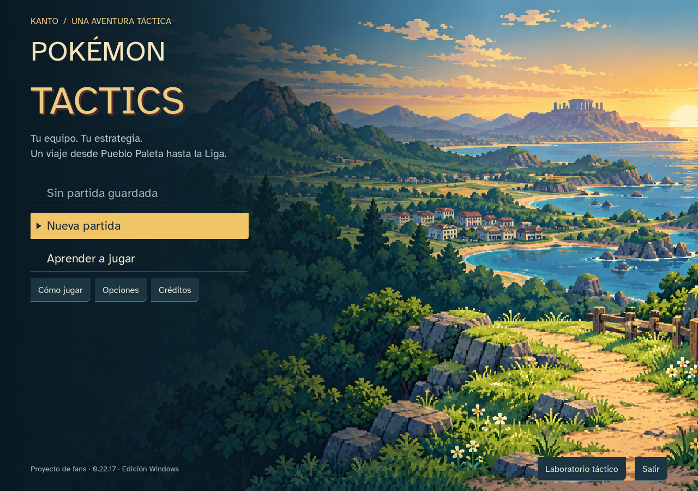

# Pokémon Tactics

**Windows 0.23.0:** [movimientos espaciales, zonas y sonidos originales](docs/SPRINT_23_SPATIAL.md). [Tabla aplicada para revisión](docs/reports/moves-2026-10-24/aplicacion-0.23.csv). Actualización de aventura desde mapa/tienda; las partidas anteriores conservan sus reglas hasta actualizar.
Proyecto de fans para portfolio, desarrollado con asistencia de IA. Dos entregas locales: campaña de Kanto Windows 0.23.0 y campaña web 0.12.0. Publicación pendiente de decisión del creador.

**Kanto nativo:** campaña hasta la Liga y dos finales legendarios alternativos. Capturas locales, niveles/evolución, movimientos/MT LGPE combinados, naturalezas/habilidades y PC. Ejecutable Windows offline. 151 especies; 49/78 habilidades normales activas. 42 imágenes nuevas integradas; pruebas humanas y publicación pendientes.

[Nueva interfaz e inicio](docs/SPRINT_22_UI.md) · [Guía para jugar en Windows](docs/PLAYTEST_WINDOWS.md) · [Balance: 29 simulaciones y límites](docs/reports/balance-native-0.22/INFORME.md)

[Controles configurables y navegación 0.22.2](docs/SPRINT_22_CONTROLS.md): primer bloque de las mejoras de accesibilidad. F2 configura teclas; F6 cambia de panel; foco conservado en equipo, tienda y PC.

[Turno contextual0.22.3](docs/SPRINT_22_CONTEXT.md): habilidades que se preparan antes de actuar, Q/E para objetivos, orientación con flechas/Enter y cámara por cruceta o teclado.

[Informe de accesibilidad y jugabilidad](docs/reports/beta-accesibilidad-0.22.1/INFORME.md) · [9 prompts para futuras actualizaciones](docs/reports/beta-accesibilidad-0.22.1/PROMPTS_ACTUALIZACIONES.md). Auditoría y propuestas; no cambia las reglas de la entrega.

Las campañas 0.16–0.21 pueden continuar con **Continuar aventura · ampliar Kanto**, con copia y diario conservados. Las anteriores siguen sus reglas. [Sprint 22 e información de pruebas](docs/SPRINT_22.md) · [Cómo jugar](godot/README.md) · [Plan](docs/PLAN_SPRINTS.md).



[Mejoras0.22.10](docs/SPRINT_22_ACCESSIBILITY_COMPLETE.md): práctica guiada, lectura ampliada, compras por cantidad, PC y biblioteca con filtros y acceso textual experimental. Ejecutable offline; pruebas humanas y lector de pantalla pendientes.

[Rendimiento0.22.11](docs/SPRINT_22_PERFORMANCE.md): terreno y minimapa conservan su dibujo entre animaciones, las preferencias solo cambian valores distintos y el cursor evita previsiones repetidas. Mismas reglas y guardados.

[Interfaz de juego0.22.13](docs/SPRINT_22_GAME_UI.md): órdenes con cursor, fichas integradas en una franja de combate, medidores de PS/PT y jerarquías visuales para inicio, tienda y PC. Conserva controles, alto contraste y guardados.

[Semillas0.22.12](docs/SPRINT_22_SEEDS.md): cada aventura nueva genera una semilla automáticamente. Puedes escribir, regenerar y copiar la semilla junto a los iniciales; Menú permite copiar la de la campaña actual. Las partidas existentes conservan su azar.

[Hub y tienda simplificados 0.22.14](docs/SPRINT_22_HUB.md): Comprar y Equipo y bolsa separados, cuatro categorías y fichas por pestañas. Resúmenes bajo demanda y avance siempre visible.

[Arte integrado 0.22.16](docs/SPRINT_22_GENERATED_ART.md): 42 imágenes generadas e incorporadas a portada, escenas, tablero, efectos e iconos. [Prompts completos](docs/PROMPTS_ARTE_FINAL.md) y [dirección artística](docs/DIRECCION_ARTISTICA.md). Las 3 piezas promocionales opcionales siguen pendientes.

[Animaciones y sonidos 0.22.17](docs/SPRINT_22_ATTACK_EFFECTS.md): preparación, lanzamiento e impacto, variantes por tipo, 26 sonidos locales y movimiento reducido.

[Auditoría de movimientos](docs/reports/moves-2026-10-24/INFORME.md) · [Tabla editable](docs/reports/moves-2026-10-24/auditoria-movimientos-pokemon.xlsx): 211 movimientos, básico y 15 técnicas históricas evaluados para áreas, zonas y desplazamientos. Propuestas para revisión; no cambia reglas ni balance.

## Campaña web 0.12.0

Tres Pokémon iniciales aleatorios, equipo de hasta seis, ocho zonas de Kanto y dos finales excluyentes. Las instrucciones y capacidades siguientes corresponden a esta versión web.


## Probar en local

Node 24 y npm. No hacen falta cuentas ni claves de servicios.

```sh
npm ci
npm run dev
```

Abrir http://127.0.0.1:5173/. Semilla sugerida: `kanto-0`. Las partidas guardadas en sprints anteriores conservan sus reglas; empieza una nueva para probar la campaña actual. Para comprobar la compilación final: `npm run build` y `npm run preview` (puerto 4173).

## Qué funciona

- Desplazamiento y acción en cualquier orden; iniciativa por velocidad con variación de ±5 % o ±10 % por ronda. Orientación al terminar, precisión frontal/lateral/trasera y aliados atravesables.
- Tipos modernos, daño físico/especial, puntos tácticos, quemadura, veneno y parálisis. Áreas con daño aliado, empuje, cobertura y peligros del escenario.
- Dieciséis mapas de gimnasio y dos arenas. Roca → agua → eléctrico → planta → veneno → psíquico → fuego → tierra → tres aves o Mew y Mewtwo.
- Tienda o reclutamiento antes de cada combate; PS persistentes, bajas definitivas y recuperación del equipable. Curación solo fuera de combate. Un objeto equipado por miembro.
- Experiencia individual, cinco niveles y evolución por objetos. Nueve evoluciones seleccionadas; conservar identidad, EXP, PS actuales y equipo. No hay curación gratuita al progresar.
- Guardado automático local, migraciones de versiones anteriores, detección de conflicto entre pestañas y descarte explícito de datos inválidos. Tutorial, sonido local, control de volumen y movimiento reducido.

Hay 28 especies con recursos locales; cinco están reservadas para jefes. No están implementadas las 151 especies, todos los estados de la franquicia, PP individuales, cuentas, multijugador, clasificación ni IA generativa durante la partida.

Controles: botones o flechas/Enter para recorrer y seleccionar casillas; Escape cancela. Las acciones muestran previsión antes de confirmar. `?view=battle` conserva el ensayo clásico 3v3; `?view=battle&boss=birds` y `?view=battle&boss=psychic` abren pruebas de finales con equipo predefinido. `?view=battle&map=canal` prueba un mapa. `?view=training` y `?view=camp` conservan los prototipos iniciales de seis unidades.

## Comprobar

```sh
npm test
npm run verify:assets
npm run build
npm run test:browser
npm run test:browser:zones
npm run test:browser:combat
npm run test:browser:lifecycle
npm run test:browser:training
npm run test:browser:release
```

Las pruebas de navegador requieren servidor activo y Playwright. En Windows usan Edge; en Linux, Chromium de Playwright. `TACTICS_URL` cambia el servidor; `TACTICS_QA_DIR` cambia la carpeta de evidencia. La suite release juega ambas rutas completas desde una partida nueva con los controles reales: tarda más que la comprobación breve. `npm run simulate` ejecuta decisiones de la IA fuera del navegador; sus resultados no equivalen a pruebas humanas.

93 pruebas de reglas/datos, 19 comprobaciones de combate, 18 de movimiento, tres de ciclo de vida, escritorio/móvil y dos campañas completas comprobados en Edge/Chromium. Evidencia e incidencias corregidas en `docs/SPRINT_11.md`. Sin linter ni cobertura configurados. Phaser mantiene un aviso de tamaño del paquete. Firefox/Safari y pruebas con otras personas pendientes.

## Estructura y recursos

TypeScript, Phaser y Vite; EasyStar para navegación. Dominio con POO en `src/domain`, reglas puras en `src/rules`, datos en `src/data` y presentación en `src/game`. Los objetos con comportamiento no entran en el guardado. Tipos y evoluciones son relaciones de datos; cada especie comparte la base Pokémon y compone acciones polimórficas.

Se reutilizan la plantilla oficial de Phaser, sprites originales de SpriteCollab, datos de PokéAPI, Pixelify Sans y jsfxr para generar WAV locales. Importadores explícitos, commits de fuente y hashes registrados; el juego no consulta esas APIs al arrancar. Ver [créditos](CREDITS.md), [arquitectura](docs/ARCHITECTURE.md) y [material de portfolio](docs/PORTFOLIO.md).

[Plan e informes por sprint](docs/PLAN_SPRINTS.md) · [Prueba con jugadores](docs/PLAYTEST.md) · [Ajuste inicial de campaña](docs/BALANCE.md). La diversión y el equilibrio siguen sujetos a feedback del creador y jugadores; no se promete viralidad.

## Versión preparada para publicar

Sprints 7–12 implementados en ramas separadas, con subida verificada al terminar cada entrega. Versión 0.12.0; el paso de publicación permanece aplazado por el creador. [Guía de despliegue y reversión](docs/DEPLOY.md), textos legal/privacidad incluidos y paquete estático con inventario SHA-256. Para generarlo: `npm run build`, `npm run release:prepare` y `npm run verify:build`. Falta definir alojamiento, dominio y contacto público; no existe una URL pública verificada.
