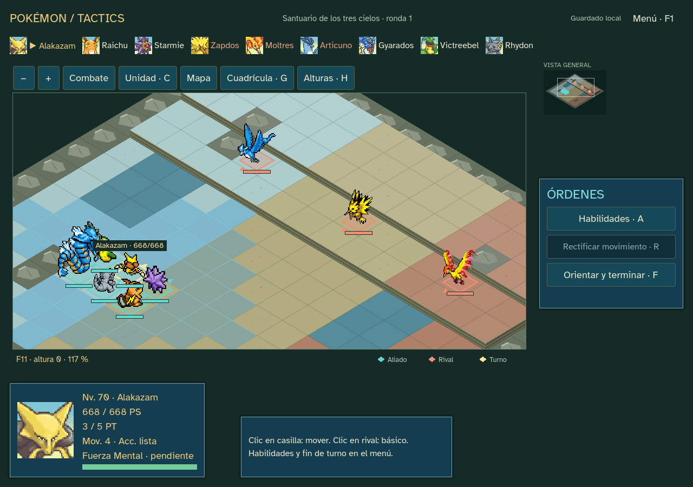
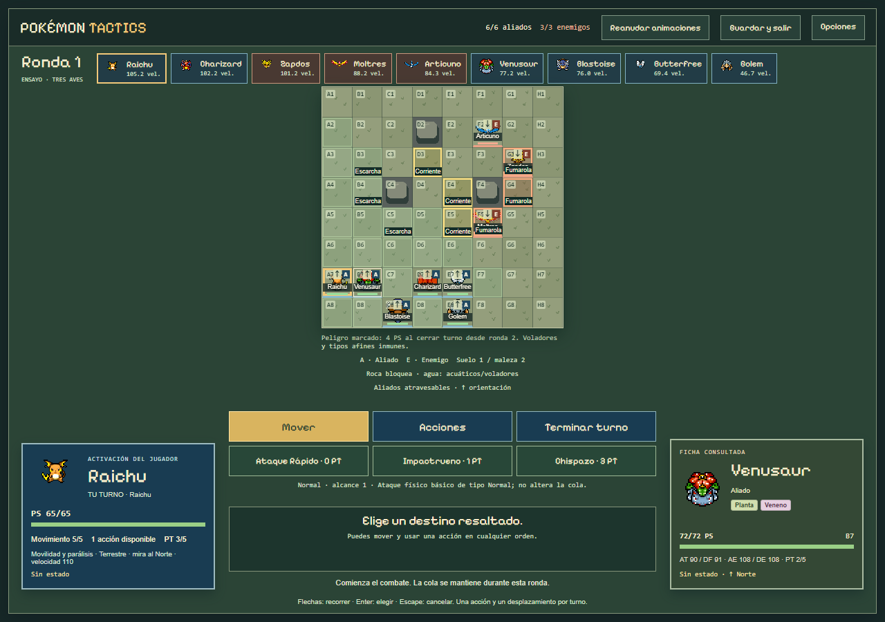

# Pokémon Tactics

Proyecto de fans para portfolio, desarrollado con asistencia de IA. Dos entregas locales: muestra de Kanto Windows 0.21.0 y campaña web 0.12.0. Publicación pendiente de decisión del creador.

**Kanto nativo:** Campaña Kanto completa hasta la Liga y dos desafíos legendarios alternativos. Captura local, niveles/evolución, movimientos/MT LGPE combinados, naturalezas/habilidades y PC. Ejecutable Windows offline, sin editor ni servidor. Catálogo151; no todas las especies se obtienen en cada recorrido.

Las campañas0.16/0.17 pueden continuar con **Continuar aventura · ampliar Kanto**, con copia y diario conservados. Las anteriores siguen sus reglas. [Sprint21 e información de pruebas](docs/SPRINT_21.md) · [Cómo jugar](godot/README.md) · [Plan](docs/PLAN_SPRINTS.md).



## Campaña web 0.12.0

Tres Pokémon iniciales aleatorios, equipo de hasta seis, ocho zonas de Kanto y dos finales excluyentes. Las instrucciones y capacidades siguientes corresponden a esta versión web.



## Probar en local

Node 24 y npm. No hacen falta cuentas ni claves de servicios.

```sh
npm ci
npm run dev
```

Abrir http://127.0.0.1:5173/. Semilla sugerida: `kanto-0`. Las partidas guardadas en sprints anteriores conservan sus reglas; empieza una nueva para probar la campaña actual. Para comprobar la compilación final: `npm run build` y `npm run preview` (puerto 4173).

## Qué funciona

- Desplazamiento y acción en cualquier orden; iniciativa por velocidad con variación de ±5 % o ±10 % por ronda. Orientación al terminar, precisión frontal/lateral/trasera y aliados atravesables.
- Tipos modernos, daño físico/especial, puntos tácticos, quemadura, veneno y parálisis. Áreas con daño aliado, empuje, cobertura y peligros del escenario.
- Dieciséis mapas de gimnasio y dos arenas. Roca → agua → eléctrico → planta → veneno → psíquico → fuego → tierra → tres aves o Mew y Mewtwo.
- Tienda o reclutamiento antes de cada combate; PS persistentes, bajas definitivas y recuperación del equipable. Curación solo fuera de combate. Un objeto equipado por miembro.
- Experiencia individual, cinco niveles y evolución por objetos. Nueve evoluciones seleccionadas; conservar identidad, EXP, PS actuales y equipo. No hay curación gratuita al progresar.
- Guardado automático local, migraciones de versiones anteriores, detección de conflicto entre pestañas y descarte explícito de datos inválidos. Tutorial, sonido local, control de volumen y movimiento reducido.

Hay 28 especies con recursos locales; cinco están reservadas para jefes. No están implementadas las 151 especies, todos los estados de la franquicia, PP individuales, cuentas, multijugador, clasificación ni IA generativa durante la partida.

Controles: botones o flechas/Enter para recorrer y seleccionar casillas; Escape cancela. Las acciones muestran previsión antes de confirmar. `?view=battle` conserva el ensayo clásico 3v3; `?view=battle&boss=birds` y `?view=battle&boss=psychic` abren pruebas de finales con equipo predefinido. `?view=battle&map=canal` prueba un mapa. `?view=training` y `?view=camp` conservan los prototipos iniciales de seis unidades.

## Comprobar

```sh
npm test
npm run verify:assets
npm run build
npm run test:browser
npm run test:browser:zones
npm run test:browser:combat
npm run test:browser:lifecycle
npm run test:browser:training
npm run test:browser:release
```

Las pruebas de navegador requieren servidor activo y Playwright. En Windows usan Edge; en Linux, Chromium de Playwright. `TACTICS_URL` cambia el servidor; `TACTICS_QA_DIR` cambia la carpeta de evidencia. La suite release juega ambas rutas completas desde una partida nueva con los controles reales: tarda más que la comprobación breve. `npm run simulate` ejecuta decisiones de la IA fuera del navegador; sus resultados no equivalen a pruebas humanas.

93 pruebas de reglas/datos, 19 comprobaciones de combate, 18 de movimiento, tres de ciclo de vida, escritorio/móvil y dos campañas completas comprobados en Edge/Chromium. Evidencia e incidencias corregidas en `docs/SPRINT_11.md`. Sin linter ni cobertura configurados. Phaser mantiene un aviso de tamaño del paquete. Firefox/Safari y pruebas con otras personas pendientes.

## Estructura y recursos

TypeScript, Phaser y Vite; EasyStar para navegación. Dominio con POO en `src/domain`, reglas puras en `src/rules`, datos en `src/data` y presentación en `src/game`. Los objetos con comportamiento no entran en el guardado. Tipos y evoluciones son relaciones de datos; cada especie comparte la base Pokémon y compone acciones polimórficas.

Se reutilizan la plantilla oficial de Phaser, sprites originales de SpriteCollab, datos de PokéAPI, Pixelify Sans y jsfxr para generar WAV locales. Importadores explícitos, commits de fuente y hashes registrados; el juego no consulta esas APIs al arrancar. Ver [créditos](CREDITS.md), [arquitectura](docs/ARCHITECTURE.md) y [material de portfolio](docs/PORTFOLIO.md).

[Plan e informes por sprint](docs/PLAN_SPRINTS.md) · [Prueba con jugadores](docs/PLAYTEST.md) · [Ajuste inicial de campaña](docs/BALANCE.md). La diversión y el equilibrio siguen sujetos a feedback del creador y jugadores; no se promete viralidad.

## Versión preparada para publicar

Sprints 7–12 implementados en ramas separadas, con subida verificada al terminar cada entrega. Versión 0.12.0; el paso de publicación permanece aplazado por el creador. [Guía de despliegue y reversión](docs/DEPLOY.md), textos legal/privacidad incluidos y paquete estático con inventario SHA-256. Para generarlo: `npm run build`, `npm run release:prepare` y `npm run verify:build`. Falta definir alojamiento, dominio y contacto público; no existe una URL pública verificada.
