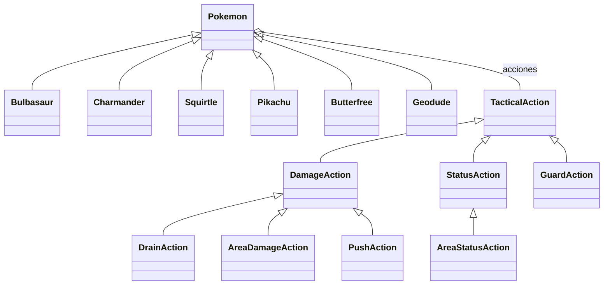

# Dominio del combate — sprint 3

POO solicitada el 14 de octubre de 2026. TypeScript, sin dependencias nuevas.

`Pokemon` es la clase base de `Bulbasaur`, `Charmander`, `Squirtle`, `Pikachu`, `Butterfree` y `Geodude`. Comparte creación de unidades, lectura de estadísticas, presupuesto de movimiento y búsqueda de acciones. Cada especialización define su rol y sus tres acciones. `pokemonFor` es el registro central de perfiles, independiente de Phaser.

`TacticalAction` define el contrato de previsión. `DamageAction`, `StatusAction` y `GuardAction` lo implementan; `DrainAction` hereda de `DamageAction` y añade recuperación a partir del daño real. El combate llama al mismo contrato para prever y resolver órdenes del jugador y de la IA. No selecciona efectos mediante nombres de especies o habilidades.

Los tipos son datos de cada unidad. Un Pokémon de tipos Planta/Veneno conserva ambos; no hereda de clases de tipo. Las evoluciones futuras se modelarán como relaciones entre especies y cambios de perfil, sin asumir que una evolución es una subclase de su preevolución. Este sprint no incorpora evolución ni niveles.

`Combatant`, `Battle` y `Run` conservan valores serializables: posiciones, PS, PT, estados, cola y semilla. Las instancias con comportamiento permanecen en el registro de dominio. Cada orden valida el estado actual y devuelve una copia; inspeccionar, prever y elegir órdenes de IA no cambia el estado ni consume aleatoriedad. El sprint 5 incorpora persistencia local versionada.

La orquestación de rondas sigue en `src/rules/battle.ts`, el movimiento en `src/rules/movement.ts` y la representación en `src/game`. El HUD usa las previsiones del dominio; no calcula otra fórmula de daño.

Sprint 4: las acciones comparten contratos de casillas afectadas, empuje y terreno generado. `AreaDamageAction` configura si deja ascuas; el área no implica fuego para futuras habilidades. La orientación y la línea de visión se calculan en reglas, y el perfil de movimiento aporta costes y terrenos legales al adaptador de EasyStar. `Battle.fields` conserva solo posiciones, tipo y ronda de caducidad. Jugador e IA consultan la misma previsión por afectado.

Para añadir una especie: importar sus datos y recursos con procedencia, definir su perfil heredado con acciones existentes o una nueva implementación del contrato, registrarlo y comprobar su catálogo, órdenes y presentación. La restricción a las seis especies actuales sigue activa hasta el sprint de ampliación correspondiente.

Sprint 5 separa `id` de unidad y `speciesId`. La primera identifica posición, turno, PS y miembro de la partida; la segunda selecciona el perfil de POO, las estadísticas y las texturas compartidas. Dos Geodude de bandos diferentes poseen sprites independientes y comparten la hoja original. El ensayo anterior conserva sus IDs y resultados. Evolucionar podrá cambiar especie sin reemplazar la identidad individual.

`run.ts` genera equipo y grafo con un PRNG separado del estado del combate. La semilla de cada sala deriva de semilla de partida e ID de nodo; inspección, rutas y guardado no consumen tiradas. Entrar solo acepta salas conectadas; completar solo acepta resultados terminales y registra una vez los PS y las bajas. Los perdidos se conservan en el roster con 0 PS y se excluyen del siguiente despliegue.

`RunStore` persiste un sobre con esquema y versión. Valida catálogo, ruta reproducible, historial, PS, mapa y estado del combate antes de entregarlos al DOM o a Phaser. Compara el guardado leído con el actual antes de escribir o descartar, para evitar sobrescribir otra pestaña. No es un sistema contra trampas. El host guarda cada orden aceptada antes de animarla y controla montaje/desmontaje del combate; salir invalida la IA y los callbacks pendientes. Quota o almacenamiento bloqueado permite jugar en memoria con un aviso y reintento.

Sprint 6: `Item` se especializa en `HealingItem` y `HeldItem`; Restos, Chaleco Asalto y Botas Gruesas implementan recuperación, defensa especial efectiva, restricción de apoyo y protección de ascuas. Se guardan IDs y cantidades, nunca instancias. Defensa base permanece intacta; previsión y resolución leen el mismo efecto equipado. Los recursos públicos aportan nombres/IDs; precios y adaptación táctica pertenecen al prototipo.

`RunEvent` registra entradas, cierres, compras, curación, equipamiento, reclutas y resultados. `performRunEvent` aplica una copia; `replayRun` usa las mismas transiciones para reconstruir economía y miembros al validar el esquema 2. Las órdenes dentro del combate conservan su snapshot y RNG; los resultados guardan un recibo por miembro. Una recompensa solo se concede al cerrar una victoria pendiente. Reproducción de recibos sirve para integridad, sin afirmar verificación contra trampas de cada combate histórico.

`departed` conserva bajas y liberados, mientras `roster` contiene hasta seis vivos. Recuperar equipo ocurre antes de archivarlos; el siguiente ID no se reutiliza. Las seis posiciones aliadas de despliegue son libres en los tres mapas. Los módulos `legacy-*` mantienen generación/validación de versión 1 para actualizar sin restaurar PS ni sortear de nuevo una pelea. No modificar su contrato al ampliar la versión actual; revisar migración cuando cambien valores usados por el diario.
