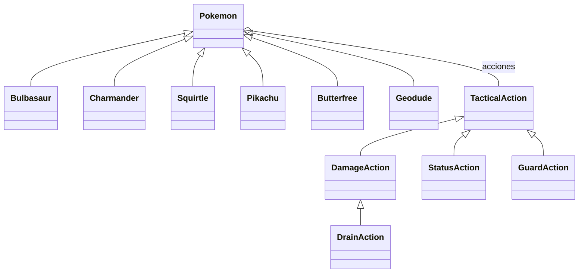

# Dominio del combate — sprint 3

POO solicitada el 14 de octubre de 2026. TypeScript, sin dependencias nuevas.

`Pokemon` es la clase base de `Bulbasaur`, `Charmander`, `Squirtle`, `Pikachu`, `Butterfree` y `Geodude`. Comparte creación de unidades, lectura de estadísticas, presupuesto de movimiento y búsqueda de acciones. Cada especialización define su rol y sus tres acciones. `pokemonFor` es el registro central de perfiles, independiente de Phaser.

`TacticalAction` define el contrato de previsión. `DamageAction`, `StatusAction` y `GuardAction` lo implementan; `DrainAction` hereda de `DamageAction` y añade recuperación a partir del daño real. El combate llama al mismo contrato para prever y resolver órdenes del jugador y de la IA. No selecciona efectos mediante nombres de especies o habilidades.

Los tipos son datos de cada unidad. Un Pokémon de tipos Planta/Veneno conserva ambos; no hereda de clases de tipo. Las evoluciones futuras se modelarán como relaciones entre especies y cambios de perfil, sin asumir que una evolución es una subclase de su preevolución. Este sprint no incorpora evolución ni niveles.

`Combatant` y `Battle` conservan valores serializables: posiciones, PS, PT, estados, cola y semilla. Las instancias con comportamiento permanecen en el registro de dominio. Cada orden valida el estado actual y devuelve una copia; inspeccionar, prever y elegir órdenes de IA no cambia el estado ni consume aleatoriedad. No hay todavía persistencia de partidas.

La orquestación de rondas sigue en `src/rules/battle.ts`, el movimiento en `src/rules/movement.ts` y la representación en `src/game`. El HUD usa las previsiones del dominio; no calcula otra fórmula de daño.

Para añadir una especie: importar sus datos y recursos con procedencia, definir su perfil heredado con acciones existentes o una nueva implementación del contrato, registrarlo y comprobar su catálogo, órdenes y presentación. La restricción a las seis especies actuales sigue activa hasta el sprint de ampliación correspondiente.
