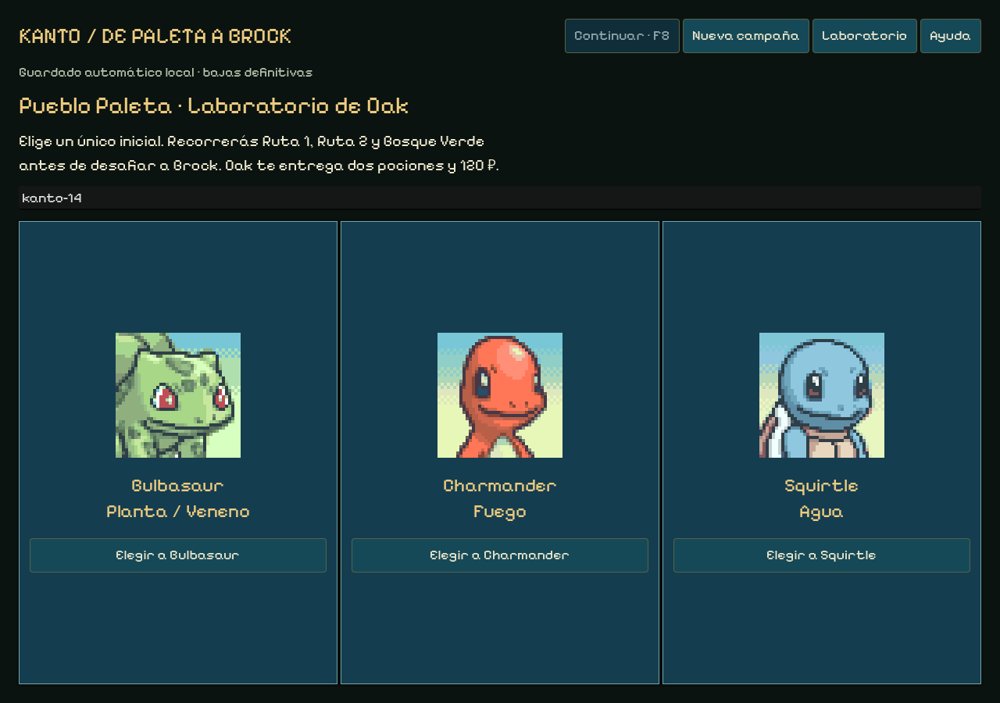
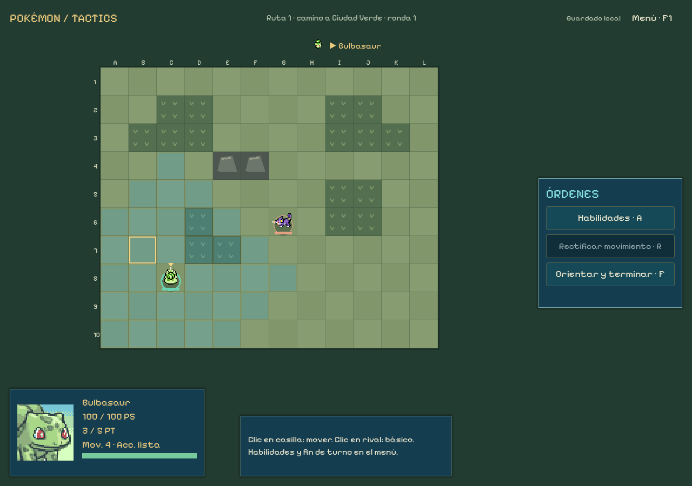

# Sprint 14 — Paleta hasta Brock

16 de octubre de 2026. Versión Windows 0.14.0, rama codex/sprint-14. El usuario autorizó este siguiente sprint y confirmó el premio de Brock y las reglas mínimas de evolución/entrenamiento. No autoriza iniciar automáticamente 15–22 ni publicar.

## Resultado jugable

Elección de Bulbasaur, Charmander o Squirtle en Oak → Ruta 1 → Ruta 2 → Bosque Verde → gimnasio de Brock. Un combate por ubicación. Los enemigos de ruta pertenecen a sus tablas de Rojo; Brock utiliza Geodude/Onix. Cada victoria registra PS/bajas, concede 150 ₽, sortea y guarda una captura local, permite reclamarla una vez y abre tienda. Tras Brock añade Medalla Roca y captura del Bosque Verde, según la decisión del creador; la tienda final permite cerrar la muestra.

Los mapas de prueba son 12×10, con prados/senderos, obstáculos del bosque y arena de gimnasio diferenciados mediante datos. Conservan vista cenital, menú flotante derecho, movimiento directo, orientación final y rectificación exclusiva del movimiento. Se reutilizan retratos PMD y el motor táctico anterior. El laboratorio 3v3/8×8 sigue accesible e independiente.

## Reglas provisionales y decisiones

| Sistema | Regla de esta muestra |
| --- | --- |
| Inicio | Un inicial, dos pociones y 120 ₽ de Oak |
| Recompensa | 150 ₽ y captura local garantizada por victoria; Brock también da medalla |
| Captura | Pesos originales de hierba de Rojo; nivel del slot conservado como fuente, no aplicado como nivel táctico |
| Duplicados | Admitidos provisionalmente, anunciado en pantalla; sin cláusula de familias |
| Curación | Poción40 ₽/+40 PS; Superpoción90 ₽/+100 PS; solo fuera de combate, sin revivir |
| Evolución | Caramelo Raro100 ₽; uno por etapa sin nivel, confirmado por el usuario; no cura |
| Entrenamiento | 80 ₽, +5 al atributo elegido, máximo dos compras totales por miembro, confirmado; tope persiste al evolucionar |
| Bajas | Permanentes y registradas; sin desplegar, curar, evolucionar ni entrenar muertos |
| Equipo | Hasta seis vivos al entrar; este tramo concede un inicial y cuatro capturas, máximo cinco miembros |

Los precios y recompensas son valores de implementación para probar, no balance final. El entrenamiento de PS máximos tampoco cura. No se añaden PC, equipables ni EXP/niveles completos todavía: su ampliación corresponde a 16. Se conserva el reinicio cuando no queda nadie vivo.

Los enemigos de Ruta 1/Ruta 2 usan solo su básico; los del bosque hasta dos acciones y Brock hasta tres. Es una definición provisional de los nuevos encuentros para que un único inicial no afronte Hipercolmillo desde el primer Rattata. No cambia el repertorio del laboratorio, sus fórmulas ni sus parámetros de referencia. Las evoluciones/capturas usan los perfiles tácticos actuales, sin simular todos los niveles del original.

## Código y guardado

- core/kanto_battle.gd hereda del motor de combate existente; kanto_pokemon.gd compone sus acciones y limita repertorios enemigos por encuentro. Tipos/evoluciones son datos; no clases por tipo o etapa.
- core/kanto_run.gd centraliza fases, capturas, dinero, objetos, evolución y entrenamiento en transacciones puras. Cada orden incorpora la revisión de pantalla/estado: un callback anterior no puede cobrar ni conceder dos veces.
- kanto_store.gd reutiliza escritura temporal, copia, checksum y conflicto entre instancias del guardado anterior. Reconstruye desde semilla/inicial/diario y compara el estado canónico. Archivo independiente user://kanto-save.json, esquema kanto/versión 1. Los cambios futuros de reglas deberán conservar esta edición o migrarla.
- El sorteo se realiza al registrar la victoria y se persiste antes de mostrar la captura; cerrar/cargar no cambia el resultado. Cada orden táctica también se guarda antes de presentar.
- La rectificación recibe el estado inicial exacto del encuentro y reconstruye el diario táctico sin el último movimiento; comprueba que no cambien ataques, recursos ni RNG. El diario global conserva la transacción y se reproduce al cargar.
- ui/campaign.gd reutiliza el HUD de laboratory.gd y añade Oak, viaje, premio, tienda y resultado. board.gd admite dimensiones rectangulares. El laboratorio conserva guardado/reglas 0.13.0 y se comprueba contra sus referencias originales.

No se leen ni sobrescriben partidas web ni laboratory-save.json desde la campaña. Los archivos inválidos se preservan; si falla la escritura aparece aviso de continuación solo en memoria. Antes de iniciar otra campaña se guarda copia de la anterior. Las pruebas usan carpetas aisladas en work, sin la partida habitual.

## Recursos reutilizados

Catálogo local de 24 especies: números 1–20, 25, 26, 74 y 95. Se reutilizan las seis del laboratorio y siete de la web; se importan once especies adicionales de PokéAPI/SpriteCollab. Hojas Idle/Walk y retratos Normal originales; miniaturas derivadas por recorte, sin recoloración. No se ha añadido música, arte generado ni plugins.

SpriteCollab fijado en 6ad5f1c6229af6b055de2c64442e5e508664290c; atribución individual de sprites/retratos y licencias en godot/CREDITS.md y cada carpeta. kanto-provenance.json registra 148 archivos con hashes/procedencia. Las instantáneas crudas de PokéAPI quedan en Git para desarrollo y se excluyen del ejecutable, que usa el catálogo procesado.

Tablas de Rojo verificadas en pret/pokered, commit af519899719f0754965776faac0e836a3b906e6d: [Ruta 1](https://github.com/pret/pokered/blob/af519899719f0754965776faac0e836a3b906e6d/data/wild/maps/Route1.asm), [Ruta 2](https://github.com/pret/pokered/blob/af519899719f0754965776faac0e836a3b906e6d/data/wild/maps/Route2.asm), [Bosque Verde](https://github.com/pret/pokered/blob/af519899719f0754965776faac0e836a3b906e6d/data/wild/maps/ViridianForest.asm) y [pesos](https://github.com/pret/pokered/blob/af519899719f0754965776faac0e836a3b906e6d/data/wild/probabilities.asm). Las diez posiciones pesan 51/51/39/25/25/25/13/13/11/3, suma256. Se usa la variante Rojo, sin mezclar Azul/Amarillo. Geodude/Onix contrastados en [equipos de entrenadores](https://github.com/pret/pokered/blob/af519899719f0754965776faac0e836a3b906e6d/data/trainers/parties.asm); sus estadísticas tácticas son una adaptación.

Importación explícita tools/godot/import-kanto.py y ayudante kanto-kits.ts; no ejecutar import-lab.ts para esta ampliación ni regenerar fixtures. Python/Pillow existentes, ayudante MIT de PokéSurvivor ya acreditado, Node para extraer perfiles locales. Importador con commits fijados y caché; ninguna petición de red durante el juego. Skill Godot consultada para GDScript, controles y pruebas; no se incorporan sus autoloads de ejemplo ni nuevas dependencias.

## Comprobaciones ejecutadas

| Comprobación | Resultado |
| --- | --- |
| Motor/importación/exportación | Godot 4.7.2 oficial, Windows x86_64, PCK embebido |
| Campaña pura | 9 recorridos (3 iniciales × 3 semillas), 3.406 comprobaciones, sin fallos |
| Casos límite | 20 comprobaciones: fases, órdenes inválidas, dos entrenamientos, PS sin curación, muertos, replay, corrupción y conflictos |
| Paridad del laboratorio | 16 combates, 506 órdenes, 25 escenarios, sin discrepancias; fixtures conservadas |
| UI campaña, fuente y .exe | 3 recorridos por ejecución, 242 órdenes aliadas y 1.373 aserciones; mismo resultado; uno completa Brock |
| UI laboratorio, fuente y .exe | 4 batallas por ejecución, 73 órdenes aliadas, 1.017 aserciones, 17 rectificaciones y 56 bloqueos tras actuar/terminar |
| Recursos | 41 archivos previos/13 fuentes, seis retratos previos y sus créditos, 148 archivos nuevos verificados |
| Distribución | .exe probado con GODOT_BIN inexistente; ZIP y ejecutable comparados por SHA-256 |

Se prueban guardado/carga en mapa, combate, captura pendiente, tienda y resultado; doble callback de captura; rectificación antes/después de cargar; estados compartidos con previsión/IA. QA utiliza señales de controles, eventos del tablero y del viewport; no es una prueba humana. Capturas renderizadas a 1024×720, 1280×900 y 1440×1000. Revisados visualmente Oak, combate, tienda a tamaño mínimo y resultado.

Correcciones encontradas durante la verificación: posición enemiga que coincidía con un obstáculo en Brock; números enteros leídos como float por JSON al validar inicial/orientación; conversión canónica y validación de órdenes mal formadas. Los recorridos y cargas completos pasan después de corregirlas.

Sintaxis de herramientas Node y git diff --check sin errores. El linter de la skill informa un falso positivo previo: interpreta audio/%s.wav como ruta literal; cero advertencias y cero errores de parseo. El motor y los hashes verifican los WAV reales. No se repite la suite web porque src/, public/, reglas y guardados web no se han modificado.

Evidencia: [simulación](qa/sprint-14/campaign-result.json), [casos límite](qa/sprint-14/campaign-edge-result.json), [paridad](qa/sprint-14/parity-result.json), [UI fuente](qa/sprint-14/campaign-source-result.json), [UI ejecutable](qa/sprint-14/campaign-release-result.json), [laboratorio ejecutable](qa/sprint-14/lab-release-result.json), [paquete](qa/sprint-14/release-info.json).

## Diagnóstico de balance provisional

La política automática decide ambos bandos con el motor compartido; fuera de combate cura, prioriza evolucionar el inicial vivo y entrena PS máximos cuando puede. Se usan kanto-14, paleta y rojo. Son nueve muestras, sin exploración de estrategias humanas ni estimación estadística de dificultad.

| Inicial | Tramos superados por semilla (de 4) | Campañas que vencen a Brock |
| --- | --- | --- |
| Bulbasaur | 2 / 2 / 4 | 1 de 3 |
| Charmander | 3 / 3 / 3 | 0 de 3 |
| Squirtle | 4 / 4 / 4 | 3 de 3 |

Indica diferencias de afinidad, repertorio y economía que conviene medir tras ampliar mecánicas. No basta para concluir tasas de victoria de jugadores ni para equilibrar ahora. Se mantiene el acuerdo de no ajustar fórmulas de daño. Para probar continuidad hasta el cierre con una configuración comprobada: Squirtle y semilla kanto-14.

## Entrega y límites

Distribución fuera de Git: ../releases/pokemon-tactics-0.14.0/windows/PokemonTactics.exe y ../releases/pokemon-tactics-0.14.0-windows.zip respecto a la raíz. ZIP de 39.613.654 bytes; hashes en release-info.json y SHA256SUMS.txt. Incluye instrucciones/créditos/licencias. Código en rama privada codex/sprint-14; sin publicación, cambio de visibilidad ni rama predeterminada.

La muestra termina en Brock. Son pantallas de viaje con textos, no exploración libre ni toda la historia inicial: paquete/Pokédex resumidos, rival inicial/Ruta 22 opcional/entrenadores secundarios pendientes. Mapas y terreno de prototipo; no hay todavía cámara, gran escala, vista isométrica, alturas, animación Walk en movimiento, PC, equipables de campaña, EXP, niveles ni MT. No se promete compatibilidad automática de esta edición con la futura campaña completa.

El siguiente bloque propuesto es 15: evaluar isometría/alturas, cámara y escala antes de ampliar escenarios definitivos. El equipo/progresión completa corresponde a 16. Esperar feedback del creador sobre el ciclo; ninguna ampliación ni rebalanceo se ejecuta automáticamente.
