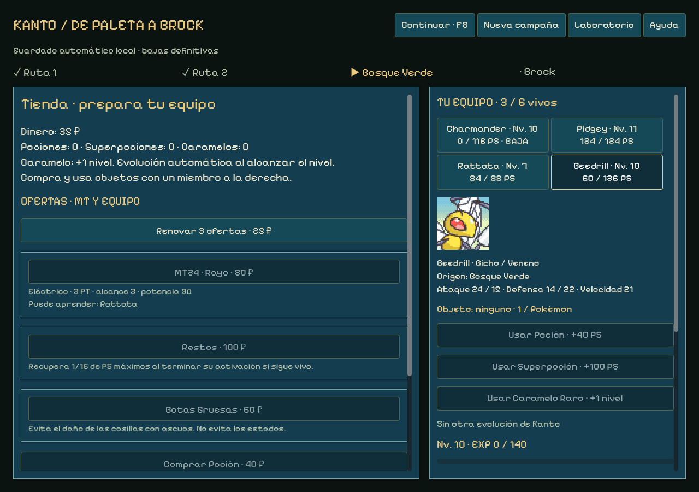

# Revisión del sprint 14 — Caramelos y evolución automática

16 de octubre de 2026 · Windows0.14.3 · codex/sprint-14-growth · campaña edición4.

El Caramelo compra un nivel por25 ₽ y la evolución ocurre automáticamente al alcanzar su umbral, tanto por EXP como por Caramelo. Beedrill aprende Demolición y Butterfree Megaagotar al evolucionar al10; Pikachu aprende Cola Férrea al7. Se retira la evolución manual por Caramelo en nuevas partidas. Los niveles20 de Pikachu y36 de Graveler se mantienen como adaptaciones por confirmación expresa del usuario.

## Reglas y uso

Comprar Caramelo en la tienda, seleccionar miembro y pulsar Usar Caramelo Raro · +1 nivel. Cuesta25 en vez de100, consume una copia y sube exactamente un nivel. Conserva EXP parcial y PS actuales; no cura ni revive. Tope100: usar al máximo se rechaza sin consumir objeto, dinero ni revisión. Una orden obsoleta, inválida o durante combate también se rechaza. Poción/Superpoción y resto de economía permanecen igual.

Al cruzar el nivel evolutivo se cambia de especie automáticamente, sin segundo objeto, compra ni confirmación. Un premio de EXP que cruza varias etapas resuelve cada una en orden y aprende los movimientos correspondientes. Se conservan identidad, origen, equipable, biblioteca, selección de movimientos y PS; se recalculan estadísticas para el nuevo nivel/forma. Las bajas no ganan EXP ni evolucionan. La evolución se resuelve al subir de nivel; los encuentros mantienen sus especies y niveles configurados.

| Línea | Evolución automática |
| --- | --- |
| Bulbasaur → Ivysaur → Venusaur |16 /32 |
| Charmander → Charmeleon → Charizard |16 /36 |
| Squirtle → Wartortle → Blastoise |16 /36 |
| Caterpie → Metapod → Butterfree |7 /10 |
| Weedle → Kakuna → Beedrill |7 /10 |
| Pidgey → Pidgeotto → Pidgeot |18 /36 |
| Rattata → Raticate |20 |
| Pikachu → Raichu |20, adaptación confirmada |
| Geodude → Graveler → Golem |25 /36; Golem adaptado |

Beedrill/Demolición, Butterfree/Megaagotar y Pikachu/Cola Férrea usan los movimientos ya presentes y sus parámetros sin cambiar daño, potencia, precisión o PT. Son decisiones de aprendizaje propias del juego. Las entradas nuevas cuentan en los roles de sus familias y se comparten con la IA. Raichu también conserva acceso a Cola Férrea.

Se mantienen cuatro preparados más básico neutro. Los movimientos de evolución tienen prioridad de aprendizaje con hueco; si ya están las cuatro plazas ocupadas, se guardan en la biblioteca sin reemplazar nada. Prepararlos después es gratis. No hay diálogo adicional. La interfaz muestra el siguiente umbral, las evoluciones y movimientos aprendidos en el recibo de progreso, y usa el jingle de nivel existente al consumir Caramelo.

## Implementación y compatibilidad

Growth hereda Progression y aplica sobre su instancia las adiciones de data/growth.json. GrowthRun hereda ShopRun, comparte el estudio con el motor/perfiles y añade compra barata/uso de Caramelo. Se reutilizan los52 movimientos,26 especies, perfiles, sprites, retratos, tema, audio y transacciones existentes. Sin recursos externos, plugins, dependencias ni servicios nuevos; ninguna consulta de red al jugar.

Nuevas partidas edición4. KantoStore selecciona los motores1/2/3/4 y reconstruye el diario sin modificar las ediciones publicadas ni sus catálogos. Archivos0.14/0.14.1/0.14.2 continúan como clásicos con sus costes y reglas anteriores, incluso en una batalla en curso. Iniciar Nueva campaña preserva copia y permite las reglas nuevas. No se convierten batallas, se asigna EXP retroactiva ni se regenera el stock al cargar.

Compras/uso guardados antes de presentar; estado JSON y revisión por transacción conservados. La subida no cambia el PRNG de combate ni renueva las ofertas. Premio Onix, tres ofertas, MT, equipables, rerolls25/50/75…, rectificación exclusiva del movimiento y laboratorio anterior siguen disponibles. Las reglas/datos4 también deben congelarse tras entregar o sustituirse mediante edición/migración futura.

## Comprobaciones ejecutadas

- **Reglas4:1.194 comprobaciones**, sin fallos, tres recorridos. Precio25, +1 nivel, EXP parcial/PS/equipo, evoluciones16 y7/10, dos evoluciones mediante una recompensa de EXP, aprendizajes, biblioteca llena, Pikachu7 ejecutable, umbrales adaptados20/36, cap100, bajas, órdenes inválidas/obsoletas y replay exacto. Se verifica carga de ediciones1/2/3 con sus propios motores.
- **Regresión3:1.118 comprobaciones** y **regresión2:1.165**, mismos resultados anteriores. Casos clásicos20; paridad laboratorio16 batallas/506 órdenes/25 escenarios, sin diferencias ni regenerar referencias.
- **UI fuente:1.837 aserciones,244 órdenes aliadas**, tres recorridos con resultado1/3/4 encuentros superados. Se compran/usán Caramelos mediante controles, se observa evolución a Beedrill antes de Brock y aprendizaje de Demolición, se carga el diario y se verifica que no hay botón Evolucionar en4. Mantiene prueba de cinco acciones/tecla5, compras/MT/equipo/rerolls, captura/Onix, rectificación, fallo/inmunidad y carga clásica.
- Vistas a1024×720,1280×900 y1440×1000, revisadas visualmente. Linter:0 errores/advertencias. Sintaxis Node, importación/exportación Godot4.7.2 y diff comprobados. Recursos anteriores verificados por hashes; sin cambios en web ni fixtures.

Los recorridos usan la IA compartida en ambos bandos y una política explícita de tienda: MT temprana para Charmander, Caramelos para insectos hasta10 y Pikachu hasta7, curación según presupuesto. En el ensayo puro Squirtle completa, Wartortle evoluciona automáticamente al16 y Beedrill llega al14; Charmander pierde contra Brock y Bulbasaur antes. La compra permite cobertura antes del gimnasio, sin certificar balance humano o diversión. No se retocan fórmulas/estadísticas base ni se presentan esas tres muestras como tasas de victoria.

Los controles, señales y eventos de viewport usan guardados QA aislados. No se han sobrescrito partidas reales. No son partidas humanas ni automatización de escritorio. Balance, mapas grandes, cámara/isometría/alturas, PC y el resto de Kanto siguen pendientes; no se inicia15.

El ejecutable autónomo supera **1.837 aserciones/244 órdenes** de campaña, con los mismos tres resultados que la fuente, y **1.022/73** del laboratorio, con sus cuatro resultados anteriores. Ambas pruebas usan GODOT_BIN apuntando a un editor inexistente. Los logs finales no contienen errores de ejecución. ZIP comprobado contra el SHA-256 del .exe.

Evidencias: [reglas4](qa/sprint-14-growth/growth-result.json), [regresión3](qa/sprint-14-growth/shop-result.json), [regresión2](qa/sprint-14-growth/progression-result.json), [UI fuente](qa/sprint-14-growth/campaign-source-result.json), [UI ejecutable](qa/sprint-14-growth/campaign-release-result.json), [laboratorio ejecutable](qa/sprint-14-growth/lab-release-result.json), [linter](qa/sprint-14-growth/lint-result.json), [paquete](qa/sprint-14-growth/release-info.json).

## Entrega

Windows0.14.3 offline en ../releases/pokemon-tactics-0.14.3/windows y ZIP hermano, fuera de Git, con créditos/licencias/LEEME/SHA256SUMS. Código y evidencias en la rama privada codex/sprint-14-growth. No hay despliegue público ni cambios de visibilidad/rama predeterminada.
