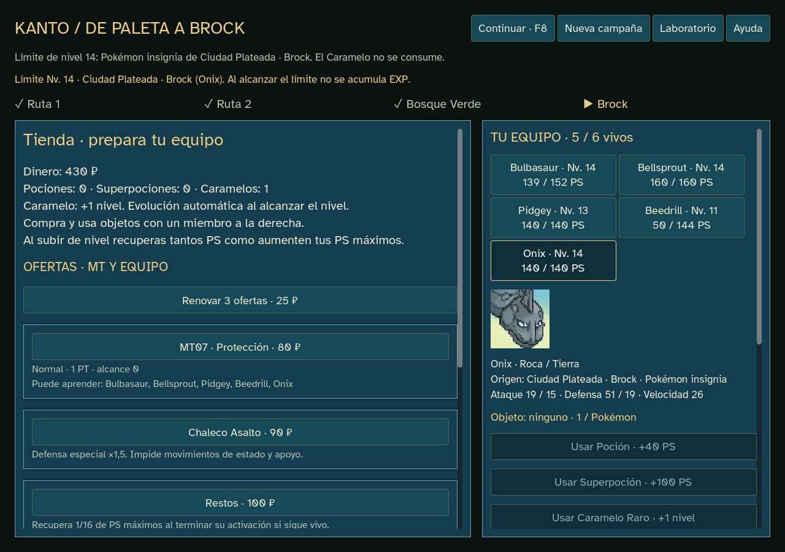

# Límite por gimnasio — 0.14.7

Ningún miembro puede superar el nivel del Pokémon insignia del próximo gimnasio pendiente. En la muestra actual, el Onix de Brock es nivel14: Charmander y el resto del equipo pueden alcanzar14, pero no15 antes de vencerlo. Se usa el enemigo no legendario/mítico de mayor nivel, igual que para la captura de insignia existente.

El límite se calcula desde los líderes, sus equipos/niveles y los encuentros superados. No hay una lista paralela de topes a mantener. Al vencer un líder, su recompensa de EXP puede usar el tope del siguiente gimnasio si existe. Solo está implementado Brock: al terminar esta muestra se conserva14; no se añade otro gimnasio en esta revisión.

## EXP y Caramelos

- La EXP se acepta hasta completar el coste de llegar al nivel límite. El sobrante se descarta y se muestra en el recibo; al alcanzar el tope la EXP queda en0. No se acumula EXP para saltar niveles al desbloquear el siguiente.
- Un Caramelo puede subir de13 a14. Al llegar se descarta la EXP parcial; en14, el botón queda deshabilitado y el dominio rechaza la orden sin gastar Caramelo, alterar revisión o consumir RNG.
- El aumento de PS máximos sigue sumándose a los PS actuales en cada subida válida. No hay curación al recibir EXP estando al tope ni resurrección de bajas.
- Se conservan evolución automática, aprendizaje, cuatro movimientos más básico, objetos y precios. Una captura tampoco puede entrar por encima del límite.

La interfaz muestra `Límite Nv. 14`, el líder y Onix; la ficha indica EXP detenida al alcanzarlo.

## Código y partidas

`gym_study.gd` hereda `vitality_study.gd`, limitando la EXP aceptada antes de usar el crecimiento existente. `gym_run.gd` comparte ese estudio con motor/perfiles y resuelve el líder pendiente. Los datos y módulos publicados1–7 permanecen intactos; KantoStore selecciona la edición1–8 correcta para cada diario.

**Nueva campaña** activa edición8. Continuar una anterior mantiene sus reglas y no reduce niveles retroactivamente; al empezar otra se conserva copia. QA usa archivos propios y nunca los guardados reales.

## Comprobaciones ejecutadas

- Lint antes y después: cero errores/advertencias; diff sin errores de formato.
- `npm run godot:test:gym-caps`:167 comprobaciones, cero fallos.32 especies, EXP masiva/parcial,14 exacto, sin acumulación, Caramelo válido/rechazado, PS/evolución/equipo, bajas, victoria y replay1–8. Una fixture de segundo líder verifica tope21 y su desbloqueo por victoria; esa fixture no se añade al contenido del juego.
- `npm run godot:test:level-hp`:5.446 comprobaciones, cero fallos; edición7 conservada.
- `npm run godot:test:tactics`:1.364 aserciones, cero fallos; edición6 conservada.
- `npm run godot:qa:campaign`:2.194 aserciones/289 órdenes del jugador, cero fallos. Compra real de Caramelo, Onix14 seleccionado y botón bloqueado con Caramelo en la bolsa; callback rechazado y diario cargado sin cambio. Revisión de límites de pantalla en1024×720/1280×900/1440×1000.
- `npm run godot:qa:campaign:export` con `GODOT_BIN=C:/editor-inexistente/Godot.exe`: las mismas2.194 aserciones/289 órdenes y cero fallos; ejecutable independiente del editor. Informes en `docs/qa/sprint-14-gym-caps`.
- `godot:prepare` y `godot:export`: importación/exportación con Godot4.7.2 oficial y verificación de hashes de recursos existentes completadas.

El recorrido de UI completa cuatro encuentros con Bulbasaur/tactics-1 y Charmander/tactics-4; Squirtle/kanto-14 cae en Ruta1. Son comprobaciones concretas con una política automática, sin estimar tasas humanas ni retocar el balance para alterar el resultado.

## Entrega

`outputs/releases/pokemon-tactics-0.14.7/windows/PokemonTactics.exe`, fuera de Git, con LEEME/créditos/licencias/SHA256SUMS. Funciona offline; no necesita servidor ni editor. Publicación pendiente por decisión del creador.

SHA256 del ejecutable: `547dc485acac04559cdf322b11a37502cd797afd334112650e8dab6e5b3f2e56`.

ZIP verificado con `testzip` y SHA256 del ejecutable interno coincidente. SHA256 ZIP: `ed91e37c4dde17bac5b91fec288c1cdc5011f0dc4683c8d4ccc47e0e0d422990`.

Sin recursos, plugins o dependencias nuevos. No inicia el sprint15 ni completa Kanto.
