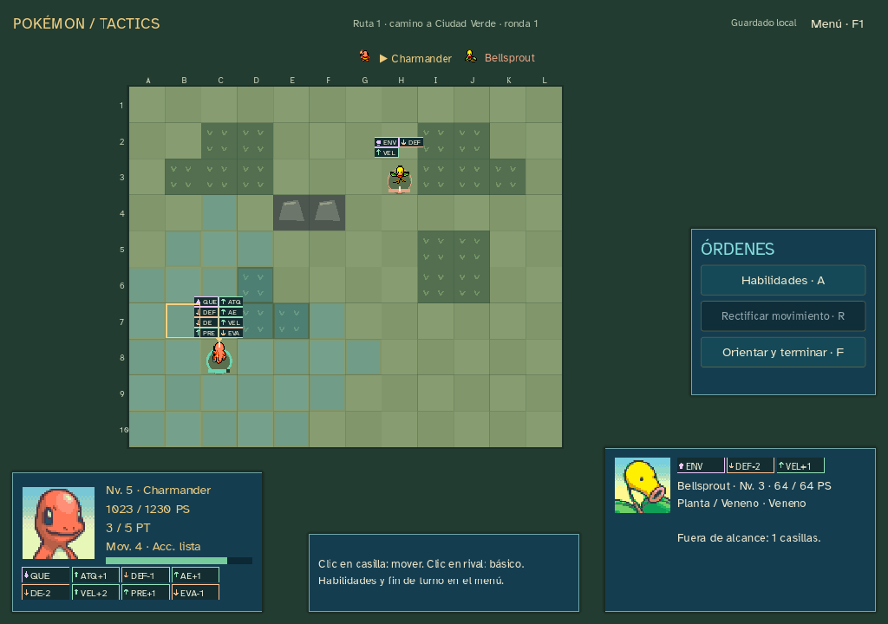

# Sprint14 — legibilidad, indicadores y Let’s Go

16 de octubre de2026 · Windows0.14.4 · codex/sprint-14-letsgo · nuevas partidas edición5.

Fuente **Atkinson Hyperlegible** para distinguir mejor cifras/letras. Indicadores de estados y etapas sobre los sprites y en las fichas de unidad activa/objetivo. Encuentros y repertorios de las zonas actuales de Let’s Go Pikachu y Eevee combinados. Excluidos los13 movimientos de los iniciales especiales; retiradas las anteriores excepciones de cobertura, según la respuesta del usuario.

## Encuentros y aprendizaje

| Zona | Especies capturables | Nivel |
| --- | --- | --- |
| Ruta1 | Pidgey, Rattata, Oddish, Bellsprout |3–4|
| Ruta2 sur | Caterpie, Weedle, Pidgey, Rattata, Oddish, Bellsprout |3–4|
| Bosque Verde | Caterpie, Metapod, Butterfree, Weedle, Kakuna, Beedrill, Pidgey, Pikachu, Oddish, Bellsprout; Bulbasaur especial |3–6|
| Brock | Onix insignia, medalla y dinero |14|

La unión no duplica pesos por aparecer en ambas ediciones. Enemigos salvajes generados entre especies terrestres normales con niveles LGPE; se mantienen1/2/3 enemigos y gimnasio12/14. Captura sorteada independientemente al vencer y persistida antes de reclamar. Bulbasaur especial solo como recompensa del bosque. Excluidos spawns aéreos/legendarios posjuego. Mapas/historia resumida sin cambios.

**Probabilidades provisionales:** PokéAPI incluye especies, niveles, edición y método, pero no los porcentajes por especie de LGPE. Normales equiprobables y1% para Bulbasaur son pesos propios, no tasas originales. Sin combos ni señuelos. La rareza requiere otra fuente o ajuste posterior.

Catálogo32 especies/12 líneas/104 movimientos: añade Oddish, Gloom, Vileplume, Bellsprout, Weepinbell y Victreebel. Aprendizaje y compatibilidad por máquina filtrados exclusivamente por `lets-go-pikachu-lets-go-eevee`. Los movimientos de evolución con nivel0 se aprenden al entrar en esa forma; formas salvajes conservan especie aunque tengan nivel bajo. Biblioteca previa conservada; cuatro preparados más básico, sin reemplazar elecciones.

- Charmander: Arañazo1, Gruñido4, Pantalla de Humo9, Ascuas13; sin Garra Metal temprana.
- Pikachu: Impactrueno/Gruñido1, Látigo3, Ataque Rápido6, Doble Patada9, Doble Equipo12. Cola Férrea por MT19, sin regalo al7.
- Butterfree obtiene Tornado/Confusión; Megaagotar por MT. Beedrill obtiene Doble Ataque/Picotazo, sin regalo de Demolición.
- Squirtle comienza con Placaje/Látigo y aprende Burbuja al9. No se adelanta un movimiento para compensarlo.
- Oddish/Bellsprout al21; Gloom/Weepinbell con Piedra Hoja80 ₽ en tienda, sin curar/subir nivel/revivir. Pikachu20/Golem36 conservan adaptaciones confirmadas. Caramelo25/+1 nivel y demás umbrales se mantienen.

Siete MT consumibles80 ₽, numeración/compatibilidad LGPE: Protección7, Demolición13, Cola Férrea19, Avalancha22, Escaldar29, Rayo36, Megaagotar53. Sustituyen Hidropulso/Tumba Rocas. Tres ofertas, rerolls25/50/75…, equipables y Demolición garantizada en primera tienda de Charmander siguen como reglas propias del roguelike. Los equipables se conservan aunque no existieran en Let’s Go.

## Indicadores y efectos

Mismo conjunto de datos en sprites y ambas fichas. Icono/abreviatura por condición; cada atributo con flecha arriba/abajo, abreviatura y color. Las fichas añaden etapas firmadas y tooltip: ATQ/DEF/AE/DE/VEL/PRE/EVA. No se comunica solo con color ni se muestra una previsión como efecto aplicado. Se eliminan al expirar, cambiar unidad o reiniciar combate.

Todos los modificadores importados, incluidos cambios múltiples. Límite táctico−2/+2, fórmula2 para atributos y3 para precisión/evasión. Velocidad afecta la próxima ronda, sin reordenar la actual. Niebla Clara elimina etapas/restaura bases. Daño fijo, drenaje, retroceso y autodestrucción tienen resolución propia; KO propio actualiza resultado/cola. STAB×1,5, tipos modernos/inmunidades y básico neutro conservados. Fórmula de daño, bases, EXP y economía existente sin retoques de balance. Fallo/inmunidad conservan sus imágenes/sonidos; recibos distinguen coste del movimiento de Vidaesfera.

El aprendizaje es LGPE; **no se afirma equivalencia completa del combate**. Cada habilidad explica sus adaptaciones:

| Sistema/movimiento | Adaptación |
| --- | --- |
| PT, alcance, orientación y áreas | Sistema táctico existente; cruz puede afectar aliados |
| Sueño/congelación | Sin acción, permiten movimiento,3 activaciones, sin daño de quemadura |
| Confusión | Efecto independiente:−25 puntos de precisión3 activaciones, sin autolesión |
| Drenadoras | Independiente3 activaciones;1/8 PS por final de turno, cura al usuario vivo; Planta inmune |
| Veneno/Tóxico/quemadura/parálisis | Temporales; Tóxico no aumenta su daño |
| Multiimpacto | Dos golpes agregados, una tirada |
| Carga/prioridad/retroceso | Carga sustituida por4PT; prioridad/retroceso no cambian cola |
| Foco Energía/Espejo |+1 Precisión/+1 Evasión; sin críticos ni copia |
| Furia/Venganza(Bide) |+1 Ataque/+1 Defensa; sin almacenar daño |
| Otra Vez/Trampa Rocas |−1 Ataque especial/−1 Velocidad; sin repetición ni trampas |
| Pantalla de Luz |+2 Defensa especial individual |
| Remolino |Empuja una casilla sin daño, no expulsa |
| Atadura/Constricción/Giro Fuego |Golpe único sin atrapamiento |
| Enfado/Danza Pétalo |Una acción, sin repetición/confusión posterior; no confunden al enemigo |

Sin críticos, pasivas ni clima. Estas traducciones son visibles y candidatas a revisión posterior.

## Implementación y fuentes

`letsgo_study/actions/battle/run.gd` extienden el dominio existente; catálogos nuevos y selector de guardado5. Motores/datos1–4 congelados, mismo diario/RNG. Nueva campaña preserva copia; sin migración silenciosa. Fuente/indicadores también mejoran la presentación clásica. Web0.12.0 y laboratorio0.13.0 conservados.

Importador explícito [import-letsgo.py](../tools/godot/import-letsgo.py), reutilizando fetch/cache y ayudante SpriteCollab existentes. Seis hojas Idle/Walk y retratos con bytes originales/créditos individuales, miniaturas recortadas identificadas.46 archivos/hashes y respuestas de origen en letsgo-provenance.json; licencia OFL incluida. Sin dependencias, plugins, servicios ni descargas al jugar.

Fuentes: [PokéAPI CSV fijados](https://github.com/PokeAPI/pokeapi/tree/81d20919845b6a445969b9265aab5cec6b04cece/data/v2/csv), [estructura de encuentros](https://pokeapi.github.io/pokeapi.co/v2/openapi/operations/api_v2_pokemon_encounters_retrieve/), [SpriteCollab fijado](https://github.com/PMDCollab/SpriteCollab/tree/6ad5f1c6229af6b055de2c64442e5e508664290c), [Atkinson Hyperlegible y licencia fijadas](https://github.com/google/fonts/tree/66928797f271fed5ee428544e7229685e2d90127/ofl/atkinsonhyperlegible).

## Comprobaciones

- Reglas nuevas:4.301 comprobaciones sin fallos.32 repertorios/exclusiones,1.200 capturas por zona y niveles locales, ejecución/previsión de104 movimientos sin mutar estado/RNG, STAB/tipos, etapas múltiples/precisión/evasión, sueño, indicadores, daño fijo/Contraataque/Explosión/Drenadoras/Niebla Clara, Piedra Hoja y replay1–5.
- Regresiones: edición4,1.194; edición3,1.118; edición2,1.165, salidas anteriores conservadas.
- Recorridos auxiliares:24 ensayos,5.351 comprobaciones de órdenes; completan Bulbasaur/lgpe-9 y Charmander/lgpe-1. La búsqueda para en el primer éxito por inicial: **no representa tasas de victoria ni balance humano**. Squirtle no completa con esa política en12 semillas; Burbuja al9 y la pool nueva requieren revisar después el arranque.
- UI fuente:1.775 aserciones/236 órdenes aliadas. Bulbasaur/lgpe-9 completa4 encuentros; Charmander/kanto-14 supera2; Squirtle/kanto-14 supera0. Controles de captura, Caramelos/evolución, biblioteca4, cinco acciones/tecla5, rectificación, tienda/MT/equipables/rerolls, Onix, carga clásica, fallo/inmunidad. Ambas fichas con8/3 marcadores y cifras1023/1230; ventanas1024×720,1280×900 y1440×1000. Capturas de indicadores son fixtures de presentación, no equipo conseguido en partida.

Balance/pruebas humanas pendientes. No se ajustan parámetros para forzar victorias ni se inicia15. Publicación pública sigue pendiente por decisión del usuario.

También ejecutadas:20 casos clásicos; paridad de laboratorio16 combates/506 órdenes/25 escenarios y503.579 comprobaciones sin diferencias. Laboratorio gráfico fuente/ejecutable:1.027 aserciones/73 órdenes y sus cuatro resultados anteriores. Campaña del ejecutable:1.775/236, mismas salidas que fuente. Ambas QA de Windows se ejecutan con GODOT_BIN apuntando a un editor inexistente. Linter:0 errores/advertencias; sintaxis Node/Python, importación/exportación4.7.2, recursos/hash y diff comprobados. Guardados QA aislados, sin sobrescribir partidas reales.

Evidencias: [reglas5](qa/sprint-14-letsgo/letsgo-result.json), [recorridos auxiliares](qa/sprint-14-letsgo/letsgo-journeys.json), [campaña fuente](qa/sprint-14-letsgo/campaign-source-result.json), [campaña ejecutable](qa/sprint-14-letsgo/campaign-release-result.json), [laboratorio ejecutable](qa/sprint-14-letsgo/lab-release-result.json), [linter](qa/sprint-14-letsgo/lint-result.json), [paquete](qa/sprint-14-letsgo/release-info.json). Los informes de regresión4/3/2, paridad y casos clásicos están en la misma carpeta.

## Entrega

Windows0.14.4 y ZIP fuera de Git, en ../releases/pokemon-tactics-0.14.4 respecto a la raíz. Ejecutable autónomo con PCK embebido, créditos, licencias, LEEME y SHA256SUMS. SHA-256 del .exe: `a572626f388018fd2445189304c82180434aa32eb91a6e621dbf48def120e859`. ZIP verificado con el mismo hash para el ejecutable incluido. Código/evidencias en la rama privada codex/sprint-14-letsgo; sin despliegue ni cambio de visibilidad/rama predeterminada.
