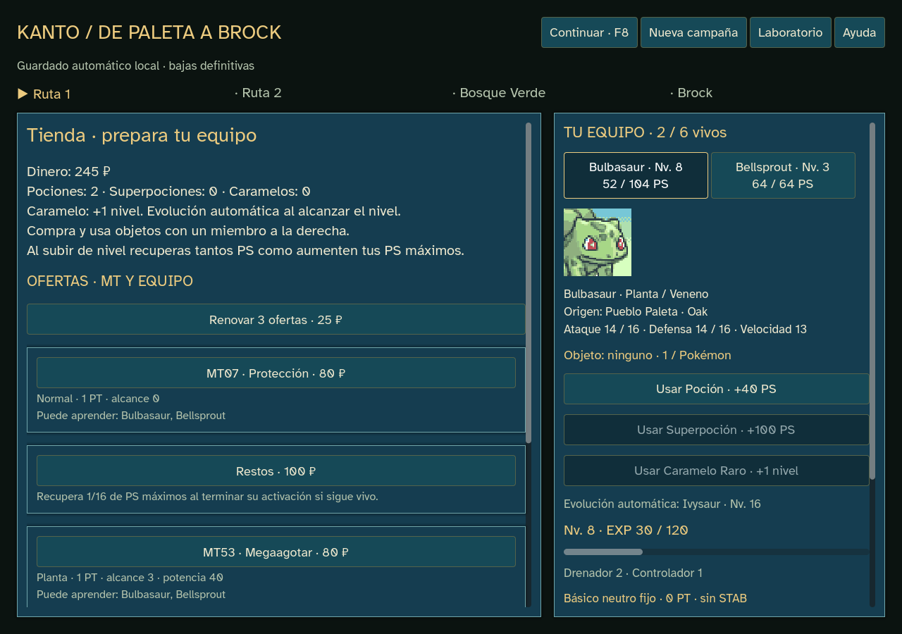

# PS al subir de nivel — 0.14.6

Cada subida de nivel suma a los PS actuales el aumento de PS máximos. Por ejemplo, 20/30 pasa a 23/33 si el máximo aumenta tres puntos. Funciona por EXP y Caramelo Raro, sin curación completa: se conservan los PS que faltaban.

Si esa subida provoca una evolución automática, se incluye su aumento de PS máximos. Varios niveles seguidos suman la diferencia total una sola vez. Un Pokémon con todos sus PS sigue al máximo; uno debilitado no revive. Ganar EXP sin subir, intentar superar el nivel 100 o usar una piedra sin subir de nivel conserva los PS actuales.

La tienda explica la regla y el recibo de progreso muestra `+N PS`. EXP parcial, precios, objetos, aprendizaje y reglas tácticas conservan su comportamiento.

## Implementación y compatibilidad

`vitality_study.gd` hereda `tactics_study.gd` y aplica la diferencia de máximos después del crecimiento existente. `vitality_run.gd` comparte ese estudio con motor y perfiles. Nueva campaña usa edición7; KantoStore reconstruye cada guardado con su edición1–7. Los módulos y datos publicados1–6 permanecen intactos para conservar el replay de sus diarios.

Para probar el cambio hay que empezar una **Nueva campaña**. La anterior se conserva como copia; continuarla mantiene sus reglas originales. No se toca ningún guardado real durante las comprobaciones.

## Comprobaciones ejecutadas

- Lint de Godot antes y después: cero errores y advertencias.
- `npm run godot:test:level-hp`: 5.446 comprobaciones, cero fallos. Las32 especies, PS completos/heridos/uno restante, EXP/Caramelo, umbrales de evolución, varios niveles, límite100, bajas, órdenes rechazadas, victoria y carga de ediciones1–7.
- `npm run godot:test:tactics`: 1.364 aserciones, cero fallos; edición6 mantiene sus reglas. El nuevo test también compara estado inicial de combate/RNG entre6 y7.
- `npm run godot:qa:campaign`: 2.152 aserciones y289 órdenes del jugador, cero fallos. Compra/uso real de Caramelo, recibo de PS, carga del diario y vistas1024×720/1280×900/1440×1000.
- `npm run godot:qa:campaign:export` con `GODOT_BIN=C:/editor-inexistente/Godot.exe`: las mismas2.152 aserciones/289 órdenes, cero fallos, recibo/PS y carga exactos. El ejecutable funciona sin editor. Informes JSON en `docs/qa/sprint-14-level-hp`.
- Importación y exportación con Godot4.7.2 oficial completadas; recursos/licencias/hashes verificados por los scripts existentes.

El recorrido automático completa los cuatro encuentros con Bulbasaur/tactics-1 y Charmander/tactics-4; Squirtle/kanto-14 cae en Ruta1. Son recorridos concretos de comprobación, sin estimación de victoria humana ni reajuste de balance.

## Entrega local

Ejecutable: `outputs/releases/pokemon-tactics-0.14.6/windows/PokemonTactics.exe`, acompañado de LEEME, créditos, licencias y SHA256SUMS. ZIP en la carpeta0.14.6, fuera del repositorio. Funciona offline; no necesita servidor ni editor. Publicación pendiente de decisión del usuario.

ZIP comprobado con `testzip` y coincidencia del ejecutable interno; SHA256 del ZIP: `02d9ed6c076822dc76f9e6bc43fcd956706a40fd6e9ebf23769319b8ddee3a87`.

SHA256 del ejecutable: `c2c4413349b5bf4c69f1f1e5b125eda5d779a27f67621c653cc83d746830c840`.

No añade recursos externos ni dependencias y no inicia el sprint15.
