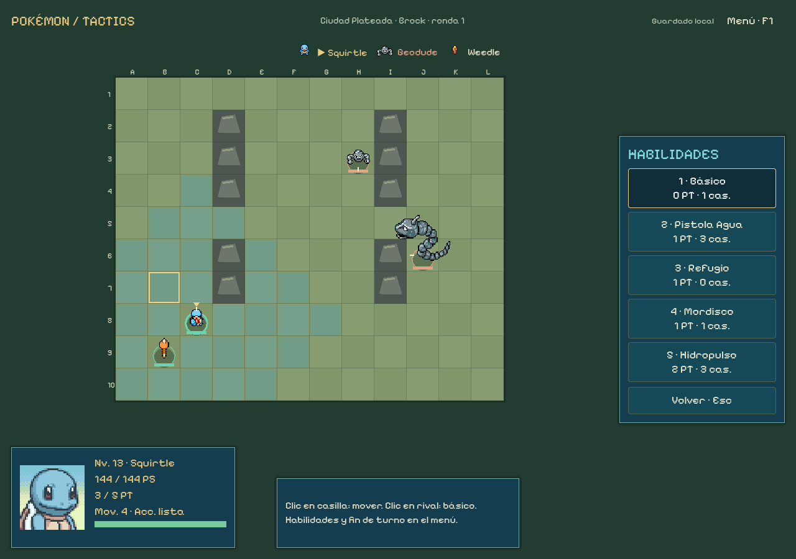
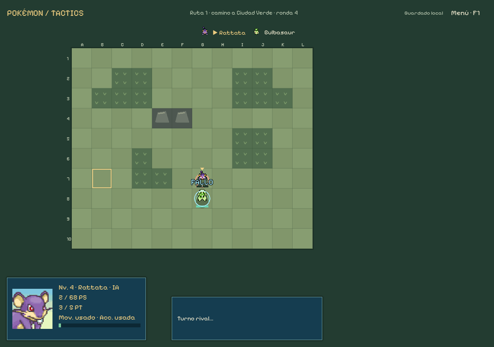

# Revisión 0.14.1 — niveles, roles y señales de combate

16 de octubre de2026. Rama codex/sprint-14-progression. Cambios pedidos tras probar la muestra14; adelanta parte de16 sin iniciar mapas/isometría de15 ni ampliar Kanto.

## Resultado

Nuevas campañas con EXP/niveles y estadísticas, diez líneas con dos orientaciones de repertorio, cuatro movimientos configurables más un básico neutro fijo, evolución con nivel mínimo/Caramelo y retirada del entrenamiento pagado. Fallos e inmunidades tienen imágenes/rótulos/audio distintos y la previsión muestra STAB. El tramo sigue Oak → Ruta1 → Ruta2 → Bosque Verde → Brock.

El usuario concretó que el Caramelo hace evolucionar **con restricción de nivel**, y que los cuatro movimientos son **además del básico sin tipo ni STAB**, para cinco acciones. Se aplican esas respuestas, conservando las antiguas reglas solo en partidas de edición1.

## Auditoría de reglas Pokémon

El motor ya tenía STAB×1,5, tabla moderna con multiplicación de tipos dobles, resistencias/inmunidades, físico/especial, precisión por frente/flanco/espalda, veneno/quemadura/parálisis, inmunidades de esos estados y polvos, áreas con riesgo aliado, terreno y empuje. Código de STAB en godot/core/actions.gd, DamageAction.preview. No había un cálculo completo de cartucho: el daño es una fórmula táctica propia. No se incorporan críticos, habilidades pasivas ni clima en esta entrega.

El básico nuevo usa tipo interno typeless con multiplicador1 contra todos los tipos y STAB1, incluso contra Fantasma/Roca/Acero o al usarlo un Pokémon Normal. Potencia25, físico, alcance1 y0PT, consume acción y conserva precisión/defensa/quemadura/protección. No se convierte simplemente en un movimiento de tipo Normal.

## Progresión aplicada

- Inicial nivel5, capturas con el nivel de la posición sorteada de la tabla de Rojo. Cada superviviente recibe EXP de victoria:220/350/500/650 por tramo. Las bajas no ganan; capturas nuevas llegan después del reparto. No se puede cultivar EXP repitiendo defensa/curación/últimos golpes.
- Coste del siguiente nivel40+10L, sobrante conservado y cap100. Estadísticas con bases reales, IV15/EV0/naturaleza neutra, fórmula por nivel y PS×4 como adaptación táctica. Ningún aumento cura ni revive. Son valores provisionales, no balance final.
- Aprende técnicas al alcanzar los umbrales de su línea/forma; guarda todas en una biblioteca. Rellena huecos libres hasta cuatro y conserva el resto para cambiar gratis fuera de combate. Evolucionar no borra el repertorio. Los roles se deducen de las técnicas preparadas y no dan estadísticas ocultas.
- Evolución mediante un Caramelo100 ₽ cuando cumple el nivel. Umbrales normales de las etapas disponibles; Pikachu20 y Graveler36 son adaptaciones explícitas de piedra/intercambio para cumplir el sistema solicitado. No sube niveles ni cura. Onix no tiene otra evolución de Kanto.
- Desaparece la compra +5 de estadísticas en edición2. Dinero para curación/caramelos y futuras compras; precios de poción40/super90, curación40/100 y victoria150 conservados provisionalmente.

26 especies del catálogo y51 adaptaciones de movimientos, incluyendo Graveler/Golem reutilizados de la web. No significa que las26 puedan capturarse en estas cuatro zonas. Los enemigos usan niveles de prueba4;6/5;8/8/7;12/14 y los movimientos disponibles por nivel, con las mismas reglas de jugador. Capturas, especies y niveles de slot siguen las tablas locales originales.

Etapas de Ataque/Defensa/Velocidad limitadas a -2…+2 y reseteadas por encuentro, para Gruñido/Látigo/Agilidad/Fortaleza/Refugio/Chirrido y efectos de Tumba Rocas/Terratemblor. La cola permanece fija hasta la siguiente ronda. Respiro aporta curación; la previsión y la IA comparten estos efectos. Los límites aparecen en descripciones; no se anuncia una bajada si el atributo ya llegó al tope.

[Reglas exactas, tabla de roles, evoluciones y propuestas](DESIGN_LEVELS_ROLES.md). Los nombres/tipos/categoría/potencia y compatibilidad proceden de PokéAPI, pero niveles de aprendizaje, geometría, PT y algunos efectos están adaptados. Ataque Rápido no altera iniciativa y Pin Misil/Dobleataque agregan dos impactos; no se afirman todos los efectos de cada técnica. Continúan faltando PP y otros estados/propiedades.

## Presentación y recursos

combat_feedback.gd usa los recibos reales de la resolución, sin inferir un fallo del daño0 ni volver a tirar. FALLO por precisión, INMUNE por tipo, daño/curación/atributos/protección con rótulo. Los dos primeros tienen imagen y aro sobre el objetivo. Un fallo total solicita miss.wav y una inmunidad total immune.wav; un área mixta conserva avisos por objetivo y un sonido de acción. Subir de nivel tiene su jingle.

Los efectos se dibujan después de guardar. Sonido, mostrar/cancelar una previsión y animación no alteran estado ni RNG. El movimiento reducido elimina desplazamiento/fade y conserva rótulos estáticos hasta retirarlos. Se mantienen mute, orientación y rectificación exclusiva del movimiento. Atajos1–5, con el quinto probado mediante evento de teclado real del viewport. Preparación de movimientos directa por casillas de selección en el equipo; curación/evolución aparecen antes de la biblioteca para reducir desplazamiento.

- Dos PNG originales transparentes de [Kenney Particle Pack](https://kenney.nl/assets/particle-pack), CC0, sin editar bytes; escala/color al dibujar. Licencia original incluida y archivo ZIP fuente con hash.
- Tres WAV generados localmente con el jsfxr ya fijado, Unlicense; no se descargan sonidos de Pokémon. Generador reproducible import-feedback.mjs. Medidos: aproximadamente0,073s/0,062s/0,571s, señal no silenciosa y sin clipping. No se ha realizado una escucha humana de control.
- Sprites/miniaturas75/76 de los recursos web existentes, retratos del mismo commit SpriteCollab6ad5f1c6229af6b055de2c64442e5e508664290c. Créditos individuales y licencias conservados.
- progression-provenance.json:18 archivos y77 respuestas de PokéAPI con hashes. feedback-provenance.json:3 WAV. Importadores explícitos; sin red al jugar, plugins nuevos, instalación de dependencias ni cambios a hojas originales.

## Arquitectura y guardado

progression_run hereda KantoRun y añade EXP, aprendizaje, evolución por umbral y transacciones de repertorio. progression_battle/pokemon/actions amplían los perfiles/acciones compartidos sin modificar la fórmula clásica. progression.gd concentra datos y reglas de crecimiento; tipos/evoluciones siguen como datos. Las instancias de comportamiento y nodos no se serializan.

KantoRun solo añade recibos de presentación al retorno; sus estados/reglas1 permanecen iguales. KantoStore selecciona el motor1 o2 según la cabecera, reconstruye el diario y valida el estado canónico. Nueva edición2 en kanto-save.json; archivos1 se cargan y continúan como Clásica0.14, sin convertir una batalla o inventar EXP retroactiva. Nuevo inicio conserva copia. La UI lo señala y permite seguir jugando; los efectos de fallo se aplican también al laboratorio/clásico.

Checksum, escritura temporal/copia, detección de otra instancia y preservación de archivos inválidos continúan. No se sobrescriben laboratory-save.json ni guardados web. Cambios futuros de reglas de edición2 exigirán conservarla o migrar expresamente.

## Comprobaciones ejecutadas

| Comprobación | Resultado |
| --- | --- |
| Reglas nuevas |1.165 comprobaciones y3 recorridos, sin fallos: STAB/tipos/básico, crecimiento sin curar, biblioteca/límite4+1, evolución y consumo, órdenes inválidas y replay1/2 |
| Casos límite clásicos |20 comprobaciones: entrenamiento/evolución anteriores, corrupción y conflicto, sin regresiones |
| Paridad laboratorio |16 batallas,506 órdenes y25 escenarios contra referencias originales, sin discrepancias |
| UI campaña, fuente y .exe |1.568 aserciones y244 órdenes aliadas por ejecución;3 recorridos con resultado equivalente, cinco acciones/tecla5, capturas/EXP/evolución/repertorio y guardado |
| UI laboratorio, fuente y .exe |1.022 aserciones/73 órdenes, cuatro batallas con los mismos resultados69/40/9/21;17 rectificaciones y56 bloqueos tras actuar/terminar |
| Recursos/audio |Hashes anteriores+21 archivos nuevos;3 WAV válidos sin silencio/clipping; fuente/importación/exportación con Godot4.7.2 real |
| Revisión estática |Linter de la skill:0 errores/advertencias; sintaxis Node/Python y diff comprobados |

UI renderizada a1024×720,1280×900 y1440×1000; menú de cinco acciones también a tamaño mínimo, sin cubrir casillas. Revisión visual de Oak, menú, tienda, fallo, inmunidad y rótulo clásico. QA de inmunidad es una fixture aislada que no se guarda; la de compatibilidad utiliza otro archivo. El fallo de precisión se obtiene durante una partida real automatizada, no con un recibo inventado. Se usan controles/señales y eventos del viewport; no automatización de escritorio ni partidas humanas.

El .exe se ejecuta con GODOT_BIN apuntando a un editor inexistente. No se repite la suite web porque src/, public/, sus guardados y reglas permanecen intactos. No se regeneran fixtures de paridad.

Evidencia: [progresión](qa/sprint-14-progression/progression-result.json), [UI fuente](qa/sprint-14-progression/campaign-source-result.json), [UI ejecutable](qa/sprint-14-progression/campaign-release-result.json), [laboratorio](qa/sprint-14-progression/lab-release-result.json), [audio](qa/sprint-14-progression/audio-result.json), [linter](qa/sprint-14-progression/lint-result.json), [paquete](qa/sprint-14-progression/release-info.json).

## Diagnóstico y propuestas

La política automática utiliza la IA compartida en ambos bandos; en tienda cura vivos y evoluciona cuando cumple requisitos/presupuesto. Una semilla (kanto-14), tres iniciales: Bulbasaur supera1 encuentro, Charmander3 y Squirtle4. Squirtle llega a16 y evoluciona a Wartortle sin ganar niveles por Caramelo. Son tres muestras de IA, no tasas humanas ni prueba de equilibrio/diversión. No se han retocado las fórmulas de daño clásicas; las nuevas estadísticas/niveles constituyen la nueva edición.

Propuestas separadas de lo implementado: amenazas por casilla, pasivas visibles por especie, apoyo limitado al flanquear, terreno/alturas elementales, MT/equipables y objetivos concretos de encuentro. [Documento de diseño](DESIGN_LEVELS_ROLES.md#propuestas-propias-para-siguientes-entregas) con prioridades, criterios y fuentes oficiales de Fire Emblem, Final Fantasy Tactics y Triangle Strategy. La siguiente prioridad recomendada es lectura de amenazas y pasivas, antes de añadir más multiplicadores.

## Entrega y límites

0.14.1 Windows x86_64 offline en ../releases/pokemon-tactics-0.14.1/windows/PokemonTactics.exe y ZIP hermano fuera de Git. Créditos/licencias/instrucciones acompañan al binario; integridad del ZIP contrastada con el .exe y registrada en release-info.json. Rama privada codex/sprint-14-progression; sin publicación ni cambios de visibilidad/rama predeterminada.

Para probar las reglas nuevas: Nueva campaña. Para un recorrido completo comprobado automáticamente: Squirtle/semilla kanto-14. Las partidas clásicas continúan con sus reglas anteriores y se conservan al reiniciar.

Sigue siendo la muestra hasta Brock en tableros cenitales12×10. Mapas grandes, cámara, isometría/alturas, PC, MT/equipables, Liga/legendarios y ampliación narrativa quedan en sus siguientes bloques. No hay críticos, pasivas/clima ni todos los estados/efectos; las sugerencias no se han aplicado como mecánicas por documentarlas. Balance y pruebas humanas pendientes.
