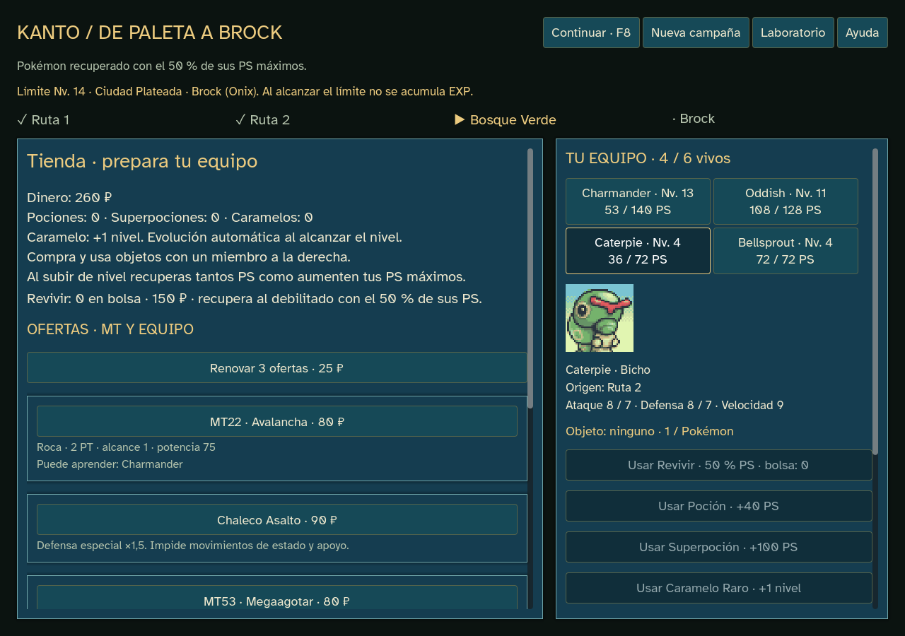

# Revivir en tienda — 0.14.8

Revivir cuesta **150 ₽**, el equivalente a la recompensa de una victoria actual. Es un precio inicial de prueba: recuperar un compañero compite con curación, MT y equipables.

Se compra entre los consumibles fijos, aparte de las tres ofertas renovables. Selecciona un Pokémon debilitado y pulsa **Usar Revivir**: consume una unidad y vuelve con el **50 % de sus PS máximos**, redondeando hacia abajo y con mínimo1. Solo se compra y usa en la tienda, fuera de combate.

Conserva identidad, especie, nivel, EXP, movimientos y origen. El objeto que volvió a la bolsa cuando cayó permanece allí; no se duplica ni equipa automáticamente. Una vez recuperado, se puede curar con pociones normales. Revivir no puede usarse sobre un Pokémon que siga en pie.

Las bajas individuales dejan de ser definitivas en campañas nuevas. **Si cae todo el equipo, termina la campaña**, aunque queden Revivir: no se abre una tienda de rescate. Los límites de nivel por gimnasio y los PS recuperados al subir siguen vigentes.

## Implementación y partidas

`revive_run.gd` hereda `gym_run.gd` y añade solo las transacciones de compra/uso, el consumible y `bag.revive`. Valida revisión, fase, fondos, cantidad y objetivo; trabaja sobre una copia y no consume RNG. La curación usa los PS máximos de las estadísticas de progresión, sin construir unidades de combate para usar un consumible.

Nueva campaña usa edición9; KantoStore selecciona las reglas1–9 originales al reconstruir diarios. Módulos/datos1–8 conservados. Para probar Revivir hay que empezar una **Nueva campaña**; al hacerlo se guarda copia de la anterior. Las anteriores mantienen sus reglas.

## Comprobaciones ejecutadas

- Lint antes y después: cero errores y advertencias; diff sin errores de formato.
- `npm run godot:test:revive`:310 comprobaciones, cero fallos ni errores de motor. Precio exacto/insuficiente,32 especies en niveles5/14, media vida y preservación del miembro, uso inválido/fuera de tienda, bolsa vacía y callbacks obsoletos. KO real por Vidaesfera con otro superviviente, devolución del equipable, recuperación, poción posterior y despliegue único en el siguiente combate. Replay de ediciones1–9.
- `npm run godot:test:gym-caps`:167 comprobaciones, cero fallos; topes y edición8 conservados.
- `npm run godot:qa:campaign`:2.314 aserciones/296 órdenes del jugador, cero fallos. Caterpie cae durante la ruta, se compra y usa Revivir mediante controles de tienda: vuelve con36/72 PS. Comprar/usar queda validado al cargar el diario. Pantallas1024×720/1280×900/1440×1000 sin controles fuera de límites.
- `npm run godot:qa:campaign:export` con `GODOT_BIN=C:/editor-inexistente/Godot.exe`: las mismas2.314 aserciones/296 órdenes, cero fallos. Compra, recuperación a media vida y carga idénticas sin depender del editor. Informes en `docs/qa/sprint-14-revive`.
- `godot:prepare` y `godot:export`: importación y exportación con Godot4.7.2 oficial; recursos/hashes existentes verificados. Sin guardados reales durante QA.

El recorrido automático completa los cuatro encuentros con Bulbasaur/tactics-1 y Charmander/tactics-4. Squirtle/kanto-14 cae en Ruta1: continúa siendo derrota total. Son recorridos de comprobación, sin estimación de tasas de victoria humana ni balance global.

## Entrega local

`outputs/releases/pokemon-tactics-0.14.8/windows/PokemonTactics.exe`, fuera de Git, con LEEME/créditos/licencias/SHA256SUMS. Funciona offline, sin servidor ni editor. Publicación pendiente por decisión del creador.

SHA256 del ejecutable: `62c9e9bbf652eb76a4856ae17d706588ecef6c2d229205dc9696f88f4ce4702b`.

ZIP verificado con `testzip` y hash del ejecutable interno coincidente. SHA256 ZIP: `44c2f3aa9d4247172ff1bb63269c71d797feb49c0fc8936d5e2d2c9f3f632123`.

Sin recursos, plugins o dependencias nuevos; no inicia el sprint15.
