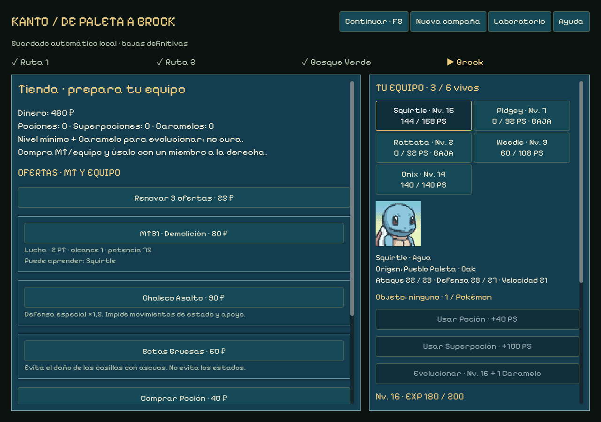

# Revisión del sprint 14 — tienda y premio insignia

16 de octubre de 2026 · Windows0.14.2 · rama codex/sprint-14-shop · edición de campaña3.

El gimnasio entrega su Pokémon insignia, la tienda ofrece tres MT/equipables con renovaciones crecientes y Charmander dispone de cobertura comprable antes de Brock. Se mantienen las fórmulas base y las estadísticas. La implementación reutiliza el motor, los recursos y los controles existentes; sin plugins, dependencias ni servicios nuevos.

## Reglas entregadas

- **Gimnasio:** medalla,150 ₽ y el enemigo reclutable de mayor nivel. Brock entrega **Onix14**, con origen del gimnasio, PS completos y repertorio de ese nivel. Empates: primero del equipo del líder. Legendarios/míticos se excluyen. Las capturas de Ruta1/Ruta2/Bosque siguen sus tablas originales, con duplicados provisionales.
- **Tres ofertas:** tres artículos distintos, una copia por casilla. Se asegura una MT que algún vivo compatible aún pueda aprender y un equipable cuando exista esa MT; resto aleatorio. Si todos conocen las MT compatibles, puede haber solo equipables. Las compras se almacenan en la bolsa. Se pueden comprar varios artículos distintos; los agotados solo se reponen renovando.
- **Renovar:** cambia las tres ofertas por25,50,75… ₽, pagando25×(renovaciones+1). Se reinicia en cada tienda. Puede volver a salir un artículo anterior; no hay garantía de rareza. Poción40/+40PS, Superpoción90/+100PS y Caramelo100 siguen disponibles aparte. Todos los precios son provisionales.
- **Seis MT80 ₽:** Demolición, Hidropulso, Megaagotar, Protección, Rayo y Tumba Rocas. Compatibilidad por aprendizaje mediante máquina verificada en PokéAPI para las26 especies, unión de versiones; numeración de distintas generaciones. No se presentan como las MT exactas de Rojo. Un uso por copia; incompatibilidad, baja o movimiento ya conocido no consumen nada.
- **Biblioteca:** seleccionar miembro y Aprender. Si hay hueco, se prepara; con cuatro preparados, queda aprendido para intercambiar gratis fuera de combate. Sigue habiendo cuatro movimientos más básico neutro.
- **Equipables:** Vidaesfera100, Restos100, Chaleco Asalto90, Botas Gruesas60 ₽. Uno por Pokémon. Cambiar/quitar devuelve el anterior a bolsa; al cerrar un combate se recuperan los de las bajas. No se equipa/aprende en combate ni antes de reclamar captura.

Vidaesfera multiplica por1,3 el daño previsto, incluido el básico neutro sin darle tipo/STAB. Se redondea el daño del motor y se limita a los PS restantes. Pierde10% de PS máximos, mínimo1, **una vez por acción que cause daño**, también en áreas. Fallos, inmunidades y apoyo no cobran retroceso. Puede causar una baja definitiva; si caen simultáneamente los últimos de ambos equipos, derrota. Si cae el activo y quedan aliados, comienza la siguiente activación. La previsión muestra el coste propio y el recibo real dibuja un rótulo separado del daño al rival. Efecto contrastado con [PokéAPI](https://pokeapi.co/api/v2/item/life-orb).

Restos recupera1/16 al cerrar la activación si sigue vivo. Chaleco multiplica defensa especial por1,5 e impide apoyo/estado. Botas evitan las ascuas del tablero, no veneno/quemadura. Se reutilizan estas reglas ya existentes del laboratorio.

## Charmander y dificultad

**Garra Metal ya estaba implementada al nivel9**, y se prepara automáticamente si hay hueco. No se cambia ese aprendizaje. La primera tienda tras Ruta1 garantiza la oferta MT31 Demolición a una campaña iniciada con Charmander, antes de Brock. Cuesta80, no exige suerte en un reroll; aprenderla ocupa una de las cuatro plazas si hay hueco. Demolición tiene75 de potencia física/Lucha/100% base, adaptada a2PT/alcance1; no hay pantallas que romper en esta muestra. [Datos](https://pokeapi.co/api/v2/move/brick-break).

Prueba controlada: Charmander13 contra Onix14,140PS, sin equipo, protección ni etapas:

| Movimiento | Daño previsto si acierta | Tipos |
| --- | ---: | --- |
| Ascuas |11 |Fuego resistido, con STAB |
| Garra Metal |26 |Acero ×2 |
| Demolición |39 |Lucha ×2 |

Esto verifica la cobertura; **no certifica el equilibrio ni una victoria garantizada**. Tres recorridos de IA, semilla kanto-14: Bulbasaur supera1 encuentro, Charmander3 y Squirtle4. En este ensayo Charmander cae en el bosque al nivel10 y los supervivientes pierden contra Brock. Una política adicional intentó priorizar Gruñido en el gimnasio, pero el inicial ya había caído. No se cambia una prueba para fingir que ese equipo gana ni se debilita automáticamente al líder. Hay que revisar conservación de unidades, composición y encuentros con partidas humanas antes de cerrar balance.

## Arquitectura, datos y guardado

shop_run hereda progression_run; shop_battle hereda progression_battle. Un decorador de acciones aplica Vidaesfera usando las previsiones reales, conservando tipos, STAB, estados, drenaje y áreas compartidos con la IA. Recoil, bajas y cola se resuelven en el motor antes de devolver el estado. La presentación solo lee recibos, sin tirar RNG.

KantoStore selecciona reglas1/2/3 por versión; ediciones anteriores y sus archivos de datos permanecen intactos. Nueva campaña para tienda y premio insignia, preservando copia de la anterior. UI identifica Clásica0.14/0.14.1. Se guardan ofertas, agotados, bolsa, equipo, contador/coste, MT aprendidas y generador de tienda separado del generador de capturas. Reconstrucción del diario y validación canónica, revisión por transacción y guardado antes de presentar; cargar o inspeccionar no regenera ofertas ni cobra de nuevo.

shop.json añade10 objetos y un movimiento a los51 anteriores. Importador explícito tools/godot/import-shop.py,28 respuestas con URL/hash y catálogo derivado en shop-provenance.json. Se reutilizan PokéAPI, traducciones, sprites/retratos PMD, Pixelify, tema y sonidos ya registrados; no hay nuevas imágenes/audio externos ni llamadas al jugar. Créditos actualizados y distribuidos junto al ejecutable.

## Comprobaciones

- Reglas3: **1.118 comprobaciones**,3 recorridos, sin fallos. Compra/agotado, MT compatible/incompatible/repetida, biblioteca llena, un equipable/devolución, coste creciente, comandos inválidos/obsoletos, carga de stock/recompensa/RNG, premio Onix, retroceso/áreas/fallo/inmunidad, KO propio/simultáneo y compatibilidad2.
- Regresión2: **1.165 comprobaciones**, mismos3 resultados anteriores. Casos clásicos:20. Paridad de laboratorio:16 batallas/506 órdenes/25 escenarios, sin diferencias contra las referencias; no se regeneraron fixtures.
- UI fuente: **1.714 aserciones,242 órdenes aliadas**,3 recorridos y cierre completo con Squirtle. Compra y aprendizaje de Demolición, dos renovaciones con precios25/50 y siguiente75, compra/equipar/quitar/reponer, carga canónica y Onix14 real. Pantallas a1024×720,1280×900 y1440×1000 revisadas visualmente. Se mantienen teclado5, rectificación y avisos de fallo/inmunidad.
- Laboratorio fuente:1.022 aserciones/73 órdenes; mismos cuatro resultados69/40/9/21,17 rectificaciones y56 bloqueos.
- Linter de la skill:0 errores/advertencias. Sintaxis Python/Node, hashes de recursos, importación Godot4.7.2 y diff comprobados. No se repiten pruebas web porque src/public y sus reglas/guardados no cambian.

La visualización de Vidaesfera utiliza una fixture aislada resuelta por el motor, sin guardarla en una campaña real. Los recorridos y compras usan controles/señales y eventos del viewport, con archivos QA propios; no son partidas humanas ni automatización del escritorio.

El ejecutable Windows autónomo supera también **1.714 aserciones/242 órdenes** de campaña y **1.022/73** de laboratorio, con los mismos resultados que la fuente. Ambas pruebas se ejecutan con GODOT_BIN apuntando a un editor inexistente. Sin errores de ejecución en los logs finales. ZIP contrastado por hash con el .exe.

Evidencia: [reglas3](qa/sprint-14-shop/shop-result.json), [regresión2](qa/sprint-14-shop/progression-result.json), [campaña fuente](qa/sprint-14-shop/campaign-source-result.json), [campaña ejecutable](qa/sprint-14-shop/campaign-release-result.json), [laboratorio fuente](qa/sprint-14-shop/lab-source-result.json), [laboratorio ejecutable](qa/sprint-14-shop/lab-release-result.json), [linter](qa/sprint-14-shop/lint-result.json), [integridad del paquete](qa/sprint-14-shop/release-info.json).

## Entrega

Paquete Windows0.14.2 offline en ../releases/pokemon-tactics-0.14.2/windows, fuera de Git, más ZIP, créditos/licencias/LEEME/SHA256SUMS. La prueba final de ejecutable y los hashes se registran en los JSON de evidencia junto a este informe.

Código en la rama privada codex/sprint-14-shop, sin despliegue público ni cambio de configuración de GitHub. Mapas grandes, cámara, isometría/alturas, PC, ampliación de Kanto, Liga/legendarios y balance humano siguen pendientes. Esta revisión adelanta tienda/MT/equipables de16; no completa todos sus sistemas ni inicia15.
