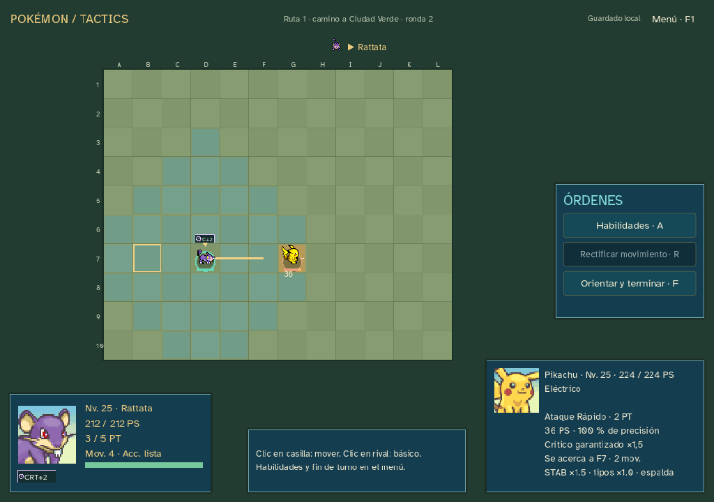
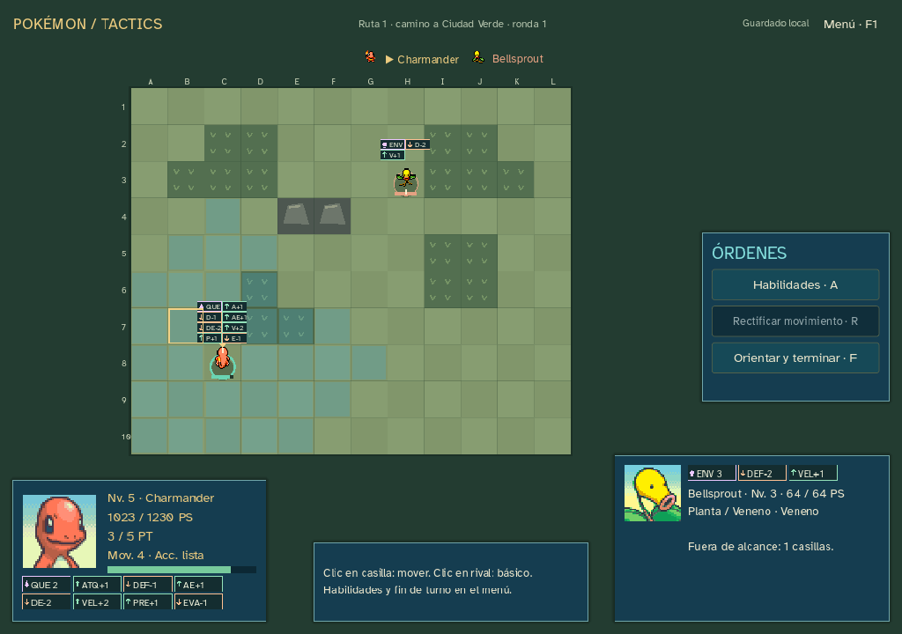

# Sprint14 — orientación, críticos y efectos temporales

16 de octubre de2026 · Windows0.14.5 · rama codex/sprint-14-tactics · nuevas partidas edición6.

El usuario considera aceptable el balance general y pide quitar la penalización de precisión por orientación, repartir el rango de daño por frente/costado/espalda, añadir críticos y movilidad, limitar la parálisis al movimiento, mostrar etapas y encarecer mejoras. Confirma que **también las subidas y bajadas de estadísticas deben caducar en tres activaciones**. No se retocan niveles, bases, PS, potencia general, EXP, precios ni tablas de encuentros para compensar estos cambios.

## Precisión, daño y críticos

Precisión base del movimiento y etapas de precisión/evasión, sin−15 frontal ni−5 lateral. Se aplica la diferencia de etapas con fórmula3, sin redondear dos multiplicadores por separado; límites de atributos existentes−2/+2. Movimiento de100 acierta desde cualquier orientación si no hay modificadores. Movimientos infalibles siguen ignorando esas etapas. Inmunidad de tipo, alcance, terreno y objetivos válidos siguen aplicándose. Confusión conserva su adaptación anterior de−25 puntos; no se presenta como réplica exacta de todos los estados del cartucho.

Se conserva la fórmula táctica de daño, STAB, tipos, quemadura, equipables y protección. Su resultado máximoD determina un rango entero desde floor(0,85D), mínimo1 si no hay inmunidad, hastaD. El punto medio entero divide el rango; el ejemplo solicitado se cumple exactamente:

| Orientación | Si el rango general fuera40–50 | Etapa extra de crítico |
| --- | --- | --- |
| Frente |40–45|0|
| Costado |45–50|0|
| Espalda |50 fijo|+1|

Los rangos son inclusivos; la mitad compartida pertenece a ambas bandas. Con D50 el rango85–100% real es42–50 y se divide42–46/46–50/50. La espalda fija el resultado máximo **antes** del crítico; un crítico puede superarlo. Se calcula antes de limitar a los PS actuales: un objetivo casi derrotado no reduce artificialmente la tirada.

Crítico×1,5, ignorando etapas ofensivas negativas y defensivas positivas; conserva quemadura, resistencias/inmunidades, STAB, equipables y protección táctica. Etapas0/1/2/3:1/24,1/8,1/2 y garantía. Espalda+1 se suma al movimiento y Foco Energía. Hoja Afilada, Viento Cortante y Ataque Aéreo recuperan su etapa alta; Cuchillada se incluye en el prototipo de garantía. Los movimientos de daño fijo como Furia Dragón, Superdiente y Contraataque no varían por orientación ni pueden ser críticos.

Referencia contrastada: [implementación primaria de Pokémon Showdown](https://github.com/smogon/pokemon-showdown/blob/master/sim/battle-actions.ts), tabla moderna y tratamiento del crítico. No se incorpora su código ni una dependencia. Datos/aprendizajes LGPE y recursos previamente atribuidos conservados.

Previsión muestra rango, probabilidad y rango crítico, lado, STAB/tipos y destino/coste de acercamiento. La barra distingue daño mínimo del adicional posible; el rótulo CRÍTICO usa el daño real del recibo. Se resuelve precisión→crítico→daño→efectos secundarios; sin tiradas al inspeccionar, mover el cursor, dibujar, consultar IA o cancelar. Un fallo consume acción/PT y no causa daño. Garantía de crítico no sustituye precisión: Hipercolmillo90 puede fallar.

## Movilidad e identidad: prototipos aplicados

Se mantienen los repertorios y compatibilidad de Let’s Go. No se añaden movimientos ajenos ni exclusivos de iniciales especiales. Las modificaciones de efectos son decisiones tácticas explícitas en las descripciones:

| Movimiento | Prototipo | PT |
| --- | --- | --- |
| Cuchillada / Hipercolmillo |Crítico garantizado al acertar|3|
| Ataque Rápido / Acua Jet |Acercamiento de hasta2 puntos de movimiento|2|
| Golpe Bajo |Acercamiento de hasta2 puntos|3|
| Ataque Ala |Acercamiento de hasta1 punto|2|
| Golpe Cabeza / Portazo |Empuje de una casilla al acertar|2|
| Remolino |Empuje sin daño, infalible, no expulsa del combate|1|
| Foco Energía |+2 etapas de crítico durante3 activaciones; sustituye antigua mejora de precisión|3|

Rattata obtiene una identidad de atacante móvil; las líneas que aprenden Cuchillada pueden explotar ventanas de crítico. Pidgey, Pikachu, Squirtle y quienes aprenden estos movimientos combinan aproximación/posición con sus roles existentes. No son clases bloqueadas ni pasivas ocultas.

Acercarse elige una casilla adyacente libre mediante las mismas reglas de camino/terreno. Descuenta el coste del movimiento restante y cuenta como desplazamiento; no concede un segundo movimiento normal. Puede atravesar aliados, no enemigos, ni terminar sobre una unidad. Si ya se movió, solo puede acercarse con presupuesto que quede. Una vez lanzado, se acerca y paga aunque falle el golpe; Rectificar sigue bloqueado tras cualquier acción. Si ya está adyacente no hay desplazamiento añadido. Empuje bloqueado por ocupación, borde o terreno: sin daño extra de choque y sin sacar unidades del mapa. No empuja bajas.

IA usa las mismas previsiones; puede buscar un flanco/espalda alcanzable cuando mejora el resultado y no expone demasiado. Valora costes de apoyo y evita gastar una mejora temporal cuando no hay enemigos próximos. No anticipa resultados del PRNG.

## Duración, parálisis y mejoras

Estados, Drenadoras, Confusión, Foco Energía y **cada atributo modificado** duran tres activaciones del Pokémon afectado. Se descuentan al terminar su activación, incluida la actual si se aplica a sí mismo. Cada atributo tiene su contador; solo se renueva si cambia de etapa, no se puede refrescar gastando una acción en el límite. Al caducar se restaura su valor base. Niebla Clara elimina también los contadores. Las bajas no se curan/reviven y los efectos se reinician por combate.

Parálisis reduce a la mitad el presupuesto de movimiento, redondeando abajo (mínimo1 con los perfiles actuales). No reduce Velocidad/iniciativa ni provoca pérdida aleatoria de acción. Las modificaciones reales de Velocidad siguen afectando a la próxima ronda, sin reordenar la actual.

Coste de mejora individual+1:2PT; individual+2:3PT; dos atributos+1:3PT; tres atributos+1:4PT. Ejemplos: Fortaleza/Refugio/Rizo Defensa2, Agilidad/Amnesia/Danza Espada3, Desarrollo3, Danza Aleteo4. Se conservan máximo5PT y regeneración de1 por activación. Foco Energía3. No se reducen potencias globales ni se encarecen todas las acciones. Cabezazo mejora la Defensa propia, no la del enemigo.

Los marcadores del tablero añaden+1/+2/−1/−2, conservando flechas y abreviaturas. Las fichas muestran etapas y duración en tooltip; estados muestran las activaciones restantes, Foco Energía CRT+2. Se mantienen fuente Atkinson Hyperlegible y retratos PMD.

## Implementación, comprobación y entrega

`tactics_study/actions/battle/run.gd` y `data/tactics.json`. Edición6, con motores/datos1–5 congelados, selección por guardado y copia al iniciar otra. Nueva campaña para estas reglas; no se transforma una pelea antigua ni su RNG. Presentación compartida mejora también marcadores clásicos. Web/laboratorio conservados. Sin recursos externos, plugins ni dependencias nuevos; sin descargas al jugar. Isometría/mapas/cámara/alturas de15 siguen pendientes.

Reglas6:1.364 comprobaciones sin fallos,104 movimientos ejecutables/previsiones puras, bandas40–50 exactas,100% frontal, críticos/precisión, daño fijo, mejoras/coste/expiración, parálisis/iniciativa, acercamiento y fallo, ocupación/aliados/enemigos, empuje bloqueado, drenaje real, barras/etapas y replay1–6. Recorridos auxiliares:19 ensayos/3.734 comprobaciones; Bulbasaur/tactics-1 y Charmander/tactics-4 completan. Se busca primer éxito por inicial: no representa tasa de victoria; Squirtle no completa esa política en ocho semillas. No es un informe de balance humano.

UI fuente:2.159 aserciones/291 órdenes aliadas; Bulbasaur y Charmander completan4 encuentros, Squirtle/kanto-14 pierde el primero. Controles reales de campaña, objetos, biblioteca, cinco acciones, rectificación, capturas, Onix, tienda/equipo/rerolls y carga clásica. Fixtures aisladas verifican crítico real, fallo original90 con imagen/sonido, ruta/destino de acercamiento y rectificación bloqueada. Ventanas1024×720/1280×900/1440×1000 revisadas visualmente. Las escenas de demostración no son equipos obtenidos en esas partidas.

Regresiones ejecutadas sin diferencias: edición5/4.301,4/1.194,3/1.118,2/1.165;20 casos clásicos y paridad16 combates/506 órdenes/25 escenarios/503.579 comprobaciones. Laboratorio fuente y ejecutable:1.027 aserciones/73 órdenes, cuatro resultados anteriores. Campaña del ejecutable:2.159/291, idéntica a fuente; GODOT_BIN apunta a editor inexistente. Linter0 errores/advertencias, sintaxis Node, importación/exportación Godot4.7.2, hashes y diff comprobados. Guardados QA aislados, sin tocar partidas reales.

Evidencia: [reglas6](qa/sprint-14-tactics/tactics-result.json), [recorridos](qa/sprint-14-tactics/tactics-journeys.json), [campaña fuente](qa/sprint-14-tactics/campaign-source-result.json), [campaña ejecutable](qa/sprint-14-tactics/campaign-release-result.json), [laboratorio ejecutable](qa/sprint-14-tactics/lab-release-result.json), [linter](qa/sprint-14-tactics/lint-result.json), [paquete](qa/sprint-14-tactics/release-info.json). Resto de regresiones en esa misma carpeta.

Windows0.14.5 y ZIP en ../releases/pokemon-tactics-0.14.5, fuera de Git, con PCK embebido, créditos/licencias/LEEME/SHA256SUMS. SHA-256 del .exe: `5adedd13e02dbdc57c8ef19b548a3382f236bd6cdbde9ed065038af66f825130`. El ejecutable dentro del ZIP coincide. Código/evidencias en rama privada codex/sprint-14-tactics. Sin despliegue público ni cambio de visibilidad/rama predeterminada; balance humano de estos prototipos pendiente.
