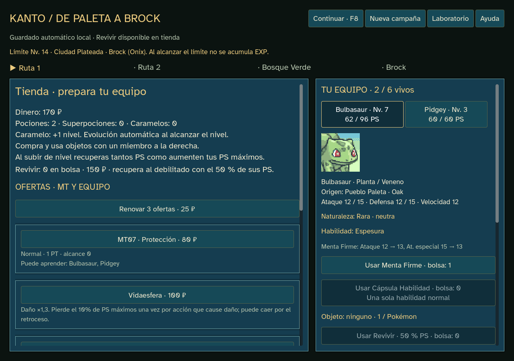
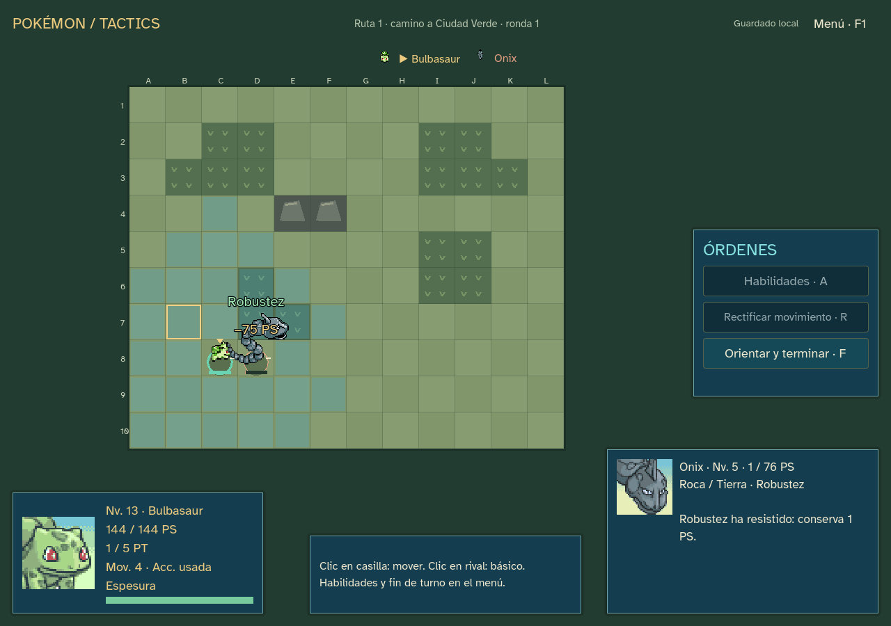

# Naturalezas y habilidades — 0.14.9

Entrega del bloque14.9A/B aprobado por el usuario, antes de mapas/isometría15. Edición10 para nuevas campañas hasta Brock;32 especies y reglas de captura/movimientos de Let’s Go conservadas. No añade más historia ni cambia potencias generales, EXP, cap por gimnasio, Revivir o equipables existentes.

## Naturalezas y objetos

Las25 naturalezas aplican los modificadores habituales: +10% a un atributo y −10% a otro, con redondeo hacia abajo; cinco naturalezas son neutras. No afectan a los PS. IV fijo15 y EV0 continúan. La naturaleza se sortea al obtener el Pokémon y queda guardada.

- **Mentas100 ₽**:21 efectos, incluyendo Menta Seria para volver a modificadores neutros. El selector permite elegir y ver la bolsa; la ficha muestra valores antes/después. La menta cambia los modificadores efectivos y conserva la naturaleza original. Repetir un efecto ya activo no consume otra.
- **Cápsula Habilidad150 ₽**: alterna entre las dos habilidades normales cuando la especie las tiene. La ficha anticipa la habilidad resultante y su descripción. No funciona en especies con una sola habilidad normal ni permite habilidades ocultas. No ocupa el equipable.

Compra/uso solo en tienda, sobre miembros vivos. Se valida revisión/fondos/bolsa/objetivo; órdenes rechazadas no consumen recursos. El Pokémon conserva especie, ID, nivel, EXP, PS y movimientos al usar estos objetos. Al evolucionar se mantienen naturaleza, menta y slot, resolviendo la habilidad de la nueva especie: por ejemplo, Polvo Escudo → Mudar → Ojo Compuesto en Caterpie/Metapod/Butterfree.

## Habilidades normales

Hay15 en el catálogo,13 funcionales en las mecánicas actuales:

| Habilidad | Efecto aplicado |
| --- | --- |
| Espesura / Mar Llamas / Torrente / Enjambre | Potencia del tipo correspondiente ×1,5 con un tercio de PS o menos; no daño fijo. |
| Polvo Escudo | Bloquea estados, confusión y cambios de atributos secundarios de ataques recibidos. No bloquea movimientos puros de estado ni empujes tácticos. |
| Mudar | Probabilidad1/3 de curar el estado principal al terminar su activación, antes de residuales. No cura confusión o Drenadoras. |
| Ojo Compuesto | Precisión ×1,3; no altera movimientos que nunca fallan. |
| Vista Lince | Evita bajadas de precisión e ignora etapas positivas de evasión del objetivo. |
| Tumbos | Evasión ×2 mientras está confuso. |
| Agallas | Ataque ×1,5 con estado principal; evita la penalización ofensiva de quemadura. |
| Elec. Estática |30% de paralizar por contacto, incluso si cae su portador. Atacante vivo, sin otro estado e inmune si es Eléctrico; Tierra sí puede sufrirlo. Conserva duración táctica3 y descuenta movimiento ya gastado. |
| Cabeza Roca | Elimina retroceso de movimientos, conservando Vidaesfera y Autodestrucción. |
| Robustez | Desde todos los PS, un golpe letal lo deja en1. Previsión, críticos, daño fijo y curación por drenaje respetan ese límite; no protege de residuales/costes propios. |

**Clorofila y Fuga** muestran sus descripciones y una advertencia explícita: esperan los sistemas de clima y huida, respectivamente. No producen efectos en los encuentros actuales. Habilidades ocultas y Parche Habilidad quedan para la ampliación posterior acordada.

Adaptaciones conservadas: estados/etapas duran3 activaciones; Mudar usa el final de la activación propia. Los multiimpactos siguen siendo un golpe agregado del prototipo, por lo que Robustez los trata como tal; esta entrega no implementa impactos individuales. Se mantiene la fórmula táctica existente.

## Presentación y guardado

Naturaleza original, menta y habilidad aparecen en la ficha. Las habilidades también se muestran en combate, con descripciones en tooltip, previsiones y rótulos de activación sobre las unidades. Las estadísticas base de los modificadores temporales incorporan la naturaleza; la Velocidad efectiva se usa al construir la iniciativa.

Los rasgos usan un PRNG separado por semilla/ID. No consumen RNG de rutas, tienda o combate al asignarse; se asignan antes de ofrecer la captura y se conservan al cargar/evolucionar. Enemigos y aliados usan las mismas reglas. IA/previsión no consumen RNG ni leen resultados futuros.

Clases nuevas: traits_study/actions/battle/run. El resolver de edición10 procesa las reacciones antes de bajas/cola; módulos y datos publicados1–9 permanecen congelados. KantoStore reproduce cada edición1–10 con sus reglas originales. **Nueva campaña** activa10 y preserva copia de la anterior. Graveler/Golem reciben en la instancia nueva el campo de movimiento que faltaba, tomando el valor de Geodude, sin modificar sus catálogos anteriores.

## Datos y comprobaciones

Se reutilizan7 CSV de [PokéAPI](https://pokeapi.co/docs/v2), commit81d20919845b6a445969b9265aab5cec6b04cece: nombres de naturalezas/habilidades, relaciones normales y contacto. `tools/godot/import-traits.py` genera traits.json y traits-provenance.json con URL/hashes. Hay39 acciones de contacto, incluido el básico propio. Sin imágenes/audio/dependencias nuevos ni solicitudes al jugar; atribuciones en godot/CREDITS.md. Reglas de [mentas](https://swordshield.pokemon.com/en-gb/gameplay/features-raise-pokemon/) y [cápsulas](https://www.pokemon.com/us/strategy/train-raid-and-hatch-pokemon-to-breed-victories-in-pokemon-sword-and-pokemon-shield) contrastadas con documentación oficial.

- Lint antes/después: cero errores/advertencias. Verificación de recursos y fuentes congeladas completada sin regenerar referencias.
- `godot:test:traits`:5.292 comprobaciones, cero fallos.25 naturalezas ×32 perfiles, objetos/órdenes inválidas, crecimiento/evolución, pasivas, drenaje limitado por Robustez, PRNG puro y replay1–10. Con rasgos desactivados, ambos resolvers coinciden exactamente en daño, estados, costes, cola y RNG en los recorridos comparados.
- `godot:test:traits:journey`:1.894 comprobaciones y11 recorridos, cero fallos. Dos completados: Bulbasaur/tactics-1 y Charmander/tactics-4. Se detiene la búsqueda por inicial al ganar: no son tasas de victoria. Squirtle cae en Ruta1 en las ocho semillas ensayadas.
- Regresión: Revivir310 comprobaciones y motor táctico6 con1.364 aserciones, cero fallos.
- `godot:qa:campaign`:2.540 aserciones/333 órdenes del jugador, cero fallos. Flujo adicional real de tienda con trait-ui-3, mentas/cápsulas compradas sin fondos ficticios, carga exacta, tres recorridos principales y Robustez mostrada antes/después con1 PS. Pantallas1024×720,1280×900 y1440×1000.
- `godot:qa`: laboratorio anterior,1.027 aserciones/73 órdenes y cuatro batallas; resultados69/40/9/21 órdenes conservados.
- Importación/exportación con Godot4.7.2 oficial completadas. Guardados de QA aislados; no se tocan campañas reales.
- `godot:qa:campaign:export`: 2.540 aserciones y 333 órdenes, cero fallos. Ejecutado con `GODOT_BIN` apuntando a un editor inexistente; el informe coincide exactamente con el de fuente. Evidencia en `docs/qa/sprint-14-traits/campaign-release.json`.

## Entrega

`outputs/releases/pokemon-tactics-0.14.9/windows/PokemonTactics.exe`, con LEEME/créditos/licencias/SHA256SUMS. Offline, sin servidor ni editor. SHA256: `d2238131782f390c5c95916da8ce832fab22c4b2a4618cf13e50412fede2a36f`.

ZIP: `outputs/releases/pokemon-tactics-0.14.9/pokemon-tactics-0.14.9-windows.zip`, 38.635.856 bytes. Integridad comprobada con `zipfile.testzip()` y SHA256 del ejecutable interior coincidente. SHA256 del ZIP: `8e829626dc499efd50632409455d115d3afc2648e48e464a52c4da5b14f2e70d`.

Paquete fuera de Git; publicación aplazada por el usuario. Balance humano pendiente; no se inicia el sprint15.
