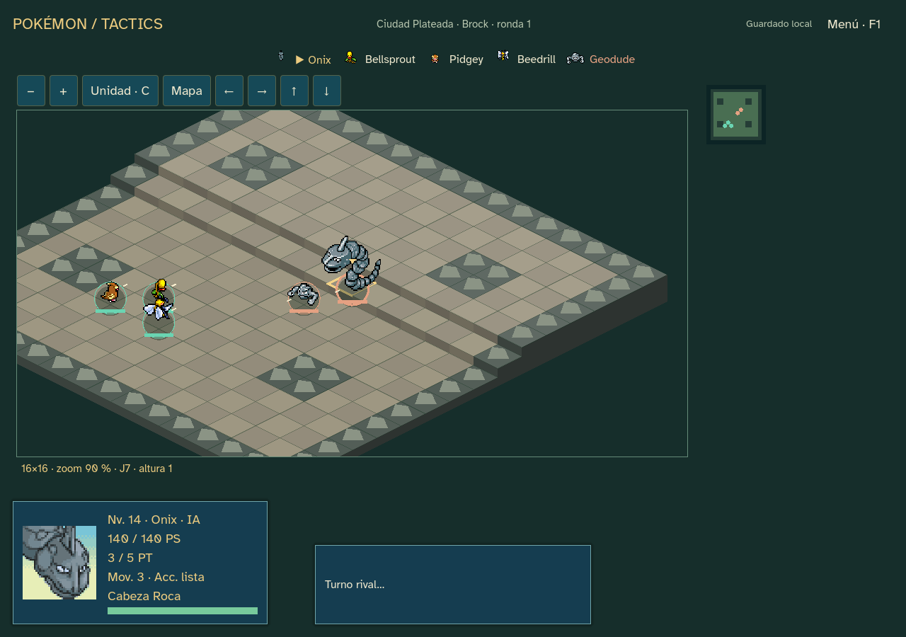

# Sprint 15 — escala, isometría y alturas · 0.15.0

Implementación del bloque solicitado por el usuario. Nuevas campañas con edición 11; la muestra sigue recorriendo Ruta 1, Ruta 2, Bosque Verde y Brock. No amplía la historia de Kanto. El ritmo y la diversión requieren prueba humana: los resultados automáticos no cierran el balance ni deciden el tamaño definitivo.

## Qué se puede probar

- Tableros isométricos con plataformas de altura 0–2, sprites originales orientados según la proyección, ruta/previsión, estados y marcadores existentes. Casillas seleccionables separadas del HUD.
- Tamaño **16×16 por defecto** y **24×24 para comparar**. Se elige en la pantalla de viaje antes del primer encuentro, queda en el diario y no cambia al cargar. Los dos tamaños conservan distancias iniciales comparables; 24 añade espacio para flanquear, no obliga a recorrer todo el mapa.
- Cámara por arrastre del botón central o botones; zoom con rueda, +/− y botones. C/Inicio y «Unidad» centran al activo; «Mapa» encuadra el tablero. Seguimiento al cambiar de unidad, minimapa de posiciones y cursor por teclado. Cámara/zoom no alteran estado ni RNG y no generan transacciones.
- Movimiento terrestre: desnivel máximo de un nivel por paso; subir añade un punto al coste del terreno. Bajar un nivel no añade coste. Voladores ignoran el desnivel, conservando las reglas de terreno. Aliados atravesables, destinos ocupados inválidos y enemigos bloqueando.
- Cuerpo a cuerpo admite una diferencia máxima de un nivel. Para movimientos de alcance mayor, subir al objetivo consume alcance; la altura también interviene en la línea de visión, con roca y unidades como obstáculos. No se aumenta daño ni precisión por altura. Empujes y acercamientos comparten costes/límites; no hay daño de caída. Las áreas conservan la cruz del prototipo alrededor del objetivo.
- En el Bosque Verde, el último enemigo actúa como **vigía**, visible en tablero/minimapa. Permanece fuera de la cola hasta la siguiente ronda si hay un rival a seis casillas, recibe daño o se alcanza la ronda tres. No se intercala una activación en la cola actual. Evita esperar indefinidamente. Los demás encuentros mantienen sus unidades activas desde el principio; no se aumenta el número de enemigos.
- El objetivo continúa siendo eliminar a los enemigos, incluidos los vigías. Salida/rescate son propuestas pendientes; no se introducen automáticamente recompensas o condiciones de derrota nuevas.

## Implementación y compatibilidad

`scale_maps.gd` define los cuatro escenarios con el vocabulario de terreno existente. `terrain_movement.gd` recorre el mapa con Dijkstra una vez por unidad, frente a un A* por destino del laboratorio. `scale_battle.gd` comparte movimiento, alcance, previsión y decisiones entre ambos bandos; la IA avanza por caminos transitables y evita retiradas defensivas repetidas. `scale_run.gd` hereda progresión, tienda y rasgos de la edición 10.

No cambian bases, niveles, fórmulas de daño, EXP, precios, movimientos o tablas de captura para balancear. La nueva geometría y la IA sí cambian los enfrentamientos; no se promete equivalencia de resultados con 0.14.9. Naturalezas/habilidades, PS por subida, cap de Brock y Revivir continúan.

`isometric_board.gd` amplía la representación existente y usa la vista cenital original para ediciones anteriores. Dos métodos de fábrica/consulta en la UI permiten utilizar el nuevo tablero y las nuevas rutas, manteniendo el laboratorio. La campaña nueva arranca con 11; KantoStore reconstruye ediciones 1–11. **Nueva campaña** es necesaria para usar mapas y alturas, preservando copia de la anterior. Los módulos/datos publicados de las ediciones 1–10 permanecen congelados.

Recursos reutilizados: hojas originales y retratos SpriteCollab/PMD, tipografía Atkinson Hyperlegible, audio y datos locales existentes. Su procedencia/licencias/hashes continúan en `godot/CREDITS.md` y manifiestos. El terreno geométrico es código propio; no se añaden assets descargados, complementos, dependencias ni red al jugar. El arte del escenario es provisional.

## Comprobaciones

Evidencia en `docs/qa/sprint-15/`. Las pruebas usan archivos de QA aislados, no campañas reales.

- Pruebas de reglas: costes y rutas, seis plazas de despliegue, aliados/enemigos, altura/visión, acercamiento/empuje, selección isométrica y cámara pura, rectificación, guardado y replay 1–11.
- Dos recorridos naturales con Bulbasaur/tactics-1, uno por tamaño, con la misma política de compras/curación. Ocho encuentros de laboratorio con tres iniciales al nivel 12, para comprobar cada escenario y tamaño; son fixtures, no partidas naturales ni tasas de victoria.
- UI nueva: elección de tamaño, cuatro encuentros completos mediante controles en ambos tamaños, rueda/cámara, rectificación y recarga; además, fixtures de las otras tres zonas. Capturas en 1024×720, 1280×900 y 1440×1000.
- Regresión de naturalezas/habilidades y laboratorio; campaña anterior comprobada separadamente con la edición 10. Este recorrido anterior no valida por sí solo la nueva geometría.
- Lint antes/después. Validación Godot sin errores de carga/configuración; advierte sobre estilos de scripts heredados. Los archivos nuevos no añaden advertencias. No se reescriben motores congelados para silenciarlas.

Resultados de fuente:

| Comprobación | Resultado |
| --- | --- |
| `godot:test:scale` | 1.689 comprobaciones, cero fallos; replay 1–11 y diez recorridos/encuentros |
| Dos campañas nuevas naturales | Ambas completan las cuatro zonas: 226 órdenes tácticas, 22 desplazamientos, 102 ataques y cuatro activaciones sin acción por recorrido; primera interacción en ronda 1 |
| Ocho encuentros con equipo fijo de QA | Todos terminan; Ruta 1: 15 órdenes/2 rondas; Ruta 2: 50/5; bosque: 87/10; Brock: 26/3. Iguales resultados por tamaño, no tasas de victoria |
| `godot:qa:scale` | 955 aserciones, cero fallos; cuatro zonas completas con controles, 256/257 transacciones según tamaño |
| `godot:qa:scale:export` | Las mismas 955 aserciones y dos campañas completas; informe idéntico al de fuente. `GODOT_BIN` apunta a un editor inexistente para verificar independencia |
| `godot:test:traits` | 5.292 comprobaciones, cero fallos |
| `godot:qa:campaign` (edición 10) | 2.540 aserciones/333 órdenes, cero fallos; resultados anteriores conservados |
| `godot:qa` (laboratorio) | 1.027 aserciones/73 órdenes, cero fallos; cuatro resultados anteriores conservados |
| Lint | Cero errores y advertencias; 66 scripts |
| Validador completo Godot | Cero errores, cero fallos de carga y cero avisos de configuración; 65 advertencias de estilo en código heredado, ninguna en los archivos nuevos |

Se detectó y corrigió una roca en una plaza de despliegue de Ruta 2, ampliando la prueba a las seis posiciones. La revisión visual detectó también recibos de daño del encuentro anterior; se limpian al entrar y la QA lo comprueba.

## Entrega y prueba humana

Ejecutable Windows offline 0.15.0 y ZIP fuera del repositorio, con LEEME/créditos/licencias/SHA256SUMS. Código en `codex/sprint-15`; no despliegue público ni cambio de rama predeterminada.

- Ejecutable: `outputs/releases/pokemon-tactics-0.15.0/windows/PokemonTactics.exe`. SHA256: `60cc231ffd52287f05214aebf72be948fb9fab5448c782b7f39ce792eeeb8385`.
- ZIP: `outputs/releases/pokemon-tactics-0.15.0/pokemon-tactics-0.15.0-windows.zip`, 38.855.633 bytes. Integridad comprobada con `zipfile.testzip()` y hash del ejecutable interior coincidente. SHA256: `0836149a0d80baa2fa87fb8ae8dbad80efe50b01cd0a8a5bc9c31c757dbbd2c8`.

Prueba recomendada: comenzar una campaña 16×16, probar cámara, desniveles y rectificación; repetir con la misma semilla en 24×24. Anotar legibilidad, turnos sin decisiones y facilidad de flanquear. Las pruebas comparables mantienen el contacto inicial cerca; más superficie por sí sola no ha añadido decisiones a la política automática. Antes de poblar mapas masivos o añadir objetivos nuevos, el creador debe valorar cuál de estas bases resulta más cómoda.

PC/reservas y ampliación de equipo/progresión siguen en el 16. No se inicia ese sprint con esta entrega.
