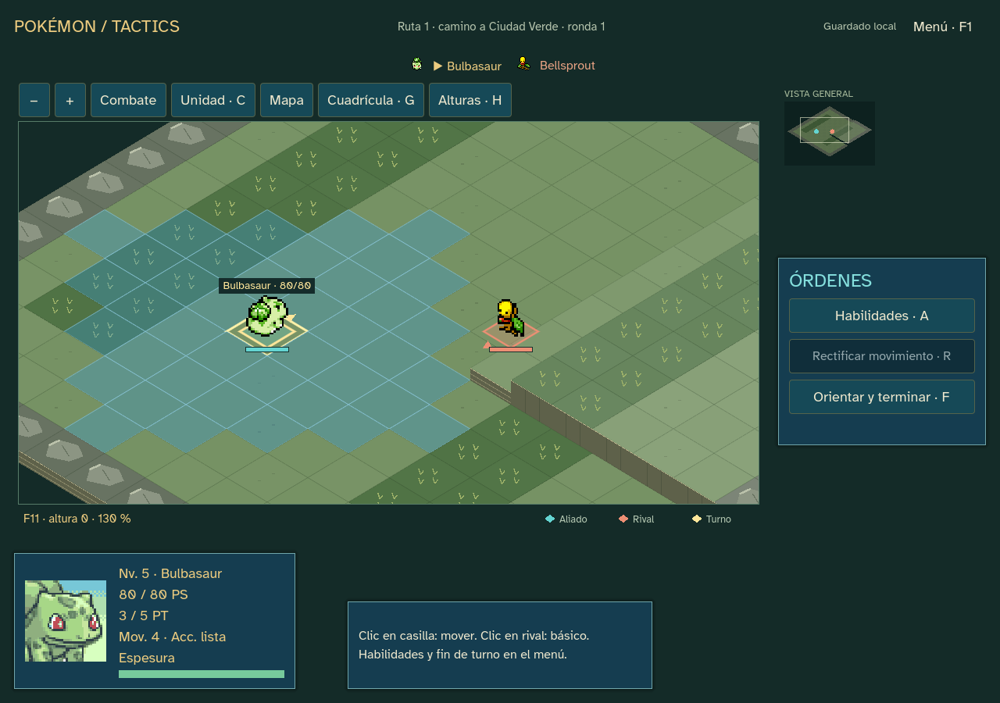
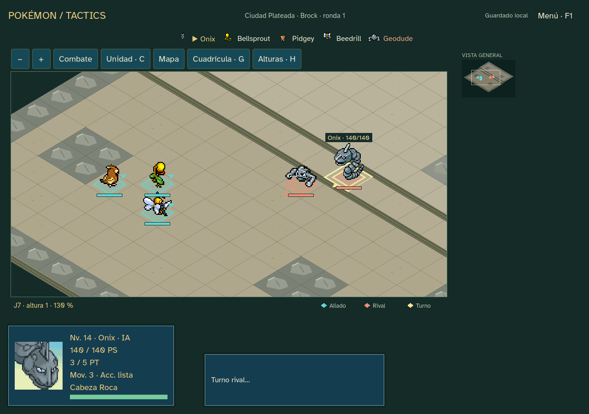

# Vista táctica — revisión 0.15.1

El usuario describe la vista del 15 como rara y confusa. Esta revisión conserva la isometría y corrige presentación y navegación. Continúa la edición 11 y los guardados existentes; no exige empezar otra campaña.

## Cambios visibles

- Proyección algo más elevada: rombos 80×48 y desniveles visuales de 12 unidades. Las alturas lógicas y sus costes no cambian.
- Encuadre inicial del grupo de combate, con zoom adaptado y espacio para los sprites. La cámara deja de centrarse en cada cambio de turno: solo corrige el borde cuando el activo sale del margen seguro. Un encuadre manual se conserva hasta pedir Unidad o Combate.
- Botones **Combate**, **Unidad** y **Mapa**, más zoom. Se retiran las cuatro flechas de cámara; sigue disponible el arrastre con botón central. Volver a Combate recupera el encuadre de los equipos. Las órdenes de cámara devuelven el foco al tablero.
- Caras verticales solamente en los bordes expuestos, sin dibujar una columna completa debajo de cada casilla. Escalones con iluminación y líneas de peldaño, suelo con textura discreta y piedras bajas en lugar de picos repetidos.
- Bases en rombo coherentes con las casillas; aliados turquesa, rivales coral y unidad activa dorada. Leyenda, flecha de orientación y nombre/PS del activo. Las barras e indicadores se dibujan después de los sprites para que no los tapen los vecinos.
- Apoyo de los sprites calculado a partir de sus píxeles visibles. Se ajusta su tamaño y el punto de los pies sin editar las hojas originales. Clic sobre un píxel visible selecciona al Pokémon; las zonas transparentes no capturan clics.
- Minimapa con la misma orientación isométrica y un marco que indica la región visible.
- **Cuadrícula/G** refuerza las líneas y **Alturas/H** muestra etiquetas espaciadas de plataformas elevadas. No se llena el suelo con etiquetas H0. Son ayudas opcionales; la altura del cursor permanece en el pie del tablero.

La vista cenital del laboratorio y de las campañas anteriores conserva su implementación. No se cambian mapas, datos, tablas, reglas, IA, economía o diario de combate. Se reutilizan los recursos locales y sus licencias; no hay nuevas descargas, complementos ni dependencias. El escenario sigue siendo arte provisional.

## Verificación

Evidencia en `docs/qa/sprint-15-view/`, con capturas del encuadre real y de la vista general, ambas separadas en QA.

- `godot:test:scale`: 1.713 comprobaciones sin fallos. Incluye cámara estable al cambiar entre unidades visibles, respeto del encuadre manual, selección, rectificación y replay 1–11. Los dos recorridos naturales completan Brock con los mismos 226 comandos tácticos de 0.15.0; los ocho encuentros de QA mantienen sus resultados.
- `godot:qa:scale`: 980 aserciones, dos campañas completas con 256/257 transacciones. Prueba clic sobre sprites, pies en su casilla, encuadre inicial, guías, movimiento, ataques, rectificación y recarga. Capturas en 1024×720, 1280×900 y 1440×1000.
- `godot:qa`: 1.027 aserciones y 73 órdenes, cuatro batallas del laboratorio con los resultados anteriores.
- Lint antes/después: cero errores/advertencias. Validador Godot: cero errores de carga o configuración, ninguna advertencia en el renderer revisado; se conservan 65 advertencias de estilo heredadas. No se reescriben los motores publicados para silenciarlas.
- Integridad de recursos y fuentes de referencia comprobada. QA usa archivos aislados; no toca campañas reales. Revisión visual de las capturas realizada.

## Entrega

Windows offline 0.15.1, rama `codex/sprint-15-view`. Ejecutable y ZIP fuera del repositorio, con LEEME/créditos/licencias/hashes. Exportación completada: el ejecutable repite las 980 aserciones y ambos recorridos completos, con informe idéntico al de fuente y GODOT_BIN apuntando a un editor inexistente. Se puede abrir la partida 0.15.0 sin reiniciarla. Valoración subjetiva de la vista pendiente del creador; no se inicia el sprint 16 ni se publica el juego.

- Ejecutable: `outputs/releases/pokemon-tactics-0.15.1/windows/PokemonTactics.exe`. SHA256: `cc30e7daf61d74cadd79702393d087a94e3521ddab6430ecd6e99a1d9859dd3d`.
- ZIP: `outputs/releases/pokemon-tactics-0.15.1/pokemon-tactics-0.15.1-windows.zip`, 38862509 bytes. Comprobado con zipfile.testzip y hash del ejecutable interior coincidente. SHA256: `e7764b60cb78993206ec7fc9181ad4ffaee8c4a9d140e60bb7cb50fac7516273`.
