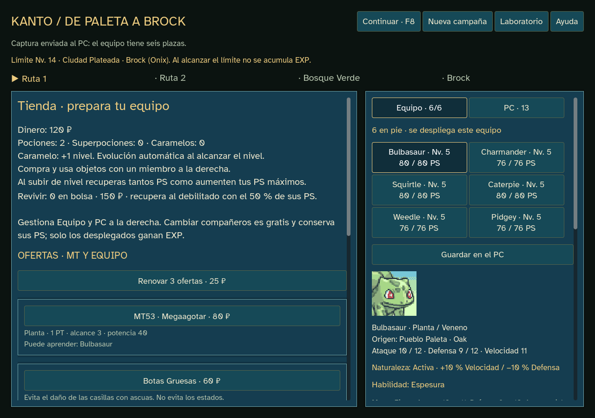
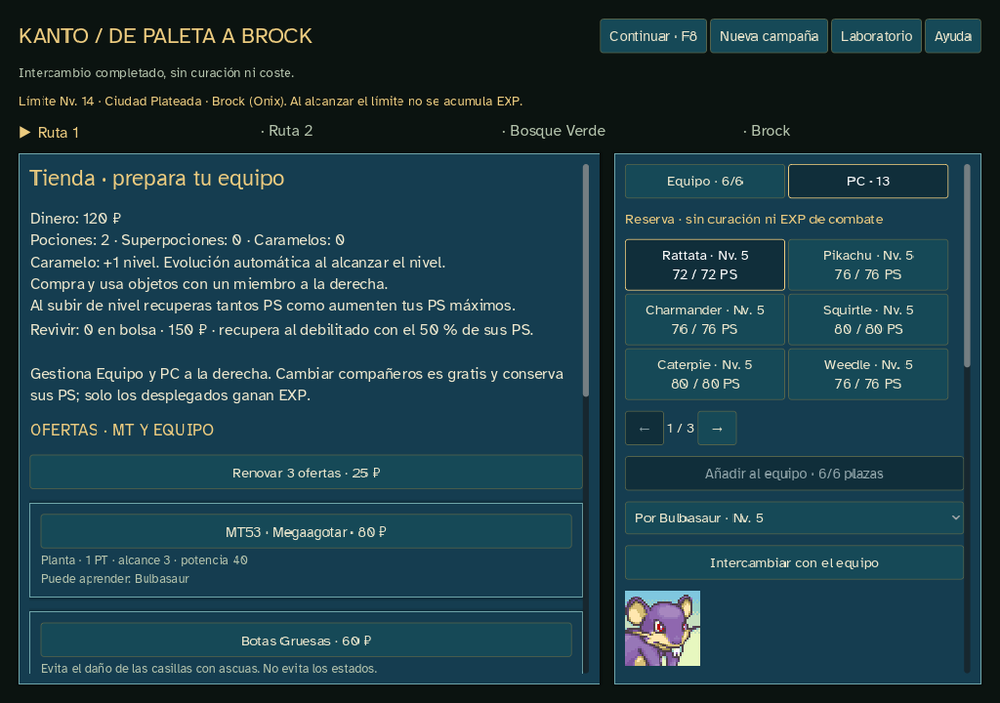

# Sprint 16 — equipo y PC · 0.16.0

Entrega del 19 de octubre de 2026. El usuario autoriza continuar tras la revisión visual del sprint15 y confirma PC sin límite, seis plazas, cambios gratis sin curación y fin de campaña al perder un combate aunque haya reservas vivas.

## Resultado

- Pestañas Equipo/PC dentro del juego, reserva paginada de seis en seis. Guardar, retirar con hueco o intercambiar directamente por una plaza elegida, incluido un equipo lleno.
- Las seis plazas incluyen debilitados. Una captura sobrante va al PC conservando el sorteo ya guardado; no se vuelve a sortear al cargar.
- Cada cambio conserva ID, origen, PS, nivel/EXP, biblioteca y movimientos preparados, naturaleza/menta, habilidad y objeto equipado. Gratis, sin curar ni revivir. Se exige al menos un miembro del equipo en pie.
- PC en mapa, tienda y resumen final; cambios bloqueados en combate, captura pendiente y derrota. Perder termina la campaña aunque queden reservas vivas.
- Las reservas no se despliegan ni reciben EXP de victoria. Preparación, MT, equipables y consumibles usan las mismas reglas y restricciones que el equipo. Las ofertas consideran compatibilidad de todos los poseídos.
- Niveles, cuatro movimientos más básico, roles, evolución automática/piedra, caps, crecimiento de PS, Revivir, naturalezas y habilidades ya adelantados en0.14.1–0.14.9 se conservan. Sin rebalanceo ni especies, rutas, precios o recursos nuevos.

## Guardado y estructura

`roster_run.gd` hereda `scale_run.gd`, añade `reserve` y tres transacciones con revisión. `party` contiene exclusivamente las seis plazas activas. El estado sigue siendo JSON y los cambios se guardan antes de presentar su resultado. RNG de rutas, tienda y combate no se consume al consultar/cambiar el PC.

Edición de campaña12; combate conserva11. `kanto_store.gd` reconstruye cada edición1–12 con su motor. Los guardados anteriores continúan intactos, sin convertirlos. Para activar el PC se inicia **Nueva campaña**, que conserva copia de la anterior. Laboratorio y web mantienen sus contratos. La reserva no modifica el resultado de ninguna orden de combate antigua.

Presentación en `roster_panel.gd`, integrada en el panel de equipo existente. La cámara, tablero y órdenes de combate de0.15.1 se conservan. Reutiliza retratos, sprites, fuente y sonidos locales ya atribuidos; manifiestos y originales sin modificar. Sin plugins, dependencias, servicios ni consultas de red al jugar.

## Comprobaciones

Evidencia en [qa/sprint-16](qa/sprint-16). Los archivos de prueba y guardados temporales están aislados de las partidas reales.

| Comprobación | Resultado |
| --- | --- |
| `godot:test:roster` | 418 comprobaciones, sin fallos; recorrido natural de cuatro encuentros,258 transacciones y checkpoints de depósito/intercambio/retirada reconstruidos exactamente |
| `godot:qa:roster` | 540 aserciones, sin fallos; recorrido por controles hasta Brock, PC no vacío cargado, intercambio por plaza elegida, páginas y capturas a1280/1024 |
| `godot:qa:roster:export` | Mismas540 aserciones y reporte idéntico en el ejecutable con `GODOT_BIN` apuntando a un editor inexistente |
| `godot:test:scale` | 1713 comprobaciones antes de editar; regla11 conservada |
| `godot:qa:scale` | 980 aserciones sin fallos; ambos tamaños completan cuatro zonas con reglas11 y la presentación compartida |
| `godot:qa` | 1027 aserciones,73 órdenes de jugador; cuatro batallas del laboratorio con resultados esperados y guardado independiente |
| Validación Godot | Sin errores de carga, configuración o sintaxis.65 advertencias de estilo preexistentes; ninguna en los módulos nuevos |
| Recursos | Todos los hashes de referencias, imágenes, sonidos, fuente y datos verificados; originales sin cambiar |

La muestra llega naturalmente a cinco miembros contando el inicial y Onix. El envío de una séptima captura, seis desplegados, PC de100 miembros, reserva paginada y derrota con supervivientes en PC son **escenarios controlados**, no capturas obtenidas jugando el tramo actual ni cifras de balance. Los recorridos automáticos no sustituyen la valoración humana de diversión y dificultad.

## Entrega y siguiente bloque

Ejecutable offline Windows x86_64 y ZIP en `outputs/releases/pokemon-tactics-0.16.0`, fuera de Git. Créditos/licencias y comprobantes SHA256 acompañan al paquete. Código subido al repositorio privado; sin publicación pública ni cambio de rama predeterminada.

El sprint17 ampliará el recorrido hacia Celeste y Carmín: Monte Moon, rutas del tramo, Bill, Misty, S. S. Anne, Lt. Surge y rival, con nuevas capturas y continuidad de campaña. Ese contenido no se inicia en esta entrega.
