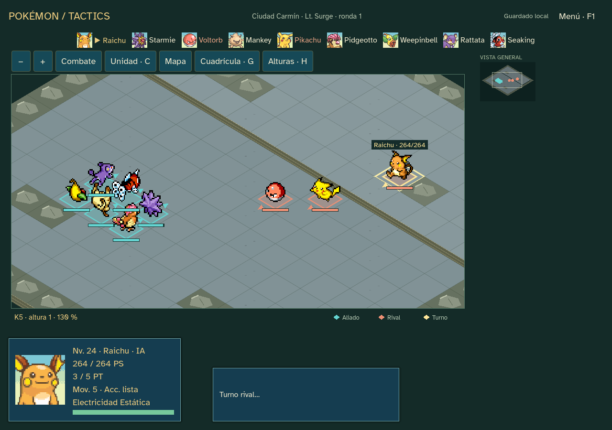

# Sprint17 — Celeste y Carmín ·0.17.0

El encargo «continua con todo» del19 de octubre de2026 autoriza cerrar17–22 en entregas separadas. Este bloque amplía Kanto hasta Lt. Surge y prepara un catálogo común para los siguientes tramos. No publica el juego en Internet.

## Contenido y reglas

18 encuentros disponibles: los cuatro de Paleta–Brock, rutas3/4, Monte Moon, rival de Celeste, rutas24/25/Bill, Misty, rutas5/6, S. S. Anne/rival/capitán, Surge y desvíos de Ruta11, Cueva Diglett y Ruta22. Orden y requisitos por datos; un premio por encuentro, sin revisitas para farmear. Bill entrega billete, el barco habilita Corte y los gimnasios medallas. Las MO no ocupan movimientos tácticos. Las escenas y puzzles se resumen narrativamente.

Entrenadores/niveles contrastados con los [datos de Rojo de pret/pokered](https://github.com/pret/pokered/blob/af519899719f0754965776faac0e836a3b906e6d/data/trainers/parties.asm). Salvajes y repertorios siguen la unión de Let’s Go mediante [CSV de PokéAPI fijados](https://github.com/PokeAPI/pokeapi/blob/81d20919845b6a445969b9265aab5cec6b04cece/data/v2/csv/encounters.csv). Se excluyen formas regionales, apariciones aéreas posjuego y legendarios de las capturas. Los pesos normales son equiprobables y los especiales1%: decisiones tácticas, no porcentajes del cartucho. Los gimnasios conceden su insignia de mayor nivel más medalla/dinero.

Mapas por bioma,16/24, alturas y hasta seis enemigos, con incorporaciones tardías. Se conserva el arranque de velocidad/TP/identidades y el vigía del bosque. No se modifican fórmulas de daño, bandas de orientación, precisión, stats base ni las ediciones antiguas. Nuevas zonas tienen EXP/dinero declarados en su snapshot. Los primeros cuatro conservan EXP220/350/500/650 y150 ₽. Cap14/21/24 en este tramo.

Piedras y Cable Vínculo80 ₽, elección de Eevee y conservación de Pikachu20/Graveler36. Evolucionar con objeto no cura ni revive. Hiperpoción120 ₽/+200 PS y Poción Máxima200 ₽/todos los PS, solo tienda; se mantienen Caramelo25, Revivir150/50% y ausencia de curación gratuita. Precios provisionales. PC y derrota con reservas sin cambios.

## Recursos y efectos

151 especies de catálogo,79 familias y211 movimientos; no todas las especies se capturan en este tramo.119 incorporaciones con sprites/retratos originales de [SpriteCollab fijado](https://github.com/PMDCollab/SpriteCollab/tree/6ad5f1c6229af6b055de2c64442e5e508664290c), autores individuales y717 archivos registrados en expedition-provenance. Reutiliza fuente, sonidos, importadores y adaptadores existentes. No modifica originales ni manifiestos publicados y no consulta APIs al jugar. Sin plugins o dependencias nuevas.

Amplía a78 habilidades normales,49 con efectos en este formato. Incluye absorciones, Levitación, Intimidación, inmunidades, Armaduras, Experto, Encadenado, No Guard, Rompemoldes y Presión. Las29 restantes se muestran como pendientes/sin condiciones aplicables; clima, huida, género y otras interacciones no se presentan como implementadas. Las adaptaciones se describen en ficha: por ejemplo, Absorbe Fuego da +1 Ataque especial temporal y Efecto Espora usa sueño. No son réplicas exactas de todas las pasivas oficiales.

Recuperación/Amortiguador curan mitad por3 PT; Descanso cura todo y duerme3 activaciones por4 PT; Transformación conserva PS/identidad y copia temporalmente forma/tipos/atributos/movimientos/habilidad. Los movimientos de KO directo se adaptan a golpes de potencia100/5 PT con su precisión. Algunos efectos complejos se traducen a protección/apoyo y lo indican expresamente. No se promete paridad completa con un cartucho.

## Continuación y comprobaciones

Nueva edición13, esquema kanto-journey. **Continuar aventura · ampliar Kanto** adopta campañas12 desde mapa, tienda o final, conservando una copia y el diario. El replay usa el motor anterior hasta la transición registrada; no transforma un combate en curso ni rescata una derrota. Los guardados1–12 siguen cargándose con sus reglas. Diario ampliado a50000 órdenes; no se regeneran capturas al cargar.

| Comprobación | Resultado |
| --- | --- |
| Catálogo/rutas/primer combate |1192 comprobaciones, sin fallos |
| Habilidades y adaptaciones |16 casos dirigidos, sin fallos; inmunidad/absorción, crítico, No Guard, Descanso, Transformación, Humedad y Presión |
| Recorrido y transición |3547 comprobaciones, sin fallos;18 encuentros tanto desde nueva campaña como desde12;1563/1572 transacciones, tres medallas y13 reservas |
| UI de fuente |3134 aserciones,18 encuentros,1563 transacciones; carga exacta y capturas de gimnasios |
| UI ejecutable |Mismo reporte3134,18 encuentros y1563 transacciones con editor inexistente; sin fallos |
| Regresión12 |418 reglas y540 UI, sin fallos |
| Regresión11 |1713 comprobaciones; ambos tamaños conservados |
| Recursos |Manifiestos nuevos y todas las referencias congeladas verificados |

Se corrigió la selección de casillas vacías que quedaban cubiertas por un sprite alto. La prioridad en el centro de una casilla alcanzable se aplica a la expansión; no modifica reglas/RNG. Retratos de la cola y sprites nuevos comprobados en la UI. Las simulaciones usan una política automática con compras/preparación y no representan dificultad humana ni diversión.

Validación completa:65 advertencias de estilo preexistentes, sin errores ni advertencias nuevas; lint sin incidencias.

Evidencia y reporte de ejecutable en [qa/sprint-17](qa/sprint-17). Paquete Windows offline0.17.0 en outputs/releases, fuera de Git, con créditos y SHA256. Arte de terreno provisional y balance humano pendientes. La entrega18 continúa hacia Lavanda/Azulona/Rocket; el encargo completo sigue activo.

