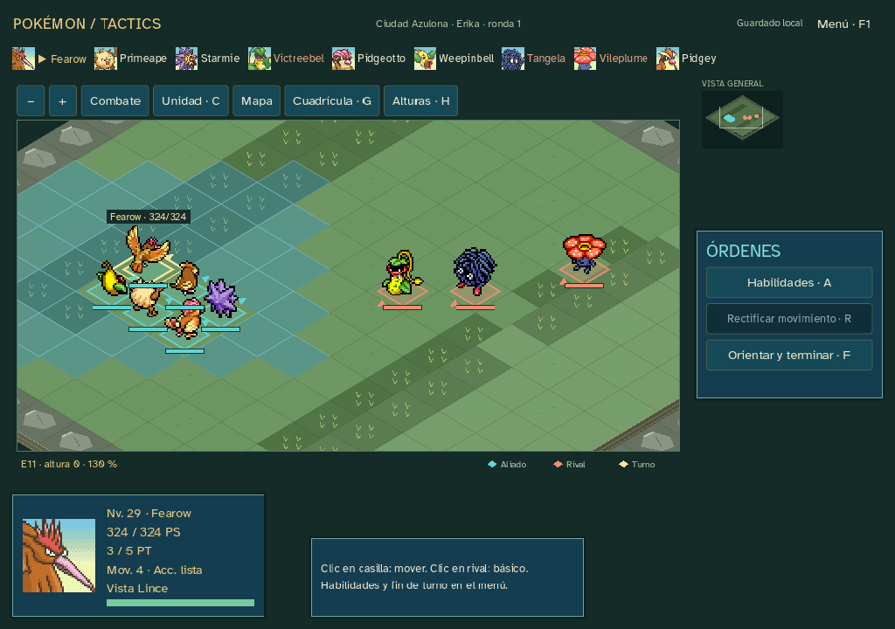

# Sprint18 — Lavanda, Azulona y Team Rocket ·0.18.0

Diez encuentros nuevos,28 en total: rutas9/10, Túnel Roca, rutas8/7, Erika, Giovanni del Casino, rival de la Torre, espíritus y rescate de Fuji. Scope Silph habilita los fantasmas y la Poké Flauta abre el siguiente tramo. Erika concede Vileplume29 como insignia; las otras capturas proceden de la tabla local indicada. Agua Fresca resume el acceso original a Azafrán.

Equipos de Rojo y tablas/repertorios combinados de Let’s Go reutilizan las fuentes fijadas en [SPRINT_17](SPRINT_17.md). El grupo Rocket de Fuji combina dos grupos de la torre; el espíritu de Marowak y los puzzles se resumen narrativamente. No se presenta como reproducción completa del cartucho. Snapshot journey-18 y manifiesto propios; sin recursos nuevos ni cambios de daño, estadísticas o economía publicada.

Edición14 con transición explícita desde13, copia y diario conservados. La cola de iniciativa se desplaza horizontalmente para caber en pantallas pequeñas; el tablero mantiene espacio para las órdenes dentro de la escena. Comprobado a1024×720.

5140 comprobaciones de recorrido/transición sin fallos: campaña nueva28 encuentros/3094 órdenes y continuación natural de17 con2870 órdenes, cuatro medallas y23 reservas. Pruebas negativas de billete, Scope, revisitas y persistencia de hitos. Fuente y ejecutable producen el mismo informe de6200 aserciones, con carga exacta. Ejecutable probado con ruta de editor inexistente. Manifiestos verificados; lint sin incidencias y validación sin errores ni nuevas advertencias (65 de estilo ya existentes).

Paquete Windows offline0.18.0 preparado fuera de Git; hashes y evidencia en [qa/sprint-18](qa/sprint-18). Simulación automática no equivale a balance o diversión humana. Publicación pública aplazada; continúa el encargo19–22.

