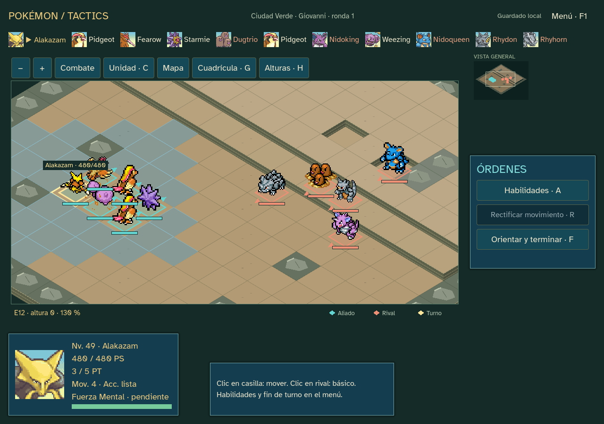

# Sprint19 — Fucsia, Azafrán y sur de Kanto ·0.19.0

20 lugares nuevos: rutas12–18, Safari, Koga, Silph/rival/Giovanni, Sabrina, rutas19/20/21, Islas Espuma, Mansión, Blaine, Giovanni del gimnasio y Central. Dos caminos alternativos a Fucsia y dos accesos marítimos a Canela; ambos siguen disponibles como desvíos. No se exige recorrer las dos alternativas para acabar la historia.

Safari es una visita narrativa: concede Surf y Fuerza, sin combate, captura ni curación. Let’s Go carece de una tabla salvaje Safari y no se inventa una. Las MO abren caminos sin ocupar movimientos. Agua Fresca permite entrar en Azafrán; la llave de la Mansión habilita a Blaine y siete medallas habilitan a Giovanni. Se conservan los equipos y niveles de Rojo. Premios insignia: Weezing43, Alakazam43, Arcanine47 y Rhydon50. Edición15, snapshot19 y manifiesto propios.

La transición desde un tramo completado ofrece una parada de tienda antes de entrar en encuentros más fuertes; conserva PS/dinero, sin recuperación gratuita. Pruebas negativas para bloqueos, ambas rutas a Safari, visita sin premio falso y ocho medallas. Se detectó y corrigió la falta de preparación al continuar desde18 antes de cerrar la entrega.

## Comprobaciones y entrega

11613 comprobaciones de recorrido/transición sin fallos. Campaña nueva: 48 lugares, 6263 órdenes y 8 medallas. Continuación del capítulo anterior: 48 lugares y 6187 órdenes, con carga exacta. Fuente y ejecutable producen el mismo informe de 12544 aserciones, sin fallos; el ejecutable se prueba con ruta de editor inexistente. Evidencia en [qa/sprint-19](qa/sprint-19).

Reutiliza catálogo, fuente, sprites, retratos y audio locales con sus créditos y hashes; fuentes factuales fijadas en [SPRINT_17](SPRINT_17.md). No se descargan recursos al jugar ni se añaden plugins. Manifiestos verificados; lint sin incidencias y validación sin errores ni advertencias nuevas (65 de estilo preexistentes). Efectos complejos y habilidades pendientes siguen identificados en ficha.

Paquete Windows offline0.19.0 preparado fuera de Git, con créditos y SHA256. Las simulaciones no acreditan dificultad humana ni diversión. Terreno provisional y pruebas humanas pendientes; publicación pública aplazada. Continúa el encargo hasta22.

