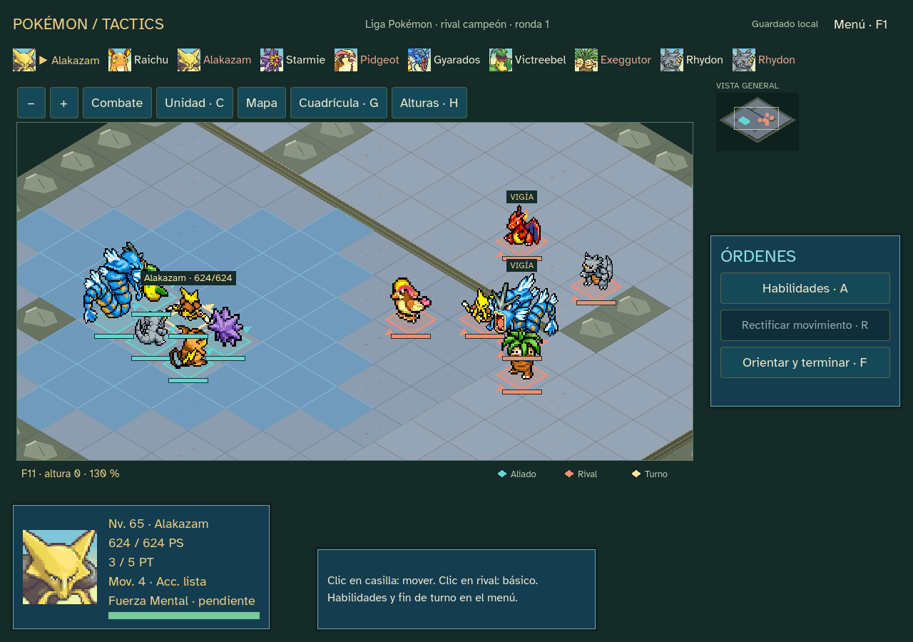

# Sprint20 — Liga y rival ·0.20.0

Ocho encuentros nuevos: rival de Ruta22, Ruta23, Calle Victoria, Lorelei, Bruno, Agatha, Lance y rival campeón. Las ocho medallas habilitan el último reto del rival; Surf/Fuerza permiten atravesar Calle Victoria. Los equipos/niveles y el inicial rival se obtienen de los datos fijados de Rojo.

La Liga tiene captura de la zona de acceso Calle Victoria y tienda después de cada combate; no concede curación gratuita. Es una adaptación de campaña táctica expresamente indicada, no una reproducción del edificio original. Perder sigue terminando la partida. Tras ocho gimnasios el cap es65; al vencer al campeón queda75 para el postgame. El Hall de la Fama se guarda y conserva equipo/PC/diario. Edición16, snapshot20 y transición desde15 con preparación.

El recorrido nuevo completa toda la campaña desde Oak. La continuación de una partida anterior también se reconstruye exactamente, aunque su estrategia pierde ante el campeón; se conserva esa derrota en la evidencia. Los diarios superan4000 órdenes. La UI conduce la Liga desde un checkpoint natural de la campaña nueva, sin modificar estadísticas, dinero o capturas. Se revisó la preparación del equipo automático: seis miembros, cobertura de tipos, Revivir del PC y curación; no se retocó el combate para garantizar victorias.

## Comprobaciones y entrega

12273 comprobaciones de recorrido/transición sin fallos de reglas/replay. Campaña nueva: 56 lugares, 8480 órdenes y 8 medallas, estado final complete. Continuación del capítulo anterior: 55 lugares y 7914 órdenes, estado defeat, con carga exacta. Una derrota válida se conserva como derrota: la transición no garantiza ganar. Fuente y ejecutable producen el mismo informe de 4009 aserciones, sin fallos de integración; el ejecutable se prueba con ruta de editor inexistente. La UI conduce 10 combates desde el origen indicado en su informe (natural-current-before-league). Evidencia en [qa/sprint-20](qa/sprint-20).

Reutiliza catálogo, fuente, sprites, retratos y audio locales con sus créditos y hashes; fuentes factuales fijadas en [SPRINT_17](SPRINT_17.md). No se descargan recursos al jugar ni se añaden plugins. Manifiestos verificados; lint sin incidencias y validación sin errores ni advertencias nuevas (65 de estilo preexistentes). Efectos complejos y habilidades pendientes siguen identificados en ficha.

Paquete Windows offline0.20.0 preparado fuera de Git, con créditos y SHA256. Las simulaciones no acreditan dificultad humana ni diversión. Terreno provisional y pruebas humanas pendientes; publicación pública aplazada. Continúa el encargo hasta22.

