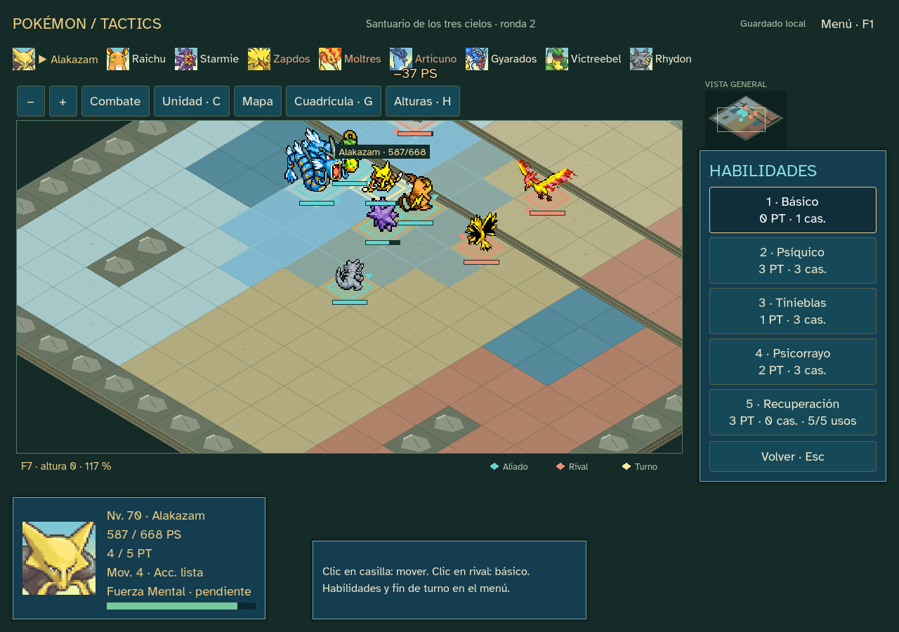
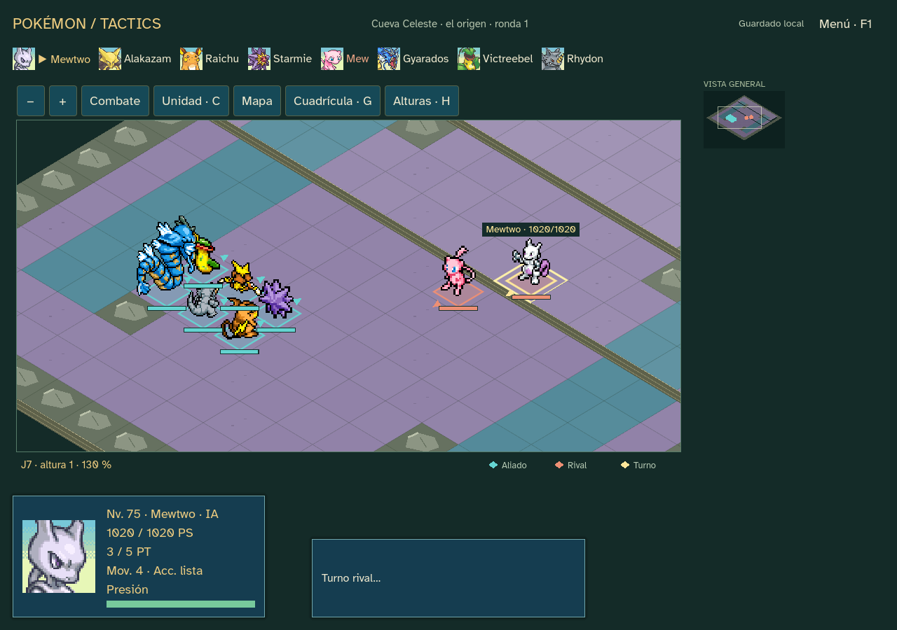

# Sprint21 — Finales legendarios ·0.21.0

Dos finales excluyentes después de la Liga: las tres aves juntas al70 o Mew/Mewtwo juntos al75. Los escenarios tienen geometría, colores y alturas propios; son desafíos alternativos originales inspirados en Kanto, no encuentros que existieran así en Rojo. Nunca conceden captura legendaria ni mítica.

La elección queda guardada y no puede cambiarse. El básico neutro se mantiene gratuito incluso frente a Presión; los movimientos preparados siguen pagando +1 PT. Se conserva el motor anterior para los diarios ya publicados y se usa el motor de final en nuevas partidas/tras transición. Edición17 y snapshot21; sin cambios globales de potencia, precisión o economía. Respiro, Recuperación, Amortiguador y Descanso disponen de cinco usos por combate, conservando sus costes de PT. El menú muestra los usos restantes y bloquea el sexto; las rondas no los restablecen. Se añade esta reserva para evitar curaciones infinitas con PT regenerables: el ensayo de las aves pasaba de84 rondas antes del límite y terminó en26 al aplicarlo. Es una regla táctica provisional, no una reproducción de todos los PP del cartucho. Las ediciones anteriores conservan su recuperación publicada.

## Comprobaciones y entrega

10729 comprobaciones de recorrido/transición sin fallos de reglas/replay. Campaña nueva: 55 lugares, 8459 órdenes y 8 medallas, estado final ending. Continuación del capítulo anterior: 57 lugares y 8924 órdenes, estado ending, con carga exacta. Una derrota válida se conserva como derrota: la transición no garantiza ganar. Fuente y ejecutable producen el mismo informe de 895 aserciones, sin fallos de integración; el ejecutable se prueba con ruta de editor inexistente. La UI conduce 1 combates desde el origen indicado en su informe (continued-previous). Evidencia en [qa/sprint-21](qa/sprint-21).

Reutiliza catálogo, fuente, sprites, retratos y audio locales con sus créditos y hashes; fuentes factuales fijadas en [SPRINT_17](SPRINT_17.md). No se descargan recursos al jugar ni se añaden plugins. Manifiestos verificados; lint sin incidencias y validación sin errores ni advertencias nuevas (65 de estilo preexistentes). Efectos complejos y habilidades pendientes siguen identificados en ficha.

Paquete Windows offline0.21.0 preparado fuera de Git, con créditos y SHA256. Las simulaciones no acreditan dificultad humana ni diversión. Terreno provisional y pruebas humanas pendientes; publicación pública aplazada. Continúa el encargo hasta22.

## Dos finales comprobados

Las 45 pruebas específicas verifican elección excluyente, cuatro movimientos legales por jefe, mapa distinto, básico gratuito ante Presión y cinco recuperaciones finitas. La fuente y el ejecutable coinciden en ambos recorridos: aves895 aserciones/8924 órdenes y origen439/8697. Ambos parten del mismo guardado real de campeón0.20, conservando una copia antes de actualizar. El resultado final no permite volver a elegir destino ni reclamar un legendario.

