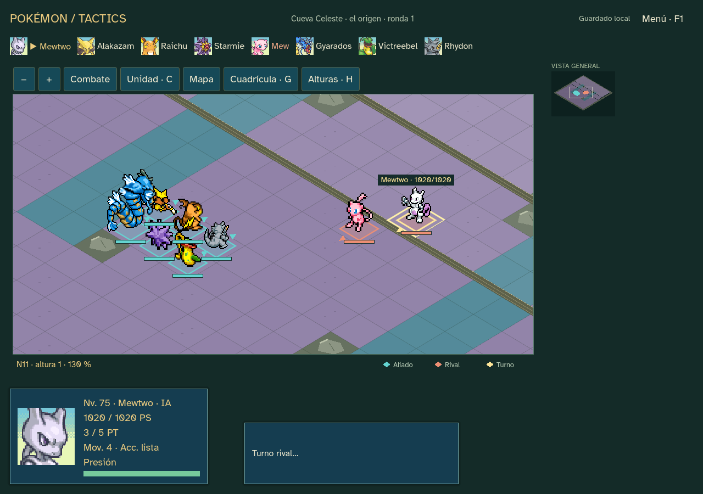
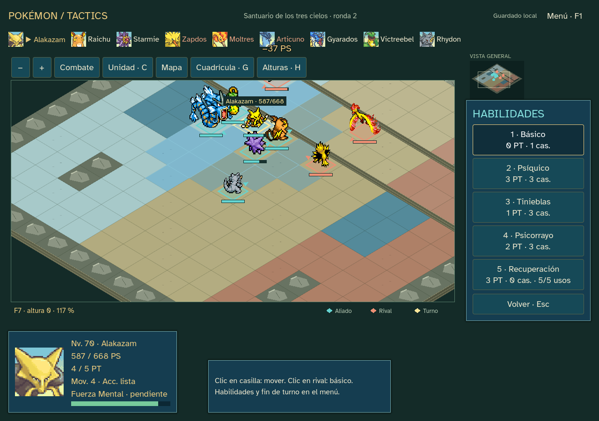

# Sprint 22 — balance y distribución ·0.22.0

Entrega técnica de la campaña nativa: Kanto, ocho gimnasios, Liga/rival y dos finales legendarios excluyentes. Ejecutable Windows offline preparado con guía, informe de balance, créditos, licencias y sumas SHA256. **Pruebas humanas y publicación pública pendientes**, por decisión del usuario. No se afirma acabado visual definitivo ni dificultad validada por personas.

## Cambios de cierre

Edición 18 de campaña; combate 17 y snapshot 21 conservados. Permite actualizar una aventura ya terminada desde el botón «Actualizar versión · conservar final», con copia previa. No reabre el desenlace, ni permite repetir capturas, ni cambia equipo, dinero o RNG. Guardados anteriores siguen reconstruyéndose con su motor publicado; una batalla pendiente no cambia de edición.

El guardado rechaza escrituras mayores de 16 MB, igual que la lectura, antes de tocar el archivo. Detecta otra instancia, conserva copia y rechaza historiales inválidos/ediciones futuras. Los JSON truncados producen un aviso controlado y se conservan. Se corrige la alineación visual de los tres territorios de aves al ampliar a 24×24; no cambia geometría ni reglas.

No se retocan daño general, precisión, niveles, economía o tablas para mejorar resultados de las simulaciones. Continúa la reserva de cinco usos de recuperación del sprint 21. Reutiliza los recursos originales locales; sin plugins, servicios ni descargas al jugar.

## Comprobaciones ejecutadas

| Comprobación | Resultado |
| --- | --- |
| Recorrido nuevo desde Oak y transición desde final 21 | 10054 comprobaciones, sin fallos; ocho medallas y final guardado/reconstruido. |
| Guardado, conflictos, límites, final y paleta 16/24 | 22 comprobaciones, sin fallos. |
| Catálogo Kanto | 1292 comprobaciones; 151 especies/79 familias/211 movimientos, 49 de 78 habilidades normales activas. |
| Finales y recuperación finita | 45 comprobaciones, sin fallos. |
| Regresión de PC y escala | 418 y 1713 comprobaciones, sin fallos. |
| Paridad del laboratorio original | 503579 comparaciones; 16 combates/506 órdenes/25 escenarios, sin fallos. |
| UI fuente y ejecutable: aves 16×16 | 898 aserciones idénticas; 8924 órdenes acumuladas. Incluye actualizar un final previo mediante botón. |
| UI fuente y ejecutable: origen 24×24 | 510 aserciones idénticas; 7396 órdenes acumuladas, desde checkpoint natural de campeón 24 de la campaña nueva. |
| Validación del proyecto y recursos | Sin errores; 65 advertencias de estilo preexistentes, ninguna nueva. Lint limpio. Manifiestos originales verificados. |

Los ensayos de UI conducen el último combate desde guardados naturales, no una campaña entera desde cero mediante clics en cada versión. El recorrido de dominio sí empieza en Oak. Cada orden de UI se compara con su resultado canónico y la partida completa se vuelve a cargar. El ejecutable se comprueba con GODOT_BIN apuntando a una ruta inexistente; no utiliza el editor durante la partida. La comprobación de código confirma ausencia de servicios de red en el juego nativo; no se afirma haber probado hardware distinto o haber desinstalado Godot de este equipo.

## Balance y prueba siguiente

Se ejecutan 29 simulaciones: 24 aperturas emparejadas por semilla y cinco recorridos extendidos. El bot gana a Brock con Bulbasaur 4/8, Charmander 0/8 y Squirtle 0/8. La estrategia no compra niveles ni prepara movimientos nuevos en las cuatro primeras zonas, por lo que estas cifras no equivalen a dificultad humana. Los tres recorridos extendidos con Bulbasaur completan aves 16, origen 16 y origen 24; los otros iniciales pierden pronto. Se conservan todas las derrotas, compras y semillas.

En 165 combates extendidos registrados: mediana 7 rondas, máximo 26; básico 13,6% de las órdenes aliadas de ataque/apoyo. La primera prueba humana debe comparar iniciales y primer reclutamiento, tiempo de tienda y peleas de recuperación. Ver [informe completo y propuestas](reports/balance-native-0.22/INFORME.md) y [guía Windows](PLAYTEST_WINDOWS.md). Las propuestas no se aplican automáticamente.

## Paquete

ZIP: pokemon-tactics-0.22.0-windows.zip · SHA256 `f16da38ce17e447680fa9f4259aa1ae1850b767a4cd8dd3b70ff7c7663e8c4a6`.

Ejecutable: PokemonTactics.exe · SHA256 `747fb439031b12e66c58986bc82b2ab599bb7f7ca7560bfcc8dc18047b793d83`.

Paquete fuera de Git en outputs/releases/pokemon-tactics-0.22.0; código e informes en la rama privada codex/sprint-22. La integridad del ZIP y la coincidencia de ambos finales se comprueban antes de empaquetar. Guardados humanos sin tocar. Las 29 habilidades pendientes, el arte de terreno provisional y las pruebas humanas quedan registrados como límites; no impiden probar esta entrega local.

