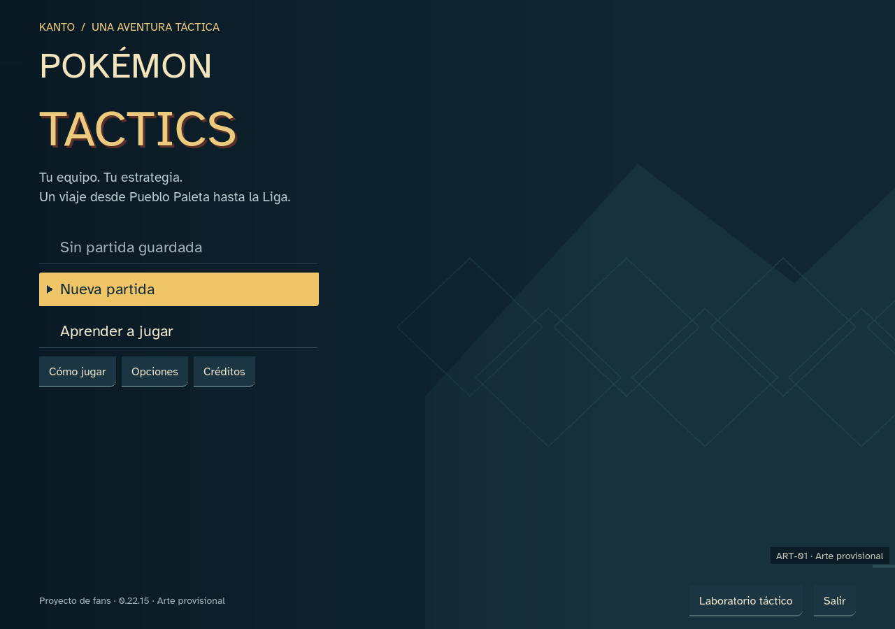
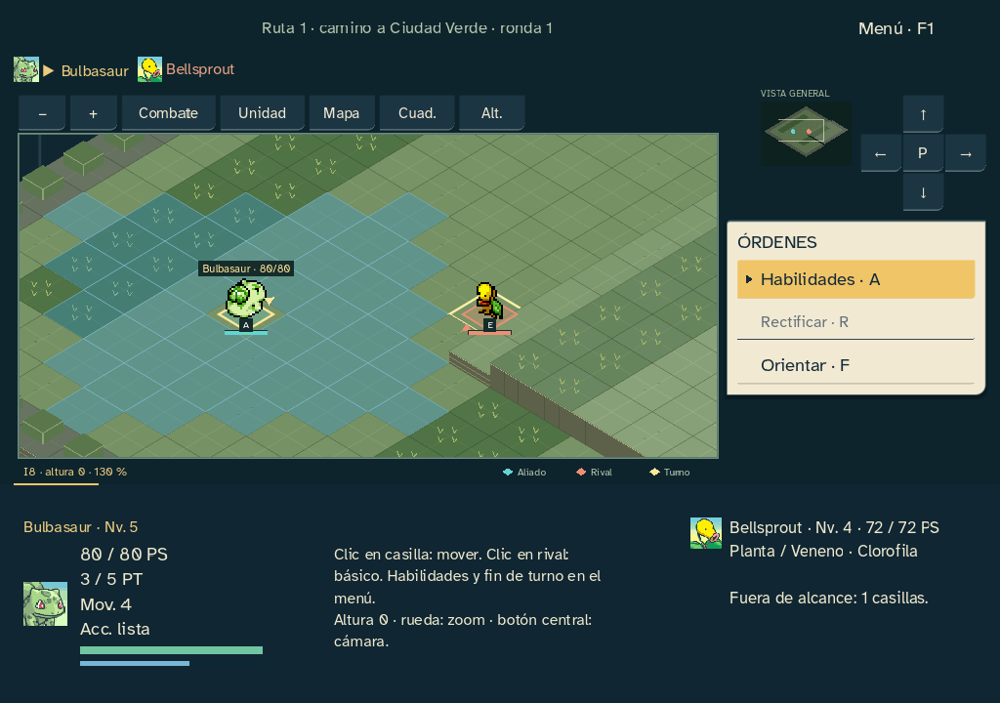
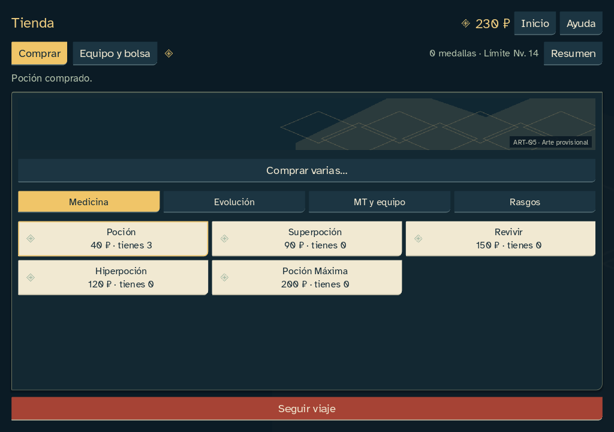

# Dirección visual y arte sustituible · 0.22.15

Petición del 22 de octubre: dar al juego una dirección profesional y preparar imágenes provisionales con prompts para producir el arte definitivo después. Se entrega un candidato visual Windows offline. No se ha ejecutado un generador de imágenes.

## Implementación

- Dirección Cuaderno de Kanto: tinta, papel y ámbar; marcos más contenidos, escenarios decorativos y controles reales. Se conserva la simplificación de hub y tienda anterior.
- 45 slots con placeholders originales identificados, de los que 42 pertenecen al juego y 3 son promoción opcional. Portada, emblema/icono Windows, escenas, 13 familias de suelo, obstáculos, efectos e iconos. Sprites, retratos PMD, fuente y sonidos existentes intactos.
- Registro de recursos con caché y sustitución automática por PNG válidos. Las imágenes inválidas o ausentes conservan su placeholder. El arte no consulta ni consume azar.
- Portada con zona segura para menú; franjas de escena en el viaje/tienda; iconos en compras; suelos/obstáculos conectados al dibujado conservado del tablero; efectos conectados a recibos reales. Se mantienen geometría 5:3, alturas, contornos tácticos y movimiento reducido.
- Documento de dirección, 45 prompts completos y herramienta de instalación/validación sin dependencias nuevas. El paquete incluye la carpeta ARTE con prompts, contratos, placeholders y estado de producción.
- Metadatos e icono de Windows propios de esta versión. El icono sigue siendo provisional y se reemplaza al instalar el emblema final.

Campaña 18/combate 17, core/data/snapshots, precios, IA, progresión, guardados y web 0.12 congelados. No se han generado ilustraciones finales ni descargado recursos nuevos.

## Comprobación

Doce baterías completadas en fuente y EXE, sin fallos finales. Los informes deterministas coinciden; los tiempos de rendimiento varían. Se compararon estados y diarios completos de ambos finales, PC y laboratorio. Ambos finales conservan exactamente los 8924/7396 comandos y estados de referencia 0.22.3.

| Batería | Fuente | EXE | Resultado |
|---|---:|---:|---|
|Inicio y ventanas|357|357|Sin fallos|
|Entrada y foco|63|63|Sin fallos|
|Preferencias y gestión|192|192|Sin fallos|
|Turno contextual|96|96|Sin fallos|
|Rendimiento|18|18|Sin fallos|
|PC|543|543|Sin fallos|
|Mapas y alturas|980|980|Sin fallos|
|Laboratorio|1041|1041|Sin fallos|
|Final aves16|901|901|Sin fallos|
|Final psíquico24|513|513|Sin fallos|
|Semántica nativa|8|8|Sin fallos|
|Semillas|920|920|Sin fallos|

Comprobaciones adicionales: preferencias 22, cantidades 44 y herramienta de arte 7 pruebas. Lint sin incidencias; validación del motor: 0 errores y 65 advertencias preexistentes, ninguna nueva. Recursos originales y hashes verificados. El EXE se probó con una ruta de editor inexistente y perfiles aislados; no se usaron partidas reales.

Los 45 contratos se cargan como texturas nativas; se prueba la caché y la sustitución, incluidos tamaño final incorrecto y alfa completamente opaco. PNG corrupto, dimensiones, transparencia, máscara de suelo y copia de reemplazo tienen pruebas. El verificador estricto falla de forma esperada con 42 imágenes de juego pendientes. No se ha ejecutado generación de imágenes.

Matriz visual de combate: 1024×720, 1280×900 y 1920×1080, con texto 100/125/150 %. Hub y fichas: 1024×720 y 1280×900. Alto contraste, movimiento reducido, teclado y ratón conservados.

Evidencias: `docs/qa/sprint-22-updates-15/`.

## Estado de publicación

Este paquete permite jugar y revisar la dirección, con los huecos de arte ya conectados. **El arte nuevo sigue provisional por petición del usuario**: faltan 42 imágenes requeridas; los 3 encargos de promoción son opcionales. El verificador estricto informa del estado pendiente del arte. Las pruebas humanas y la publicación pública continúan pendientes. No se presenta esta entrega como una versión con ilustraciones terminadas.

[Prompts completos](PROMPTS_ARTE_FINAL.md) · [Dirección y contratos](DIRECCION_ARTISTICA.md).
