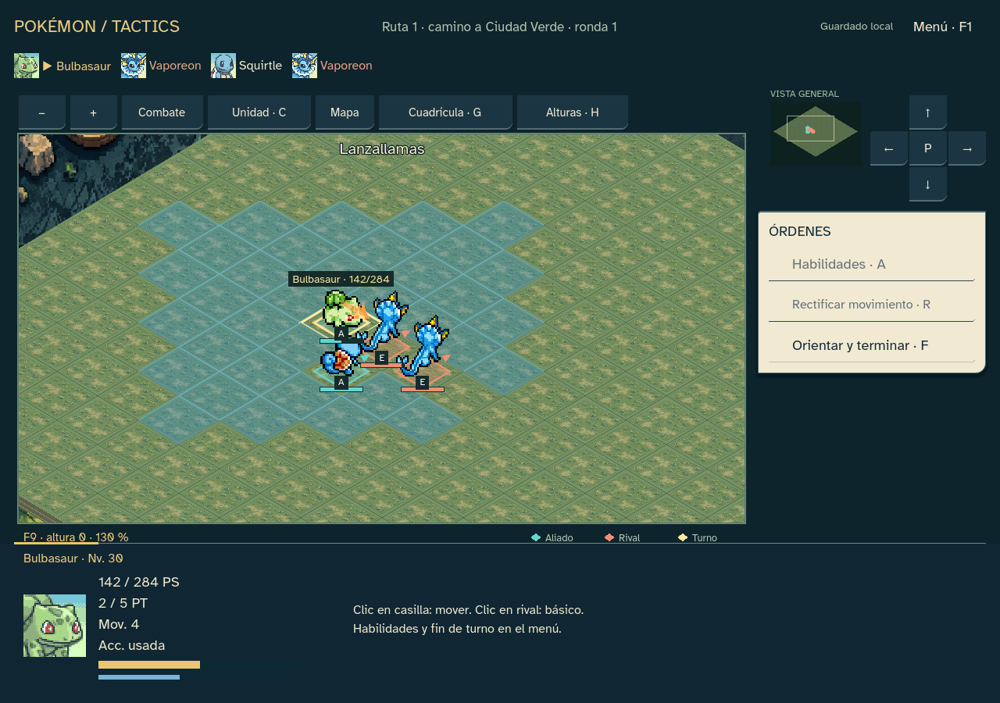
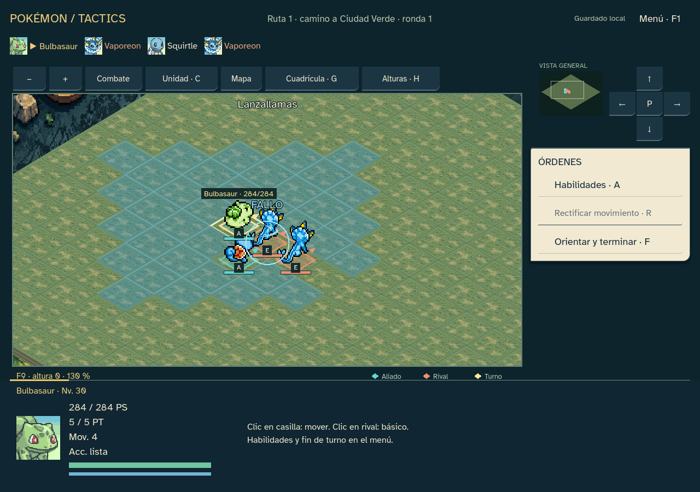

# Animaciones de ataques y sonido · 0.22.17

Trabajo iniciado el 23 y cerrado el 24 de octubre de 2026. Presentación de combate para el ejecutable Windows: preparación, lanzamiento e impacto, con sonidos sincronizados y variantes según tipo, movimiento y resultado.

## Cambios

- Familias de animación: golpe, corte, proyectil, rayo, onda de área, apoyo y curación/protección. Los 18 tipos aportan colores y motivos: llamas, gotas, relámpagos, hojas, cristales, ondas y símbolos. Los movimientos usan familias compartidas; no son 211 animaciones dibujadas individualmente.
- Nombre del movimiento sobre el tablero, pequeña anticipación del atacante y reacción del objetivo. Las cifras del resultado aparecen al llegar el impacto. Aproximaciones y empujes interpolan posiciones visuales sin modificar las casillas reales.
- Críticos, fallos, inmunidades, curación, mejoras, bajadas y protección tienen señales diferentes. Un ataque de área conserva el resultado de cada objetivo y emite un único sonido de impacto prioritario.
- 26 WAV nuevos, sintetizados sin conexión con la copia de jsfxr que ya utilizaba el proyecto. PCM mono de 16 bits y 44,1 kHz, duraciones de 0,05–0,39 segundos, techo de pico de 0,2 y entradas/salidas suavizadas. Manifest con parámetros, procedencia y hashes en `godot/assets/combat/manifest.json`.
- Cuatro voces reutilizables; ninguna carga de sonido al dibujar. Volumen cero y silencio detienen la reproducción. Las opciones existentes controlan también los sonidos nuevos.
- Secuencias de hasta 0,64 segundos; el movimiento reducido muestra un impacto estático breve. Dar otra orden interrumpe la presentación anterior. La IA espera a que termine el efecto, sin añadir pulsaciones al jugador.
- Los efectos se recortan al área de juego. Salir, volver al inicio o cambiar de combate cancela efectos y sonidos pendientes. El último golpe conserva la transición inmediata a la recompensa, acompañado por su impacto y la señal de victoria o subida de nivel.

La orden se guarda antes de animar. Campaña 18, combate 17, reglas, balance, datos publicados y estados guardados conservados. Se reutilizan los cinco efectos gráficos de 0.22.16 y los sprites existentes; no se han descargado recursos ni añadido dependencias.

## Comprobaciones

Trece baterías superadas en desarrollo y EXE: 5851 aserciones por versión, sin fallos. Informes deterministas iguales; estados y diarios completos de laboratorio, PC y ambos finales coinciden. Los finales conservan exactamente los 8924/7396 comandos y estados de la referencia 0.22.3.

| Batería | Desarrollo | EXE |
|---|---:|---:|
|Ataques y sonido|252|252|
|Inicio|399|399|
|Entrada|63|63|
|Preferencias|112|112|
|Turno|96|96|
|Rendimiento|18|18|
|PC|543|543|
|Mapas|980|980|
|Laboratorio|1046|1046|
|Final aves|901|901|
|Final origen|513|513|
|Semántica|8|8|
|Semillas|920|920|

Validación Godot: 0 errores, 65 advertencias anteriores y ninguna nueva. 26 WAV inspeccionados: sin silencio ni saturación, techo de pico y duración correctos. Verificación de hashes y del sintetizador fijado. Pruebas de reproducción con controlador Dummy, volumen cero, silencio inmediato y límite de cuatro voces.

La batería específica comprueba preparación/impacto, una señal de sonido por fase, prioridad de resultados de área, cancelación, vuelta al inicio, movimiento reducido, desplazamientos visuales y conservación de la transacción guardada. Capturas revisadas de lanzamiento, impacto, curación y fallo. El EXE se verifica sin editor disponible y con perfiles aislados.

Dibujo del escenario sintético 24×24 en el EXE: mediana 0.641 ms y P95 0.688 ms; intervalo mediano en reposo 16.661 ms. Medición local, no garantía de FPS en otros equipos.

Evidencia en `docs/qa/sprint-22-updates-17/`.

## Límites reales

Son efectos estilizados compartidos y síntesis de sonido retro. No se añaden nuevas poses dibujadas para cada especie ni música de fondo. La inspección de audio comprueba señal, volumen, duración y reproducción con controlador Dummy; queda pendiente la escucha humana para afinar timbres y mezcla. Las capturas de prueba usan combates artificiales y no constituyen un informe de balance.
