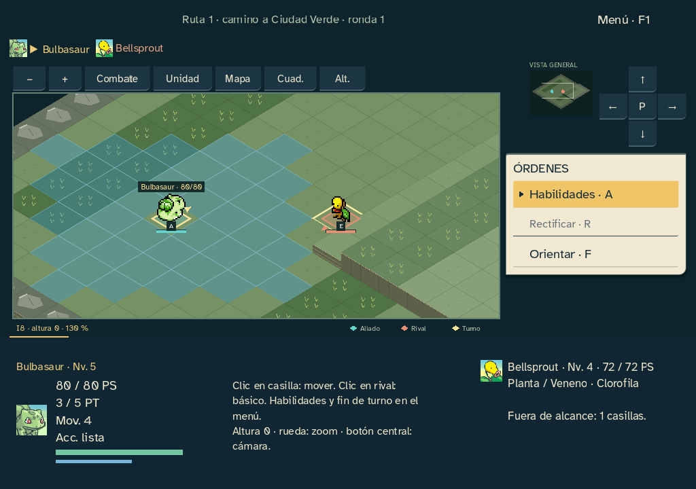
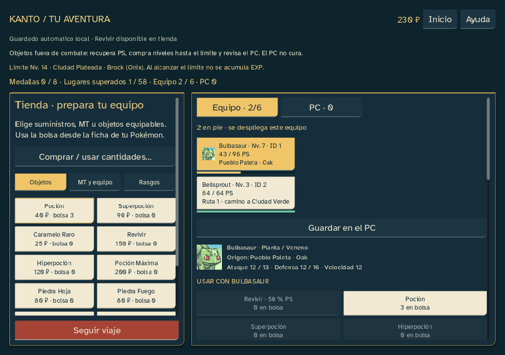

# Interfaz de juego · 0.22.13

Petición del 21 de octubre: integrar más la interfaz en el juego y sustituir los botones de aspecto genérico. Entrega nativa Windows; campaña 18 y combate 17 conservados, sin cambiar balance, semillas, objetos, IA ni guardados.

## Diseño aplicado

- Menú de órdenes sobre papel claro, filas alineadas y cursor triangular al seleccionar con teclado o ratón. Las habilidades mantienen selección y aceptación separadas; Rectificar conserva sus restricciones.
- Una franja inferior compartida reúne retrato PMD, nombre/nivel, PS, PT, movimiento/acción y previsión. Los PS y PT tienen medidores diferenciados. El tablero reserva su espacio: los paneles no son ventanas superpuestas a las casillas.
- Marcos de tinta, elecciones de color marfil, selección ámbar y acciones de avance en rojo. Herramientas de cámara, pestañas, fichas y acciones principales tienen jerarquías distintas, en lugar de compartir un único botón.
- Inicio con órdenes de menú y cursor; Oak con los tres retratos originales y acentos por inicial. Tienda y PC heredan la misma presentación. Los controles nuevos de Oak reciben también las preferencias tipográficas.
- Estados de foco, hover, pulsado y deshabilitado; alto contraste en las variantes nuevas. Controles nativos reales: se conservan nombres accesibles, remapeo, Escape, navegación y recuperación F12.

Los retratos, sprites, fuentes y sonidos existentes se reutilizan sin alterar los originales. No se añadieron dependencias, plugins ni recursos externos. Los marcos y el cursor se dibujan localmente; no tienen bucles propios de animación. Se conservan las cachés de terreno, minimapa, previsión y preferencias.

## Comprobación

Se amplió la matriz visual a 1024×720, 1280×900 y 1920×1080, con texto al 100, 125 y 150 %. Además de comprobar un tablero positivo, ahora se verifica que la ficha del actor no invada casillas, que sus recursos quepan y que cámara/órdenes permanezcan separadas. Se revisan capturas reales renderizadas por Godot.

Doce baterías completadas tanto en fuente como en EXE, sin fallos finales. Los informes deterministas coinciden; los tiempos de rendimiento varían por ejecución. Se compararon los estados y diarios completos de ambos finales, PC y laboratorio. Los finales conservan además exactamente los 8924/7396 comandos y estados de referencia 0.22.3.

| Batería | Fuente | EXE | Resultado |
|---|---:|---:|---|
|Inicio y ventanas|65|65|Sin fallos|
|Entrada y foco|63|63|Sin fallos|
|Preferencias y gestión|192|192|Sin fallos|
|Turno contextual|96|96|Sin fallos|
|Rendimiento|18|18|Sin fallos|
|PC|540|540|Sin fallos|
|Mapas y alturas|980|980|Sin fallos|
|Laboratorio|1041|1041|Sin fallos|
|Final de las aves (16×16)|901|901|Sin fallos|
|Final psíquico (24×24)|513|513|Sin fallos|
|Semántica nativa|8|8|Sin fallos|
|Semillas|920|920|Sin fallos|

Preferencias persistentes: 22; operaciones por cantidad: 44 comprobaciones adicionales. Lint sin incidencias; validación del motor: 0 errores y 65 advertencias preexistentes, ninguna nueva. Recursos y hashes verificados. Pruebas del EXE con una ruta de editor inexistente y perfiles aislados; no se usaron partidas reales.

La matriz incluye también listas de habilidades ampliadas y tamaño real de los glifos de la cámara después de redimensionar. La columna derecha usa contenedores; el minimapa y los escenarios clásicos respetan la reserva del HUD. Las habilidades aprovechan el alto disponible, manteniendo desplazamiento cuando el texto grande lo necesita. La tienda deja más espacio visible para las compras.

Evidencias: `docs/qa/sprint-22-updates-13/`.

La valoración de estilo del jugador y las pruebas humanas con lector de pantalla y otros equipos siguen pendientes. La automatización no las sustituye. Publicación pública aplazada.
