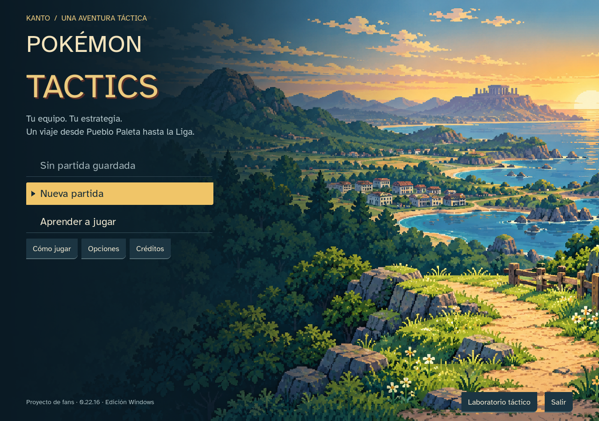
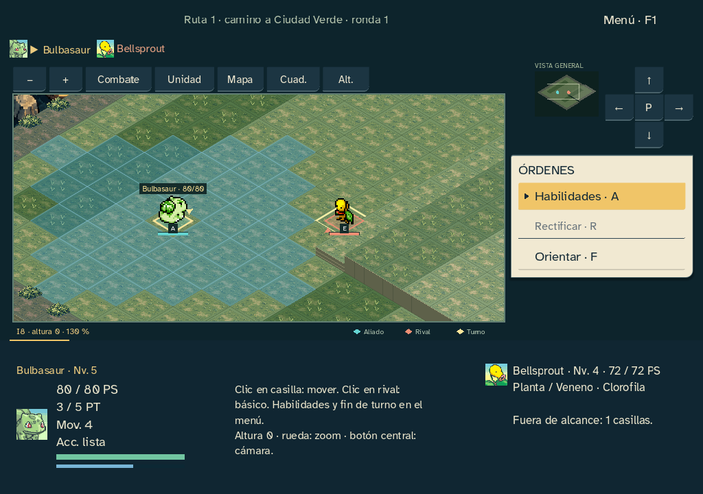
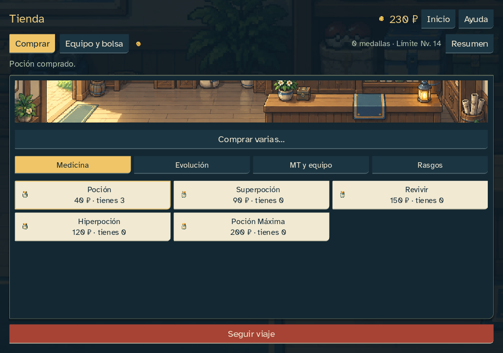

# Arte generado e integrado · 0.22.16

Encargo iniciado el 22 de octubre y cierre el 23: producir las imágenes preparadas en los prompts e insertarlas en el juego. Se han generado con OpenAI image_gen las 42 imágenes del juego: portada, emblema, ocho escenas, entorno del tablero, trece suelos, cuatro obstáculos, cinco efectos y nueve iconos. Las tres piezas promocionales opcionales siguen pendientes y no aparecen al jugar.

## Integración

- PNG locales en `godot/art/final/`, incluidos dentro del ejecutable. Sprites y retratos originales de Pokémon conservados.
- Fondos encuadrados a su proporción real, alfa generado conservado, obstáculos apoyados en su pivote y suelos ajustados a la máscara exacta 5:3. Preparación mediante Godot Image, sin red al jugar.
- Texturas de suelo mezcladas al 50 % con el color táctico existente para moderar la repetición y conservar la lectura de unidades, alturas y alcance. La geometría y las paredes siguen siendo nativas.
- Icono de aplicación sustituido por el emblema generado. Desaparecen las etiquetas de arte provisional en los espacios cubiertos.
- Registro en `godot/art/generated-provenance.json`: herramienta, prompts realmente enviados, identificadores de las imágenes originales, hashes y preparación aplicada. El generador no expone el identificador de modelo; no se atribuye uno inventado.
- Validación de los hashes de las imágenes finales y prueba nativa que exige cargar cada uno de los 42 PNG. Placeholders conservados como respaldo.

Misma campaña 18 y combate 17; reglas, datos, snapshots, progresión, guardados y recursos originales conservados. La publicación pública continúa aplazada.

## Comprobación

Doce baterías completadas en fuente y EXE: 5674 aserciones por versión, sin fallos. Informes deterministas idénticos y estados/diarios completos de ambos finales, PC y laboratorio iguales. Ambos finales conservan los 8924/7396 comandos y estados de referencia 0.22.3.

| Batería | Fuente | EXE | Resultado |
|---|---:|---:|---|
|Inicio y ventanas|399|399|Sin fallos|
|Entrada y foco|63|63|Sin fallos|
|Preferencias y gestión|192|192|Sin fallos|
|Turno contextual|96|96|Sin fallos|
|Rendimiento|18|18|Sin fallos|
|PC|543|543|Sin fallos|
|Mapas y alturas|980|980|Sin fallos|
|Laboratorio|1041|1041|Sin fallos|
|Final aves16|901|901|Sin fallos|
|Final psíquico24|513|513|Sin fallos|
|Semántica nativa|8|8|Sin fallos|
|Semillas|920|920|Sin fallos|

Siete pruebas del instalador de arte superadas; verificación estricta de 42 imágenes finales, dimensiones, alfa, máscara de suelo y hashes. Lint sin incidencias; validación del motor con 0 errores y 65 advertencias preexistentes, ninguna nueva. EXE comprobado sin editor, con perfiles aislados.

Matriz de combate: 1024×720, 1280×900 y 1920×1080, texto 100/125/150 %. Alto contraste, teclado, ratón y movimiento reducido comprobados. Capturas revisadas de inicio, combate, tienda y ficha ampliada. Evidencia en `docs/qa/sprint-22-updates-16/`.

Rendimiento de dibujo en el escenario sintético 24×24: mediana de 0,695 ms y P95 de 0,752 ms en fuente; el EXE registra 0,609 ms y 0,636 ms respectivamente. Intervalos de fotograma en reposo de 16,662 ms de mediana. Son mediciones locales, no una garantía de FPS para otros equipos.

## Revisión visual

La portada deja el menú sobre una zona oscura; tienda y viaje incorporan franjas de escena. Se conserva la interfaz nativa y la navegación con teclado y ratón. Los fondos no contienen botones, cifras ni textos que sustituyan a los controles reales.

La revisión automática y visual de esta entrega no sustituye las pruebas humanas de legibilidad, accesibilidad y gusto artístico. Esta serie es una primera producción coherente que puede afinarse con las pruebas del jugador.
