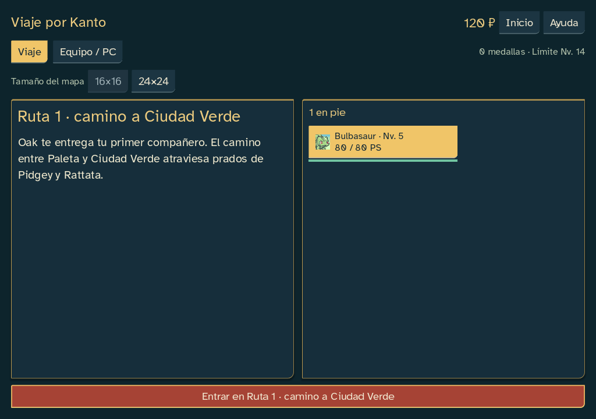
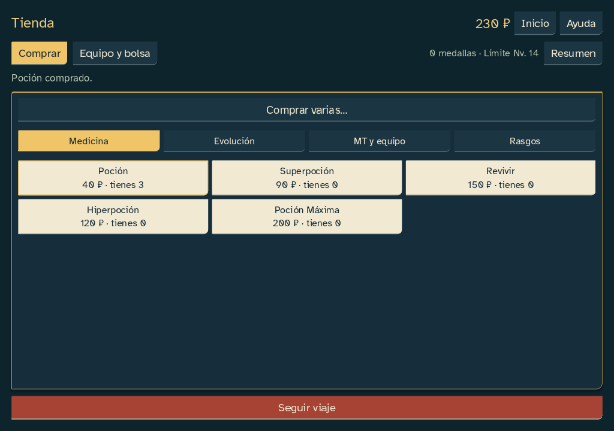
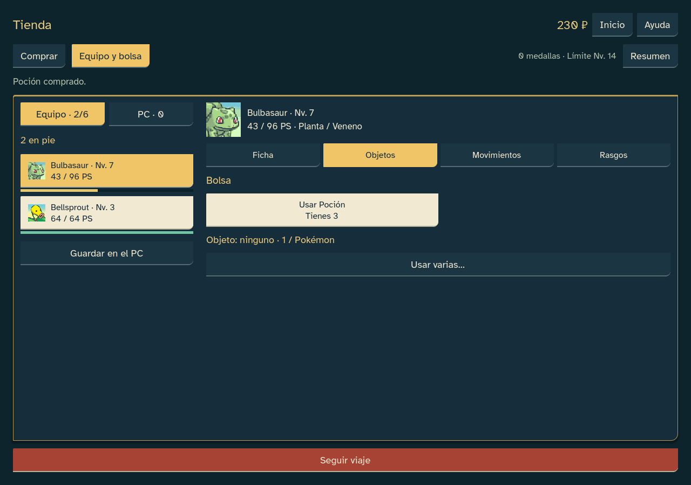

# Hub y tienda simplificados · 0.22.14

Petición del 22 de octubre: el hub explicaba demasiado y la tienda mezclaba demasiadas operaciones. Se reorganiza la interfaz nativa; campaña 18, combate 17 y reglas publicadas conservados.

## Cambios

- Dos vistas: Comprar y Equipo y bolsa en la tienda; Viaje y Equipo / PC durante el recorrido. Comprar ocupa su propio panel, sin mezclar curación ni cambios de equipo.
- Cuatro categorías: Medicina, Evolución, MT y equipo, Rasgos. Caramelos y piedras juntos; tres ofertas y renovación con su coste real. Cada compra indica precio y existencias.
- Elegir un Pokémon abre sus detalles: Ficha, Objetos, Movimientos o Rasgos. La bolsa muestra los curativos que posees y las acciones compatibles; las mentas propias se eligen junto al Pokémon al que se aplican.
- Comprar varias y Usar varias abren revisiones independientes con la operación ya elegida. Se conserva la validación, la cancelación y el guardado de cada orden; la presentación cotidiana omite IDs y explicaciones de implementación.
- Se retiran tutoriales repetidos de la vista normal. Nivel máximo y medallas ocupan una línea; las ganancias de EXP, niveles y evoluciones pasan a Resumen. Ayuda, información de compatibilidad y avisos de guardado siguen accesibles.
- Seguir viaje y las acciones de encuentro/captura quedan fuera del desplazamiento. Se conserva F6 para cambiar panel, foco por identidad, controles nativos, Escape, remapeo, texto ampliado y alto contraste.

Se reutilizan retratos PMD, sprites, fuente y sonidos locales sin modificarlos. No hay nuevos activos, plugins, servicios ni dependencias. La interfaz no consume azar ni modifica tablas, precios, balance, IA, edición de campaña o archivos antiguos. Las ediciones anteriores a 12 conservan su distribución de controles.

## Comprobación

Doce baterías completadas tanto en fuente como en EXE, sin fallos finales. Los informes deterministas coinciden; los tiempos de rendimiento varían por ejecución. Se compararon los estados y diarios completos de ambos finales, PC y laboratorio. Los finales conservan exactamente los 8924/7396 comandos y estados de referencia 0.22.3.

| Batería | Fuente | EXE | Resultado |
|---|---:|---:|---|
|Inicio y ventanas|189|189|Sin fallos|
|Entrada y foco|63|63|Sin fallos|
|Preferencias y gestión|112|112|Sin fallos|
|Turno contextual|96|96|Sin fallos|
|Rendimiento|18|18|Sin fallos|
|PC|543|543|Sin fallos|
|Mapas y alturas|980|980|Sin fallos|
|Laboratorio|1041|1041|Sin fallos|
|Final aves16|901|901|Sin fallos|
|Final psíquico24|513|513|Sin fallos|
|Semántica nativa|8|8|Sin fallos|
|Semillas|920|920|Sin fallos|

Preferencias persistentes: 22; operaciones por cantidad: 44 comprobaciones adicionales. Lint sin incidencias; validación del motor: 0 errores y 65 advertencias preexistentes, ninguna nueva. Recursos y hashes verificados. Pruebas del EXE con una ruta de editor inexistente y perfiles aislados; no se usaron partidas reales.

Se comprobaron compras separadas del uso, cuatro categorías, cancelación sin consumo, igualdad con las transacciones originales, navegación con teclado y ratón, tarjetas legibles y avance accesible. El hub se revisó a 1024×720 y 1280×900 con texto al 100/125/150 %.

Evidencias: `docs/qa/sprint-22-updates-14/`.

Las capturas y eventos automatizados comprueban distribución e interacción; la valoración del jugador, pruebas humanas con lector de pantalla y otros equipos siguen pendientes. Publicación pública aplazada.
