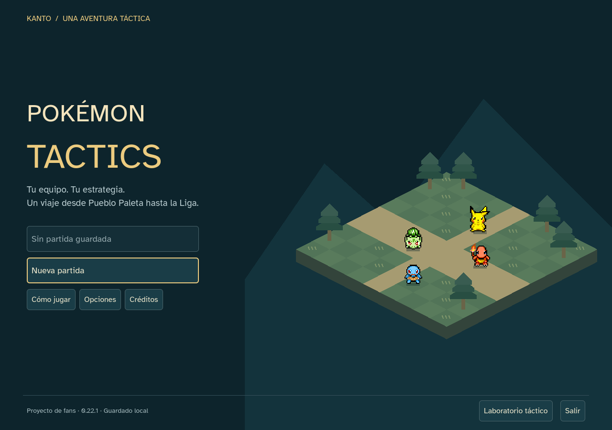
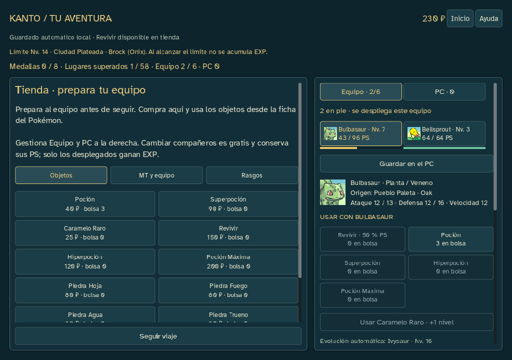
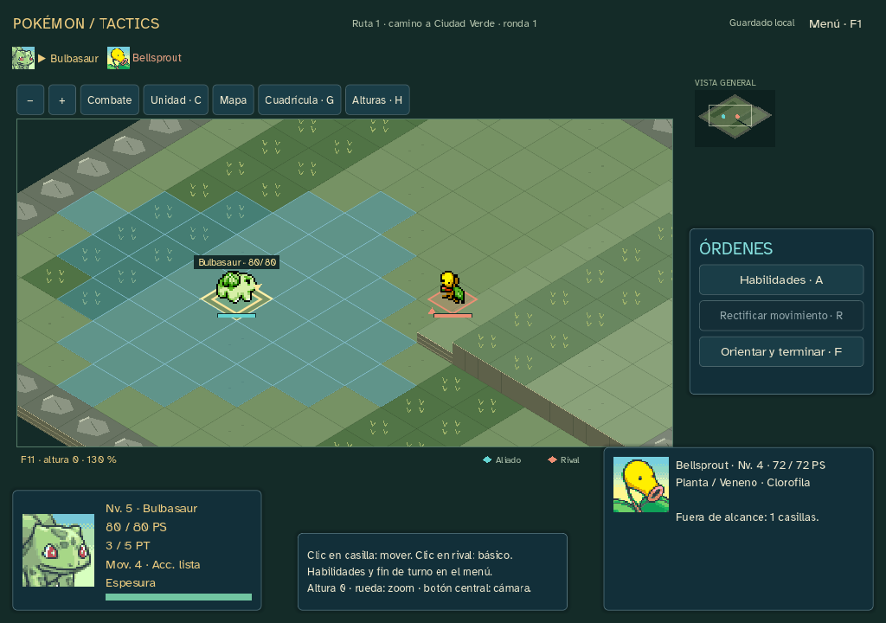

# Interfaz e inicio ·0.22.1

Petición del usuario: mejorar la interfaz y añadir una pantalla de inicio. Revisión visual y de navegación de la entrega 22, en codex/sprint-22-ui. Mantiene edición 18 de campaña, combate 17 y los guardados existentes. No modifica motores, datos, balance, economía, precisión o generación de encuentros. La web 0.12 sigue conservada.

## Cambios

- Pantalla de inicio con diorama isométrico decorativo, cuatro sprites originales locales y título. Continuar, Nueva partida, ayuda, opciones, créditos, laboratorio y salir. Continuar se desactiva sin guardado; al cargar muestra una espera y bloquea órdenes duplicadas.
- Volver a Inicio mantiene la aventura en memoria y pausa al rival. Continuar vuelve al mismo turno; no recarga para perder cambios en memoria. Empezar otra aventura pide confirmación; volver desde Oak restaura la anterior y no sobrescribe su archivo. Los guardados inválidos muestran el aviso en Inicio y se conservan.
- Contraste, bordes de selección/foco, tamaños y espaciado coherentes. Menú táctico derecho, cámara, movimiento directo, rectificación y orientación conservados. Fichas inferiores adaptadas al ancho; retrato y datos se muestran en una misma fila en la gestión del equipo.
- Equipo/PC con retratos y barras de PS, además de cifras y estado debilitado. Barra de PS del actor cambia de tono según su salud. Las cantidades siguen indicadas mediante texto.
- Tienda organizada en Objetos, MT y equipo, y Rasgos. Compras y uso de curativos en rejillas; precios y bolsa visibles. Usar objetos se coloca antes de controles avanzados. Seguir viaje queda fijo fuera del desplazamiento de ofertas.

La pantalla utiliza la escena de campaña como propietaria del estado; no añade autoloads, servicios ni una segunda copia del motor. El diorama es dibujo decorativo determinista, sin avance de iniciativa ni consumo de RNG. Se consulta el área transparente del primer frame para apoyar los sprites; las hojas originales no se modifican. Reutiliza los recursos y créditos existentes, sin descargas, plugins o dependencias nuevos. Sonido/animación se ajustan durante la sesión.

## Comprobaciones

58 comprobaciones de inicio, cancelación, continuación en caliente/en frío, pausa real del rival, opciones, compra, categorías, guardado inválido y composición a 1280×900/1024×720. La fuente y el ejecutable coinciden. Los botones principales se ejercitan con eventos de puntero en el viewport; los diálogos, que tienen su propia ventana, mediante sus botones/señales. No se afirma una prueba humana de todos los recorridos.

Regresión de PC 540 y escala 980 aserciones, sin fallos. Ambos finales vuelven a terminar: aves 16×16/898 aserciones y origen 24×24/510; los informes de fuente y ejecutable coinciden. Los estados finales completos son iguales a los de 0.22.0: misma revisión, equipo, dinero, RNG, medallas y resultado. Evidencia en [qa/sprint-22-ui](qa/sprint-22-ui).

Validación sin errores ni advertencias nuevas (65 preexistentes); lint limpio. Manifiestos y fuentes/sprites originales verificados. Ejecutable probado con ruta de editor inexistente. Guardados humanos sin tocar. El informe de balance 0.22 sigue siendo la referencia del mismo motor; no se repiten ni presentan como nuevas sus 29 simulaciones.

## Entrega

Windows 0.22.1 offline, con guía actualizada, créditos, licencias e informe de balance. Publicación pública aplazada. ZIP SHA256 `bd577bd7de14f3a25fc226a42eb5ae38e7ea45a994e7993571abf09fc1a8d740`; ejecutable SHA256 `5757c910d9483dd434fb19e3f33c511a8d3b4599bbc7474051c75e181dbf48d5`. La entrega anterior 0.22.0 queda conservada.

