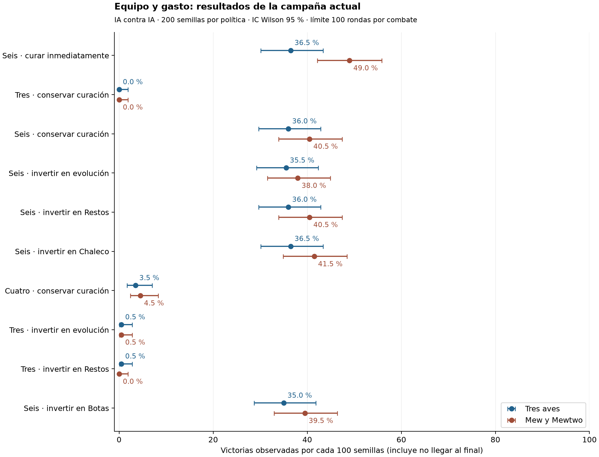
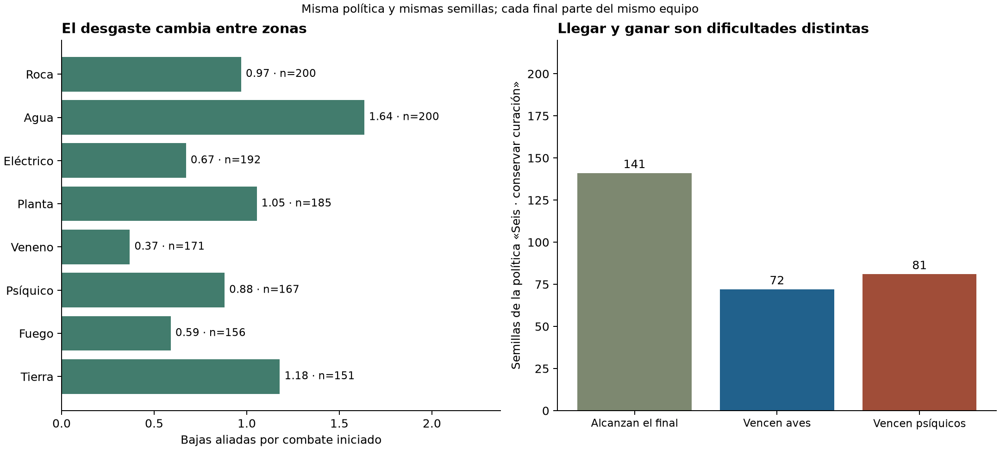

# Informe de balance — Pokémon Tactics 0.12.0

15 de octubre de 2026. Edición de reglas 14, variación de iniciativa ±5 %. Código analizado: `f602a986d2223143aaaa24f22beab5fc13cd9c42`.

La mayor presión está en reunir seis miembros pronto y reponer el desgaste. El primer reclutamiento permite formar siempre el mismo equipo completo; las alternativas con tres o cuatro miembros quedan muy por debajo en estas simulaciones. También hay diferencias importantes entre encuentros de una misma zona. Priorizaría la IA defensiva, el arranque de la campaña y la diversidad del reclutamiento antes de otro ajuste global de daño.

Los parámetros del juego permanecen intactos. Las recomendaciones de este documento son propuestas; los ensayos alternativos se ejecutan en estados de simulación separados.

## Muestra y método

- **2.000 recorridos de campaña:** 200 semillas, `balance-v012-0` a `balance-v012-199`, con diez políticas de gestión. Se permite reponer bajas hasta el límite de cada política.
- **10.597 combates de zona** y **1.790 finales**: al llegar a la bifurcación se prueba cada destino desde una copia del mismo equipo, PS, niveles y objetos. Las dos ramas no se cuentan como campañas independientes.
- **1.600 combates controlados de objetos:** dos equipos, dos finales, cuatro condiciones de equipo y 100 semillas por condición.
- **600 combates de apertura:** los tres iniciales frente al encuentro actual y dos variantes experimentales, con las mismas 200 semillas.
- Total: **14.587 combates medidos**, más tres diagnósticos breves para reproducir bloqueos de decisión. El piloto de desarrollo no entra en las tablas.

Se utiliza el motor real y `chooseTacticalCommand` para ambos bandos. Las compras, bajas, EXP y evoluciones pasan por las operaciones reales y la validación del guardado. La ruta usa un generador separado del RNG del combate; la misma semilla toma las mismas bifurcaciones en todas las políticas. Se corrige así el sesgo del simulador anterior, que dependía de la longitud del texto de semilla.

Cada combate se observa hasta 100 rondas completas o 3.000 órdenes. Hubo **7 recorridos detenidos por este límite**, registrados aparte, y ningún final sin resolver. El ensayo alternativo de apertura añade otros dos combates detenidos al sustituir Graveler por Geodude. Los siete de campaña y los dos experimentales no se contabilizan como derrotas normales. Las tasas son victorias observadas dentro de este presupuesto, incluyendo las partidas que no alcanzan el final.

La incertidumbre se calcula con Wilson al 95 % para cada destino y bootstrap emparejado por semilla para diferencias entre políticas. Los dos finales permanecen juntos al remuestrear. Estos intervalos describen variación entre semillas con este bot; **no estiman la tasa de victoria de jugadores humanos**. No se han probado aquí ±10 %, búsqueda táctica avanzada ni estrategias humanas de espera o explotación de recursos.

## Resultados por estrategia

Cada fila representa 200 semillas. «Llegan» significa superar las ocho zonas. Las columnas de victoria usan las 200 semillas completas, no solo quienes llegan al jefe.

| Política de gestión | Llegan al final | Vencen aves | Vencen Mew/Mewtwo |
| --- | ---: | ---: | ---: |
| Tres, curación conservadora | 1/200 · 0,5 % | 0 % | 0 % |
| Tres, invertir también en evolución | 5/200 · 2,5 % | 0,5 % | 0,5 % |
| Tres, invertir también en Restos | 5/200 · 2,5 % | 0,5 % | 0 % |
| Cuatro, curación conservadora | 29/200 · 14,5 % | 3,5 % | 4,5 % |
| **Seis, curación conservadora — referencia del análisis** | **141/200 · 70,5 %** | **36,0 %** | **40,5 %** |
| Seis, curar inmediatamente | 159/200 · 79,5 % | 36,5 % | 49,0 % |
| Seis, invertir en evolución | 131/200 · 65,5 % | 35,5 % | 38,0 % |
| Seis, invertir en Restos | 141/200 · 70,5 % | 36,0 % | 40,5 % |
| Seis, invertir en Chaleco Asalto | 142/200 · 71,0 % | 36,5 % | 41,5 % |
| Seis, invertir en Botas Gruesas | 141/200 · 70,5 % | 35,0 % | 39,5 % |



La política conservadora utiliza dosis según daño pendiente y coste por PS, evita curaciones pequeñas salvo urgencia y puede priorizar tienda sobre reposición. La inmediata cura cualquier daño, usa primero Superpoción y prioriza completar el equipo. Todas utilizan los objetos evolutivos gratuitos; la política de inversión compra más y reparte las primeras etapas antes de completar una línea. Las de equipables compran cuando queda una reserva de 90 monedas y reutilizan los objetos recuperados de bajas.

Son estrategias completas: sus diferencias incluyen selección de servicios, gasto y composición posterior. «Conservadora» reduce desperdicio de curación; no implica que sea óptima para ganar. La inmediata desperdicia el **21,7 %** de la capacidad nominal frente al **3,1 %** de la conservadora, pero obtiene más éxitos observados. La diferencia media entre destinos es +4,5 puntos porcentuales, con intervalo emparejado **−2,4 a +12,0**: la muestra no confirma una superioridad estable.

## Equipo y primera visita: el desequilibrio principal

Con seis vivos hay hasta seis activaciones por ronda frente a tres enemigos normales. El coste de completar el equipo es exactamente el saldo inicial: **240 monedas = tres reclutas de 80**. Además, la sala inicial ofrece las tres especies que faltan de la misma pool de seis. Comprar las tres hace que todas las semillas empiecen el combate con las mismas seis especies; varían orden, colocación y tiradas.

Esto debilita dos elecciones: empezar en tienda y conservar un equipo pequeño, y construir una composición distinta entre partidas. Incluso invertir en evolución o Restos deja a los tríos cerca del 0 % de victoria final con este controlador. Los resultados de cuatro miembros también siguen muy lejos de los de seis. Un jugador humano puede superar al bot; estas cifras no prueban imposibilidad matemática con un trío.

La apertura aislada ayuda a localizar el problema:

| Primer encuentro, tres iniciales y sin compras | Victorias | Bajas observadas medias | Rondas medias resueltas | Sin resolver |
| --- | ---: | ---: | ---: | ---: |
| Actual: tres enemigos, incluido Graveler | 118/200 · **59,0 %** | 1,72 | 3,98 | 0 |
| Variante: dos enemigos, retirando Graveler | 194/200 · **97,0 %** | 0,70 | 4,21 | 0 |
| Variante: tres enemigos, Graveler sustituido por Geodude | 131/200 · **65,5 %** | 1,53 | 5,11 | 2 |

Retirar una unidad mejora la victoria de apertura en **38 puntos** —intervalo emparejado +31,5 a +44,5—. Sustituir solo la evolución mejora 6,5 puntos, alarga los combates resueltos y añade dos casos detenidos. La primera variante es una candidata para un encuentro introductorio; **no se ha simulado una campaña completa con ese cambio**, ni se ha definido una dificultad humana objetivo.

Propuesta: probar primero una apertura de dos enemigos, manteniendo el daño y la tabla de tipos. Después, revisar el primer reclutamiento para evitar completar automáticamente el mismo sexteto: la pool disponible ya contiene otras especies básicas de Kanto. Limitar reclutas sin suavizar antes el arranque podría aumentar la dificultad.

## Desgaste por zona y diferencias entre variantes

Se utiliza solo la política de seis con curación conservadora para evitar mezclar políticas. Cada denominador cuenta las partidas que alcanzan esa zona; las más avanzadas ya están seleccionadas por supervivencia.

| Zona | Entran | Victorias del encuentro | Bajas por combate | Rondas medias |
| --- | ---: | ---: | ---: | ---: |
| Roca | 200 | 100,0 % | 0,97 | 2,95 |
| **Agua** | 200 | 96,0 % | **1,64** | 4,46 |
| Eléctrico | 192 | 96,4 % | 0,67 | 3,87 |
| Planta | 185 | 92,4 % | 1,05 | 5,71 |
| Veneno | 171 | 97,7 % | 0,37 | 4,04 |
| Psíquico | 167 | 93,4 % | 0,88 | 3,96 |
| Fuego | 156 | 96,8 % | 0,59 | 3,56 |
| Tierra | 151 | 93,4 % | 1,18 | 3,77 |



Agua destruye más miembros aunque casi siempre se gane la pelea; medir solo derrotas ocultaría su impacto en las salas siguientes. El equipo medio baja de seis al inicio a **4,55 miembros y nivel medio 3,56** al llegar al final. Las reposiciones vuelven a nivel uno.

Dos diferencias a revisar:

- **Cantera inundada:** 87/94 victorias y 2,02 bajas por encuentro. **Canales de Celeste:** 105/106 y 1,29 bajas.
- **Jardín de Azulona:** 74/85 victorias y 1,40 bajas. **Arboleda interior:** 97/100 y 0,76 bajas.

Cada variante cambia tanto tablero como enemigos; estos datos no atribuyen la diferencia únicamente al terreno. El siguiente ensayo debería cruzar ambas composiciones con ambos mapas antes de ajustar casillas, alcance o estadísticas. También conviene probar reposiciones de nivel algo más próximo al progreso de la ruta, conservando la baja definitiva y la pérdida del Pokémon anterior.

## Daño, estados y calidad de la IA

En la política de referencia hubo **312 KOs desde PS completos entre 9.490 impactos con daño recibidos por aliados: 3,3 %**. Roca y agua concentran 171 de esos KOs, el **54,8 %**. No se trata de un promedio uniforme a lo largo de la partida.

Ejemplos exactos con nivel uno, edición 14 y sin objeto:

- Lanzarrocas de Geodude o Graveler elimina los **110/110 PS de Butterfree**. La debilidad doble da ×4 y se añade afinidad de tipo.
- Pistola Agua de Squirtle elimina los **96/96 PS de Geodude**; contra Graveler hace **99/106 PS**.

Son coherentes con las reglas actuales. Para conservar la identidad Pokémon, probaría primero composición, colocación y repertorio de los primeros enemigos antes de modificar todos los multiplicadores.

La IA introduce sesgos importantes:

1. **Calcula el peligro principalmente con el ataque básico enemigo.** Así puede infravalorar un Lanzarrocas contra Butterfree o una cobertura más peligrosa que el básico. Las previsiones de las acciones sí contienen el daño correcto; el problema está en cómo el bot valora dónde colocarse.
2. **Valora los estados con un beneficio inmediato pequeño y fijo.** En el bando aliado no utilizó Fuego Fatuo ni Onda Trueno y solo utilizó Polvo Veneno una vez; el enemigo utilizó Fuego Fatuo dos veces. Esto no demuestra que sean débiles para un humano. Debería valorar daño de varios turnos, reducción de ataque, iniciativa y coste en PT.
3. **Puede repetir protección sin avanzar.** Hubo siete casos a 100 rondas, principalmente parejas de unidades que usaban Reflejo/Rizo Defensa tras obstáculos. Mover legalmente a un aliado resolvió los tres ejemplos diagnosticados en 4–12 órdenes, con victoria o derrota. El motor puede continuar; el bloqueo está en la política.

Antes de alterar el precio en PT de estados o protección, revisaría la evaluación de amenazas y la prioridad de protegerse frente a acercarse. La curación pasiva y la espera estratégica merecen una prueba humana de explotación; ese comportamiento no está optimizado por este bot.

Los estados causaron 2.659 PS de daño a aliados en la política de referencia; los sectores, 908; las ascuas, 248, frente a 384.563 PS por impactos. El bot evita peligros y tiene voladores/inmunidades: **esto no mide el valor de bloquear un camino, forzar un rodeo o modificar líneas de tiro**. Tampoco justifica por sí solo aumentar el daño de terreno.

## Objetos y evoluciones

La economía deja poco uso discrecional en estas políticas de seis: solo **30/200** recorridos equiparon Restos, **37/200** Chaleco y **46/200** Botas. La comparación de campañas mezcla el coste de comprarlos con su efecto; por eso se hizo otro ensayo sin coste de adquisición.

En las pruebas controladas todos empiezan al nivel tres y al 80 % de PS. Se equipa únicamente al tercer miembro: Golem en el trío o Blastoise en el equipo de cuatro. Se mantienen semilla, composición y tablero dentro de cada comparación.

| Equipo y final, 100 semillas | Sin objeto | Restos | Chaleco | Botas |
| --- | ---: | ---: | ---: | ---: |
| Venusaur, Blastoise, Golem · aves | 60 % | 61 % | 62 % | 58 % |
| Mismo trío · Mew/Mewtwo | 11 % | 9 % | 10 % | 11 % |
| Venusaur, Charizard, Blastoise, Raichu · aves | 22 % | 24 % | 28 % | 23 % |
| Mismo cuarteto · Mew/Mewtwo | 74 % | 79 % | 78 % | 74 % |

Hay beneficios localizados: Chaleco aumenta seis puntos al cuarteto frente a las aves, intervalo emparejado +1 a +12; Restos aumenta cinco frente a los psíquicos, +1 a +10. La mayoría de diferencias son pequeñas o incluyen cero. No aparece una prueba para debilitarlos globalmente.

**Botas Gruesas necesita una revisión de propósito/precio.** Bloquea ascuas, no los sectores del mapa. Solo evitó 108 PS en los combates registrados de su política de campaña; en las pruebas psíquicas el efecto fue prácticamente nulo. Probaría primero precio **80 → 40** o disponibilidad centrada en encuentros con ascuas. Otra posibilidad es ampliar la protección a sectores, pero sería un cambio de reglas distinto que debe ensayarse por separado. Ninguna de estas propuestas está aplicada.

**La inversión extra en evolución no muestra una mejora estable:** media entre finales 36,75 % frente a 38,25 % sin compras extra; diferencia −1,5 puntos, intervalo −6,9 a +4,3. Las etapas realizadas apenas pasan de 3,69 a 3,82 por recorrido.

Además, evolucionar cambia el rol: Ivysaur/Venusaur reemplazan Megaagotar por Hoja Afilada, perdiendo el drenaje; Wartortle/Blastoise pierden Cobertura por Surf. Es una observación del catálogo, no una explicación causal demostrada de esa diferencia. Revisaría la conservación de identidad y la comunicación del repertorio; por ejemplo, ensayar Megaagotar en la línea de Bulbasaur antes de aumentar sus estadísticas.

## Los finales sí requieren composiciones diferentes

De las 141 semillas que llegan al final con la política de referencia, las aves caen en **72/141: 51,1 %**, y los psíquicos en **81/141: 57,4 %**. Desde nueva partida equivale al 36,0 % —IC 29,7–42,9— y 40,5 % —IC 33,9–47,4— respectivamente.

Con el mismo checkpoint, 20 semillas vencen solo a las aves y 29 solo a los psíquicos. La diferencia global aves menos psíquicos es −4,5 puntos, intervalo −11,5 a +2,5. No hay base para declarar un jefe universalmente más difícil.

El ensayo de composiciones es más revelador: el trío con Golem obtiene 60 % frente a aves y 11 % frente a psíquicos; el cuarteto sin Golem obtiene 22 % y 74 %. Son equipos distintos, no una prueba aislada de Golem, pero muestran que el destino y la composición importan. Mantendría esa diferenciación.

## Orden de los próximos ajustes

| Prioridad | Propuesta | Comprobación antes de conservarla |
| --- | --- | --- |
| 1 | Resolver ciclos de protección y valorar amenazas con el repertorio asequible completo | Reproducir los siete casos; cero ciclos defensivos sin progreso; repetir semillas emparejadas |
| 2 | Ensayar apertura de dos enemigos y revisar después el reclutamiento inicial | Comparar rutas completas de tres/cuatro/seis, bajas tempranas y variedad de equipos; no asumir que 97 % en una pelea es un objetivo de campaña |
| 3 | Igualar mejor las variantes de agua/planta | Cruzar composición y tablero antes de atribuir el problema a una casilla |
| 4 | Revisar Botas y el acceso a compras opcionales | Un cambio de precio o efecto por ensayo, midiendo adquisición y utilidad efectiva |
| 5 | Conservar roles al evolucionar y probar reposiciones menos atrasadas | Comparar kits con mismo equipo/semilla; medir supervivencia, curación y valor de la progresión |
| 6 | Recoger pruebas humanas con ambos finales | Comprensión, decisiones, bajas percibidas como evitables, duración y ganas de repetir |

Las rondas observadas no se convierten a minutos de juego humano. Para juzgar diversión, ritmo y dificultad deseada hacen falta sesiones manuales. Las pruebas presentes sirven para localizar presión, dominancias y fallos de decisión concretos.

## Datos y reproducción

- [Resumen completo y metodología](summary.json), [2.000 recorridos en CSV](campaigns.csv) y archivos `*.json.gz` con telemetría por política.
- [Ensayo de apertura](opening-probe.json), [siete casos sin resolución](unresolved.json), tres checkpoints `unresolved-save-*.json` y [diagnóstico de intervención legal](guard-lock-diagnostics.json).
- Código en [tools/balance](../../../tools/balance), separado de las reglas del juego. Cada archivo de `src` y el catálogo tienen hash registrado; el análisis verifica que siguen coincidiendo.

Desde la raíz del repositorio, Node 24:

```sh
npm run simulate:balance
npm run simulate:balance:opening
node --experimental-strip-types tools/balance/diagnose_locks.ts
npm run verify:balance
npm test
```

`BALANCE_SEEDS` y `BALANCE_MICRO_SEEDS` cambian tamaños; `BALANCE_OUT` cambia la carpeta. El informe corresponde a 200/100. Las figuras se generan con `tools/balance/plot_report.py` y las dependencias independientes de `requirements-report.txt`; no se añaden bibliotecas al juego. Se reutilizaron los primeros siete lotes ya completados al añadir las tres políticas adicionales, comprobando fuente, semillas y una repetición exacta por política. Una ejecución nueva genera todos los lotes desde cero.

Verificado: **96 pruebas** —93 del proyecto y tres del análisis—, tipos del proyecto y del simulador, integridad de agregados, conservación de PS y checkpoints de finales. No se ha repetido la prueba de navegador ni el build: no hay cambios en `src`, catálogo, recursos o parámetros de la versión jugable.
